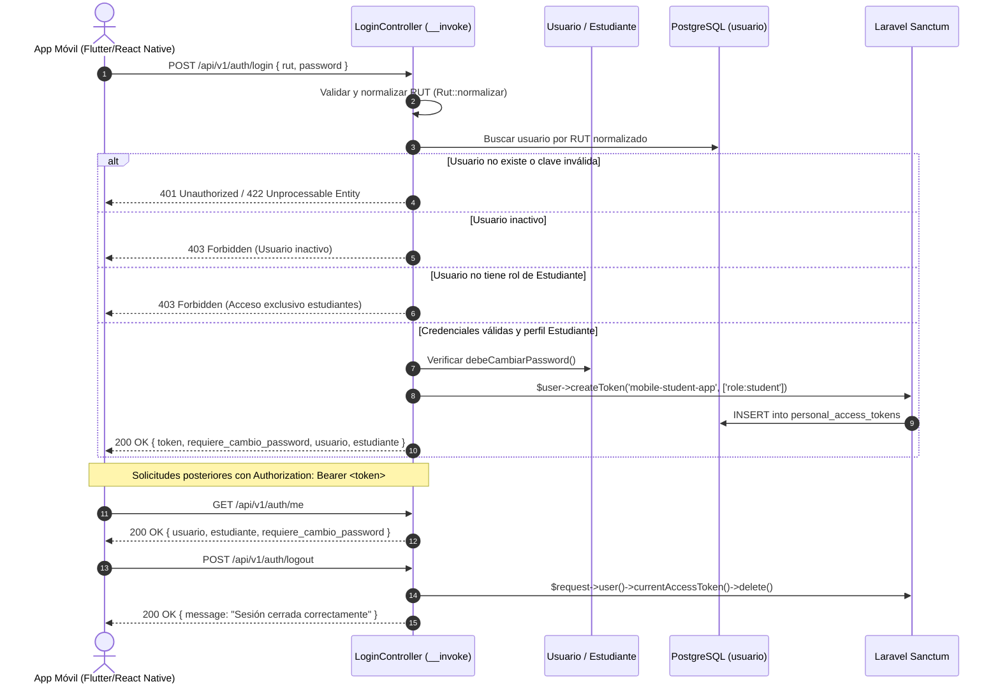

# Plan de Implementación: APP-01 · Autenticación y Emisión de Token Móvil mediante RUT y Contraseña

**Tarjeta Trello:** [APP-01 · [5 pts] Autenticación y Emisión de Token Móvil mediante RUT y Contraseña](https://trello.com/c/aUg9Grm7/139-app-01-5-pts-autenticaci%C3%B3n-y-emisi%C3%B3n-de-token-m%C3%B3vil-mediante-rut-y-contrase%C3%B1a)  
**Estimación:** 5 puntos Fibonacci  
**Directorio de trabajo:** `app/Api/V1`  
**Rama Git:** `app-movil`  

---

## 1. Descripción del Objetivo

Implementar un flujo de autenticación stateless y desacoplado para la aplicación móvil de estudiantes de UTAMED. A diferencia del portal web monolítico (basado en cookies de sesión, Fortify y CSRF), la aplicación móvil requiere:
1. Autenticación estricta y exclusiva por **RUT** (normalizado) y **contraseña** (sin aceptar ni solicitar correo electrónico institucional).
2. Emisión de tokens **Bearer stateless** persistidos de forma segura.
3. Control estricto de autorización: rechazo con **403 Forbidden** a usuarios sin rol/perfil de estudiante (e.g. administradores o docentes que intenten entrar por la app).
4. Detección y notificación en el payload si la contraseña se encuentra vencida (`debeCambiarPassword()`).
5. Revocación determinista del token Bearer al cerrar sesión (`POST /api/v1/auth/logout`).
6. Consulta de identidad del estudiante autenticado (`GET /api/v1/auth/me`).

---

## 2. Evaluación Técnica: ¿Por qué Laravel Sanctum es la Mejor Opción?

> [!IMPORTANT]
> **Conclusión del análisis**: Laravel Sanctum es la solución óptima y recomendada para la autenticación móvil en UTAMED.

### Comparativa de Alternativas

| Criterio | Laravel Sanctum (Recomendado) | Laravel Passport | JWT Autónomo (sin DB) | Sesiones Web / Cookies |
| :--- | :--- | :--- | :--- | :--- |
| **Naturaleza en Móvil** | **Stateless**: Cabecera `Authorization: Bearer <token>` estándar. | **Stateless**: Cabecera `Authorization: Bearer <token>`. | **Stateless**: Cabecera `Authorization: Bearer <token>`. | **Stateful**: Cookies, CSRF, afinidad de sesión. Inadecuado para clientes móviles nativos. |
| **Revocación en Logout (DoD)** | **Inmediata y Determinista**: Elimina el registro del token en la base de datos (`currentAccessToken()->delete()`). | **Determinista**: Revocación de token en base de datos. | **Compleja**: Requiere mantener una lista negra (blacklist) en Redis o cache distribuido. | N/A |
| **Complejidad y Mantenimiento** | **Mínima**: Utiliza hashes SHA-256 en DB; cero configuración de claves criptográficas. Cumple estrictamente YAGNI / Ponytail. | **Muy alta**: Servidor OAuth2 completo, claves RSA pública/privada, clientes OAuth y múltiples grants innecesarios. | **Media**: Manejo de firma de tokens, rotación de claves secretas y refresh tokens. | N/A |
| **Integración con Laravel 12** | **Nativa**: Comando oficial `install:api` integra Sanctum ^4.0 por defecto. | Soportado pero sobredimensionado para una app primer partido (first-party). | Paquetes de terceros desactualizados o con acoplamiento externo. | Nativa en Fortify pero incompatible con mobile stateless. |
| **Compatibilidad con `Usuario::id_usuario`** | **100% Compatible**: Sanctum utiliza `$this->getKey()`, resolviendo automáticamente la clave primaria numérica `id_usuario`. | Requiere configuración en los modelos de cliente y usuario. | Manual en los claims del token. | Compatible. |

---

## 3. Decisiones Arquitectónicas y Patrones de Diseño

1. **Directorio Raíz del Módulo API (`app/Api/V1`)**:
   Toda la lógica de la API V1 se encapsulará en `app/Api/V1`:
   - `app/Api/V1/Controllers/Auth/`: Controladores de acción única.
   - `app/Api/V1/Requests/Auth/`: Validaciones de entrada (`FormRequest`).
   - `app/Api/V1/Resources/Auth/`: Serialización JSON tipada (`JsonResource`).
   - `app/Api/V1/Middleware/`: Filtros de autorización API (`IsStudentApi`).

2. **Single-Action Controllers (Invocables)**:
   Siguiendo la regla de arquitectura `.agents/rules/single-action-controllers.md`:
   - Cada acción tendrá su propia clase con método `__invoke`:
     - `LoginController`: Procesa credenciales y genera token Bearer.
     - `LogoutController`: Revoca el token actual.
     - `MeController`: Retorna la identidad del estudiante.
   - Queda prohibido el uso de métodos tipo recurso (`index`, `store`, etc.) en la API.

3. **Scoping y Guardarraíles de Estudiante**:
   - Para emitir el token en el login, se verifica que `$user->esta_activo === true`, que posea el rol `Estudiante` (`$user->hasRole('Estudiante')`) y que exista su registro asociado en `usuario.estudiante`.
   - Si las credenciales son válidas pero el usuario no es estudiante, responde **403 Forbidden** con el mensaje explicativo correspondiente, impidiendo la emisión de tokens a roles ajenos.

4. **Validación y Normalización de RUT**:
   - `LoginRequest` valida formato mediante `Rut::esValido($value)`.
   - La búsqueda en la base de datos se realiza con normalización canónica contra el RUT del usuario para evitar inconsistencias con puntos, guiones o la letra K.

---

## 4. Diagrama de Flujo de Autenticación



---

## 5. Cambios Propuestos

### Componente 1: Dependencias y Base de Datos

#### [MODIFY] `composer.json`
- Incorporar `laravel/sanctum`: `^4.0`.

#### [NEW] `database/migrations/21_create_personal_access_tokens_table.php`
- Crear la tabla `personal_access_tokens` siguiendo el esquema estándar de Sanctum, configurada para coexistir con el search path `usuario` de PostgreSQL.

```php
return new class extends Migration {
    public function up(): void
    {
        Schema::create('personal_access_tokens', function (Blueprint $table) {
            $table->id();
            $table->morphs('tokenable');
            $table->string('name');
            $table->string('token', 64)->unique();
            $table->text('abilities')->nullable();
            $table->timestamp('last_used_at')->nullable();
            $table->timestamp('expires_at')->nullable();
            $table->timestamps();
        });
    }

    public function down(): void
    {
        Schema::dropIfExists('personal_access_tokens');
    }
};
```

---

### Componente 2: Modelo `Usuario`

#### [MODIFY] `app/Models/Usuario/Usuario.php`
- Importar y utilizar el trait `Laravel\Sanctum\HasApiTokens`.

```php
use Laravel\Sanctum\HasApiTokens;

class Usuario extends BaseUsuario implements Authenticatable, AuthorizableContract, CanResetPasswordContract
{
    use AuthenticatableTrait, HasFactory, HasApiTokens;
    // ...
}
```

---

### Componente 3: Configuración de Rutas y Middleware en `bootstrap/app.php`

#### [MODIFY] `bootstrap/app.php`
- Registrar el archivo de rutas `routes/api.php` en `withRouting`.
- Registrar el alias de middleware `'is_student_api' => \App\Api\V1\Middleware\IsStudentApi::class`.

#### [NEW] `routes/api.php`
- Definir las rutas V1 con nomenclatura limpia apuntando a controladores invocables:

```php
<?php

use App\Api\V1\Controllers\Auth\LoginController;
use App\Api\V1\Controllers\Auth\LogoutController;
use App\Api\V1\Controllers\Auth\MeController;
use Illuminate\Support\Facades\Route;

Route::prefix('v1')->group(function () {
    Route::prefix('auth')->group(function () {
        Route::post('login', LoginController::class)->name('api.v1.auth.login');

        Route::middleware(['auth:sanctum', 'is_student_api'])->group(function () {
            Route::post('logout', LogoutController::class)->name('api.v1.auth.logout');
            Route::get('me', MeController::class)->name('api.v1.auth.me');
        });
    });
});
```

---

### Componente 4: Controladores, Requests, Resources y Middleware en `app/Api/V1`

#### [NEW] `app/Api/V1/Requests/Auth/LoginRequest.php`
- Valida la presencia de `rut` y `password`.
- Normaliza el RUT y valida sintaxis con `Rut::esValido`.
- Desecha deliberadamente cualquier campo `email`.

#### [NEW] `app/Api/V1/Resources/Auth/StudentAuthResource.php`
- Serializa la respuesta del estudiante autenticado:
  - `token` y `token_type` ('Bearer').
  - `requiere_cambio_password` (booleano de `debeCambiarPassword()`).
  - `motivo_cambio_password` (string de `motivoCambioPasswordObligatorio()`).
  - `usuario`: ID, RUT formateado, nombre completo y correo institucional.
  - `estudiante`: ID, carrera, año de ingreso.

#### [NEW] `app/Api/V1/Middleware/IsStudentApi.php`
- Middleware stateless que valida que el usuario autenticado vía Sanctum sea activo, tenga el rol `Estudiante` y posea perfil en `usuario.estudiante`. En caso contrario, retorna `403 Forbidden` en JSON.

#### [NEW] `app/Api/V1/Controllers/Auth/LoginController.php`
- Single-Action Controller (`__invoke`).
- Autentica con RUT y contraseña vía hash Eloquent.
- Valida guardarraíles (activo y rol estudiante).
- Emite token Sanctum y retorna `StudentAuthResource`.

#### [NEW] `app/Api/V1/Controllers/Auth/LogoutController.php`
- Single-Action Controller (`__invoke`).
- Elimina el token de acceso actual (`$request->user()->currentAccessToken()->delete()`).
- Retorna respuesta JSON `200 OK` con confirmación.

#### [NEW] `app/Api/V1/Controllers/Auth/MeController.php`
- Single-Action Controller (`__invoke`).
- Retorna los datos del estudiante autenticado y el estado de vigencia de su clave.

---

### Componente 5: Pruebas Automatizadas

#### [NEW] `tests/Feature/Api/V1/Auth/StudentAuthApiTest.php`
- Cobertura integral de los Criterios de Aceptación (DoD):
  1. Login exitoso con RUT en diferentes formatos (`21.149.756-4`, `21149756-4`, `211497564`) y contraseña válida retorna token Bearer y flag `requiere_cambio_password`.
  2. Login deniega con `401 Unauthorized` o `422` ante credenciales inválidas.
  3. Login deniega con `403 Forbidden` si el usuario es Docente o Administrador y no posee rol ni perfil de estudiante.
  4. Login deniega con `403 Forbidden` si el usuario está inactivo (`esta_activo = false`).
  5. Flag `requiere_cambio_password` es `true` cuando la contraseña tiene más de 6 meses de antigüedad o es primer ingreso.
  6. `GET /api/v1/auth/me` con token Bearer válido responde con la información del estudiante.
  7. `POST /api/v1/auth/logout` revoca el token Bearer y peticiones posteriores con ese token son denegadas con `401 Unauthorized`.

---

## 6. Plan de Verificación

### Pruebas Automatizadas
```bash
# Ejecución de la suite de pruebas de autenticación móvil
DB_PORT=15432 php artisan test tests/Feature/Api/V1/Auth/StudentAuthApiTest.php
```

### Verificación Manual / Endpoints
1. Probar `POST /api/v1/auth/login` con cURL enviando RUT y contraseña de un estudiante de prueba (`21149756-4`).
2. Comprobar que la respuesta contiene el token Bearer y `requiere_cambio_password`.
3. Ejecutar `GET /api/v1/auth/me` con la cabecera `Authorization: Bearer <token>`.
4. Ejecutar `POST /api/v1/auth/logout` con la misma cabecera.
5. Reintentar `GET /api/v1/auth/me` con el token revocado y confirmar respuesta `401 Unauthorized`.
6. Intentar login con un usuario que solo posea rol docente y verificar respuesta `403 Forbidden`.
