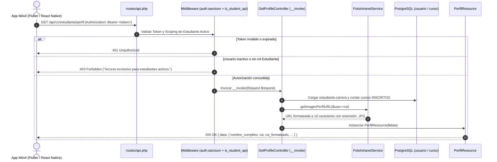

# Plan de Implementación: APP-02 · Consulta de Perfil Institucional y Fotografía Oficial (Solo Lectura)

**Tarjeta Trello:** [APP-02 · [2 pts] Consulta de Perfil Institucional y Fotografía Oficial (Solo Lectura)](https://trello.com/c/RGo6JuEL/140-app-02-2-pts-consulta-de-perfil-institucional-y-fotograf%C3%ADa-oficial-solo-lectura)  
**Estimación:** 2 puntos Fibonacci  
**Release:** R1 (Autenticación Móvil, Identidad y Dashboard)  
**Rama Git:** `app-movil`  
**Documento Backlog:** `docs/backlogs/2026-10-29_modulo_api_estudiante_app_movil.md`

---

## 1. Descripción del Objetivo

Implementar el endpoint `GET /api/v1/estudiante/perfil` en el módulo API móvil de UTAMED para permitir a los estudiantes autenticados consultar sus datos institucionales oficiales y su fotografía de credencial en modo de **estricta solo lectura**.

A diferencia del portal web monolítico (donde el estudiante puede editar datos de contacto personal como celular y redes sociales vía `PerfilController::updateContacto`), la aplicación móvil actúa como una credencial digital inmutable. Todos los datos provienen de los registros sincronizados de la Intranet y de la matrícula del estudiante en el sistema.

### Criterios de Aceptación (DoD)
- [ ] Retorna nombre completo, RUT formateado, correo institucional, carrera, cohorte (`agno_ingreso`) y total de cursos inscritos.
- [ ] Retorna `url_foto_perfil` firmada y segura generada desde el proxy de Intranet mediante `FotoIntranetService`.
- [ ] Los datos son estrictamente inmutables; no se exponen endpoints de actualización deliberada de perfil en la API móvil.

---

## 2. Decisiones de Revisión y Reglas de Diseño (User Review Required)

> [!IMPORTANT]
> **Nomenclatura de Controladores `[Action][Domain]Controller`**:
> Para mantener consistencia con los controladores de acción única invocables de la API, la clase seguirá el patrón estricto `[Action][Domain]Controller`. En este caso se denominará `GetProfileController` (ubicada en `App\Api\V1\Controllers\Student\GetProfileController`), evitando nombres genéricos de recurso monolítico.

> [!IMPORTANT]
> **Regla de Documentación de Rutas (`//`)**:
> Cada vez que se agreguen nuevas rutas o grupos en `routes/api.php`, es **obligatorio** comentar cada una con `//` indicando claramente de qué trata. Esto elimina ambigüedades, previene adivinar propósitos y evita la sobrecarga cognitiva sin generar verbosidad innecesaria.

> [!IMPORTANT]
> **Inmutabilidad Estricta**: No se creará ninguna ruta `POST`, `PUT`, `PATCH` ni `DELETE` para `/api/v1/estudiante/perfil`. Cualquier intento de mutación HTTP sobre el recurso responderá con código `405 Method Not Allowed`. La edición de datos de contacto personal queda acotada exclusivamente al portal web.

> [!NOTE]
> **Formato de RUT**: Para máxima compatibilidad con el cliente móvil y cumplimiento estricto del DoD, el recurso expondrá tanto el formato canónico (`rut`: `"21149756-4"`) como el formato con puntos de miles (`rut_formateado`: `"21.149.756-4"`). Se agregará el método auxiliar puro `Rut::formatearConPuntos` en `app/Support/Rut.php`.

---

## 3. Preguntas Abiertas (Open Questions)

*Ninguna*: Los requisitos del DoD y las directrices arquitectónicas de UTAMED (`AGENTS.md`, Single-Action Controllers, `FotoIntranetService` y Sanctum) cubren el 100% de la especificación técnica sin ambigüedades.

---

## 4. Arquitectura y Flujo de Datos



---

## 5. Cambios Propuestos

### Componente 1: Soporte de Formato de RUT

#### [MODIFY] `app/Support/Rut.php`
- Incorporar el método utilitario estático `formatearConPuntos(int|string|null $valor): ?string`.
- Si el RUT es válido, formatea el cuerpo con separador de miles mediante puntos (`number_format`) y preserva el dígito verificador en mayúscula precedido de guion.

```php
    /**
     * Formatea el RUT con separadores de miles y guion ("12.345.678-9", "9.123.456-K").
     */
    public static function formatearConPuntos(int|string|null $valor): ?string
    {
        $canonico = self::normalizar($valor);

        if ($canonico === null) {
            return null;
        }

        if (preg_match('/^(\d{7,8})-([0-9K])$/', $canonico, $partes) === 1) {
            return number_format((int) $partes[1], 0, '', '.') . '-' . $partes[2];
        }

        return $canonico;
    }
```

#### [MODIFY] `tests/Unit/RutTest.php`
- Añadir pruebas unitarias para `Rut::formatearConPuntos` cubriendo RUTs de 7 y 8 dígitos, con DV número y 'K', valores nulos e inválidos.

---

### Componente 2: Serialización del Perfil Móvil

#### [NEW] `app/Api/V1/Resources/Student/PerfilResource.php`
- `JsonResource` dedicado a la presentación del perfil institucional.
- Incluye alias amigables (`cohorte` / `agno_ingreso`, `rut` / `rut_formateado`, `email` / `correo_institucional`, `total_cursos_inscritos` / `total_cursos`) para robustez de integración móvil.

```php
<?php

namespace App\Api\V1\Resources\Student;

use App\Models\Usuario\Estudiante;
use App\Models\Usuario\Usuario;
use App\Support\Rut;
use Illuminate\Http\Request;
use Illuminate\Http\Resources\Json\JsonResource;

/**
 * Recurso de perfil estudiantil móvil (Solo Lectura).
 */
class PerfilResource extends JsonResource
{
    public function __construct(
        Usuario $usuario,
        private readonly Estudiante $estudiante,
        private readonly int $totalCursosInscritos,
        private readonly ?string $urlFotoPerfil,
    ) {
        parent::__construct($usuario);
    }

    public function toArray(Request $request): array
    {
        /** @var Usuario $u */
        $u = $this->resource;
        $e = $this->estudiante;

        return [
            'id_usuario' => $u->id_usuario,
            'id_estudiante' => $e->id_estudiante,
            'nombre_completo' => $u->nombre_completo,
            'rut' => $u->rut,
            'rut_formateado' => Rut::formatearConPuntos($u->rut),
            'email' => $u->email,
            'correo_institucional' => $u->email,
            'carrera' => $e->carrera?->nombre,
            'id_carrera' => $e->id_carrera,
            'cohorte' => $e->agno_ingreso,
            'agno_ingreso' => $e->agno_ingreso,
            'total_cursos_inscritos' => $this->totalCursosInscritos,
            'total_cursos' => $this->totalCursosInscritos,
            'url_foto_perfil' => $this->urlFotoPerfil,
        ];
    }
}
```

---

### Componente 3: Controlador de Acción Única

#### [NEW] `app/Api/V1/Controllers/Student/GetProfileController.php`
- Single-Action Controller invocable (`__invoke`) siguiendo la convención de nombres `[Action][Domain]Controller`.
- Inyecta `FotoIntranetService` vía constructor.
- Resuelve la cantidad de asignaturas activas mediante `InscripcionCurso::where('id_estudiante', ...)->where('estado_inscripcion', 'INSCRITO')->count()`.
- Genera la URL de la imagen de credencial desde `FotoIntranetService::getImagenPerfilURL($user->rut)`.

```php
<?php

namespace App\Api\V1\Controllers\Student;

use App\Api\V1\Resources\Student\PerfilResource;
use App\Http\Controllers\Controller;
use App\Models\Curso\InscripcionCurso;
use App\Models\Usuario\Usuario;
use App\Services\FotoIntranetService;
use Illuminate\Http\Request;

/**
 * Consulta de Perfil Institucional y Credencial Móvil (Solo Lectura).
 */
class GetProfileController extends Controller
{
    public function __construct(
        private readonly FotoIntranetService $fotoIntranet,
    ) {}

    public function __invoke(Request $request): PerfilResource
    {
        /** @var Usuario $user */
        $user = $request->user();

        // Carga ansiosa para evitar consultas N+1
        $user->loadMissing(['estudiante.carrera']);
        $estudiante = $user->estudiante;

        $totalCursos = InscripcionCurso::query()
            ->where('id_estudiante', $estudiante->id_estudiante)
            ->where('estado_inscripcion', 'INSCRITO')
            ->count();

        $urlFotoPerfil = $user->rut
            ? $this->fotoIntranet->getImagenPerfilURL($user->rut)
            : null;

        return new PerfilResource(
            usuario: $user,
            estudiante: $estudiante,
            totalCursosInscritos: $totalCursos,
            urlFotoPerfil: $urlFotoPerfil,
        );
    }
}
```

---

### Componente 4: Rutas de la API y Regla de Comentarios `//`

#### [MODIFY] `routes/api.php`
- Incorporar el grupo de rutas `estudiante` bajo middleware `['auth:sanctum', 'is_student_api']`.
- Aplicar de forma estricta la regla: **toda nueva ruta o grupo debe tener un comentario `//` breve y explícito que describa su función**:

```php
<?php

use App\Api\V1\Controllers\Auth\LoginController;
use App\Api\V1\Controllers\Auth\LogoutController;
use App\Api\V1\Controllers\Auth\MeController;
use App\Api\V1\Controllers\Student\GetProfileController;
use Illuminate\Support\Facades\Route;

Route::prefix('v1')->group(function () {
    // Autenticación móvil y ciclo de vida de tokens Bearer
    Route::prefix('auth')->group(function () {
        // Iniciar sesión con RUT y contraseña; emite Bearer token
        Route::post('login', LoginController::class)->middleware('throttle:10,1')->name('api.v1.auth.login');

        Route::middleware(['auth:sanctum', 'is_student_api'])->group(function () {
            // Revocar token Bearer de la sesión actual
            Route::post('logout', LogoutController::class)->name('api.v1.auth.logout');
            // Identidad y verificación de expiración de clave del usuario actual
            Route::get('me', MeController::class)->name('api.v1.auth.me');
        });
    });

    // Portal móvil del estudiante (acceso exclusivo a alumnos activos)
    Route::middleware(['auth:sanctum', 'is_student_api'])->prefix('estudiante')->group(function () {
        // Ficha oficial de perfil, cohorte, matrícula y foto de credencial Intranet (solo lectura)
        Route::get('perfil', GetProfileController::class)->name('api.v1.estudiante.perfil');
    });
});
```

---

### Componente 5: Pruebas Automatizadas

#### [NEW] `tests/Feature/Api/V1/Student/PerfilApiTest.php`
- Suite integral con Pest PHP que garantiza el cumplimiento de todos los DoD de APP-02:
  1. `GET /api/v1/estudiante/perfil` retorna `200 OK` con todos los campos requeridos: `nombre_completo`, `rut`, `rut_formateado`, `email`, `correo_institucional`, `carrera`, `cohorte`, `total_cursos_inscritos` y `url_foto_perfil`.
  2. Verifica que `total_cursos_inscritos` contabilice con precisión únicamente los registros con `estado_inscripcion = 'INSCRITO'`.
  3. Verifica que `url_foto_perfil` corresponda a la URL firmada del proxy Intranet (`https://portal.uta.cl/fotos/0123456785.JPG`).
  4. Verifica rechazo con `403 Forbidden` si un Docente o Administrador intenta consultar el endpoint.
  5. Verifica rechazo con `403 Forbidden` si el estudiante se encuentra inactivo (`esta_activo = false`).
  6. Verifica rechazo con `401 Unauthorized` si no se envía Bearer token.
  7. **Blindaje de Inmutabilidad**: Comprueba que peticiones `POST`, `PUT`, `PATCH` y `DELETE` hacia `/api/v1/estudiante/perfil` respondan `405 Method Not Allowed`.

---

## 6. Plan de Verificación

### Pruebas Automatizadas
```bash
# 1. Pruebas unitarias de formateo de RUT
php artisan test tests/Unit/RutTest.php

# 2. Pruebas funcionales del nuevo endpoint de perfil estudiantil
DB_PORT=15432 php artisan test tests/Feature/Api/V1/Student/PerfilApiTest.php

# 3. Verificación de no-regresión en la suite de autenticación previa
DB_PORT=15432 php artisan test tests/Feature/Api/V1/Auth/StudentAuthApiTest.php
```

### Verificación Manual / Endpoints
1. Iniciar sesión vía `POST /api/v1/auth/login` con un estudiante de prueba para obtener token Bearer.
2. Ejecutar `GET /api/v1/estudiante/perfil` enviando `Authorization: Bearer <token>`.
3. Comprobar que el payload JSON contiene:
   - Nombre completo en mayúsculas / formato de base de datos.
   - `rut` y `rut_formateado` (con puntos y guion).
   - Nombre de carrera y cohorte de ingreso.
   - Total exacto de cursos inscritos en estado `INSCRITO`.
   - `url_foto_perfil` con formato de 10 dígitos y extensión `.JPG`.
4. Ejecutar `PUT /api/v1/estudiante/perfil` y comprobar que el servidor responde `405 Method Not Allowed`, validando la inmutabilidad de la credencial móvil.
