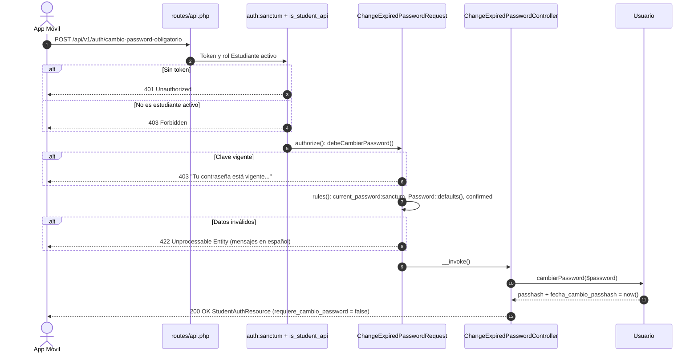

# Plan de Implementación: APP-03 · Cambio Obligatorio de Contraseña por Vencimiento de Fecha

**Tarjeta Trello:** [APP-03 · [2 pts] Cambio Obligatorio de Contraseña por Vencimiento de Fecha](https://trello.com/c/Rg7nYxea)  
**Estimación:** 2 puntos Fibonacci  
**Release:** R1 (Autenticación Móvil, Identidad y Dashboard)  
**Rama Git:** `app-movil`  
**Documento Backlog:** `docs/backlogs/2026-10-29_modulo_api_estudiante_app_movil.md`  
**Estado del plan:** Aprobado (auto-aprobado por solicitud del usuario, 2026-11-02)

---

## 1. Descripción del Objetivo

Implementar `POST /api/v1/auth/cambio-password-obligatorio` para que un estudiante con la clave vencida (más de `Usuario::VIGENCIA_PASSWORD_MESES = 6` meses) o en su primer ingreso (`fecha_cambio_passhash = null`) pueda actualizarla desde la app móvil.

La app móvil **no permite cambios voluntarios de contraseña**: el endpoint solo se habilita cuando `Usuario::debeCambiarPassword()` es verdadero. Fuera de ese caso responde `403`.

### Criterios de Aceptación (DoD)
- [ ] Endpoint restringido: solo permite ejecución si el usuario tiene flag de cambio obligatorio activo (`debeCambiarPassword()`).
- [ ] Valida contraseña actual (`current_password`) y complejidad de la nueva clave (`Password::defaults()`).
- [ ] Actualiza `passhash` y fecha de modificación en `Usuario::cambiarPassword()`, levantando el bloqueo.

---

## 2. Decisiones de Diseño (User Review Required)

> [!IMPORTANT]
> **Solo aviso, sin bloqueo de rutas (decisión del usuario, 2026-11-02)**:
> La API **no** replicará el middleware web `ForcePasswordChange` (que responde `423 Locked` y retiene al usuario). El resto de los endpoints `/api/v1/estudiante/*` siguen funcionando aunque la clave esté vencida. La app recibe el **aviso** mediante los campos `requiere_cambio_password` y `motivo_cambio_password` (`primer_ingreso` | `vencida`), ya presentes en `POST /auth/login` y `GET /auth/me` (`StudentAuthResource`), y que APP-04 sumará al dashboard. La app decide cómo mostrar el aviso.
>
> "Levantando el bloqueo" en el DoD se interpreta como: tras el cambio, `requiere_cambio_password` pasa a `false` y el aviso desaparece.

> [!IMPORTANT]
> **Nomenclatura `[Action][Domain]Controller`**: `ChangeExpiredPasswordController` en `App\Api\V1\Controllers\Auth` (ubicación coherente con `LoginController`, `LogoutController` y `MeController`). La referencia `app/Http/Controllers/Api/V1/Student/PasswordApiController.php` del backlog queda reemplazada por la estructura real `app/Api/V1/*` ya adoptada en APP-01/APP-02.

> [!NOTE]
> **Restricción en el `FormRequest`**: la regla "solo si `debeCambiarPassword()`" vive en `authorize()` del `FormRequest`, cumpliendo `AGENTS.md` (validación aislada, controlador mínimo). `authorize()` se evalúa antes que las reglas, por lo que un usuario con clave vigente recibe `403` sin pasar por la validación.

> [!NOTE]
> **Sin revocación de tokens**: el token Bearer actual sigue siendo válido tras el cambio (la app no necesita volver a autenticarse). No se revocan otros tokens del usuario; queda fuera del DoD.

---

## 3. Preguntas Abiertas

*Ninguna*: la única ambigüedad (bloquear o solo avisar) quedó resuelta por el usuario.

---

## 4. Flujo



---

## 5. Cambios Propuestos

### Componente 1: Validación y Autorización

#### [NEW] `app/Api/V1/Requests/Auth/ChangeExpiredPasswordRequest.php`
- `authorize()` exige `debeCambiarPassword()`; `failedAuthorization()` lanza `AuthorizationException` con mensaje en español (sin él Laravel respondería "This action is unauthorized.").
- Reglas y mensajes iguales a `Settings\PasswordController::update` para mantener una sola política de complejidad.
- `current_password:sanctum`: la regla debe consultar el guard de Sanctum, no el guard `web` por defecto.

```php
<?php

namespace App\Api\V1\Requests\Auth;

use App\Models\Usuario\Usuario;
use Illuminate\Auth\Access\AuthorizationException;
use Illuminate\Foundation\Http\FormRequest;
use Illuminate\Validation\Rules\Password;

/**
 * Cambio de clave en la app móvil: solo cuando la política lo exige
 * (primer ingreso o clave vencida). No hay cambio voluntario en la app.
 */
class ChangeExpiredPasswordRequest extends FormRequest
{
    public function authorize(): bool
    {
        /** @var Usuario $user */
        $user = $this->user();

        return $user->debeCambiarPassword();
    }

    protected function failedAuthorization(): void
    {
        throw new AuthorizationException('Tu contraseña está vigente; el cambio desde la app solo está disponible cuando vence o en el primer ingreso.');
    }

    public function rules(): array
    {
        return [
            'current_password' => ['required', 'current_password:sanctum'],
            'password' => ['required', Password::defaults(), 'confirmed'],
        ];
    }

    public function messages(): array
    {
        return [
            'current_password.required' => 'Ingresa tu contraseña actual.',
            'current_password.current_password' => 'La contraseña actual no es correcta.',
            'password.required' => 'Ingresa la nueva contraseña.',
            'password.confirmed' => 'La confirmación no coincide con la nueva contraseña.',
            'password.*' => 'La nueva contraseña debe tener al menos 8 caracteres, con una mayúscula, números y algún signo.',
        ];
    }
}
```

---

### Componente 2: Controlador de Acción Única

#### [NEW] `app/Api/V1/Controllers/Auth/ChangeExpiredPasswordController.php`
- Usa `Usuario::cambiarPassword()` (único camino que actualiza `passhash` y `fecha_cambio_passhash` juntos).
- Devuelve `StudentAuthResource` actualizado: la app confirma con `requiere_cambio_password = false` sin llamar a `/me`.

```php
<?php

namespace App\Api\V1\Controllers\Auth;

use App\Api\V1\Requests\Auth\ChangeExpiredPasswordRequest;
use App\Api\V1\Resources\Auth\StudentAuthResource;
use App\Models\Usuario\Usuario;

class ChangeExpiredPasswordController
{
    public function __invoke(ChangeExpiredPasswordRequest $request): StudentAuthResource
    {
        /** @var Usuario $user */
        $user = $request->user();

        $user->cambiarPassword($request->validated('password'));

        return (new StudentAuthResource($user))
            ->additional(['message' => 'Contraseña actualizada correctamente.']);
    }
}
```

---

### Componente 3: Rutas (con comentario `//` obligatorio)

#### [MODIFY] `routes/api.php`

```diff
 use App\Api\V1\Controllers\Auth\LoginController;
 use App\Api\V1\Controllers\Auth\LogoutController;
 use App\Api\V1\Controllers\Auth\MeController;
+use App\Api\V1\Controllers\Auth\ChangeExpiredPasswordController;
 use App\Api\V1\Controllers\Student\GetProfileController;
@@
         Route::middleware(['auth:sanctum', 'is_student_api'])->group(function () {
             // Revocar token Bearer de la sesión actual
             Route::post('logout', LogoutController::class)->name('api.v1.auth.logout');
             // Identidad y verificación de expiración de clave del usuario actual
             Route::get('me', MeController::class)->name('api.v1.auth.me');
+            // Cambio de clave solo si venció o es primer ingreso (sin cambio voluntario en la app)
+            Route::post('cambio-password-obligatorio', ChangeExpiredPasswordController::class)
+                ->middleware('throttle:10,1')
+                ->name('api.v1.auth.cambio-password-obligatorio');
         });
```

> [!NOTE]
> `throttle:10,1` limita intentos de adivinar `current_password` con un token robado, igual que en `login`.

---

### Componente 4: Documentación del Backlog

#### [MODIFY] `docs/backlogs/2026-10-29_modulo_api_estudiante_app_movil.md`
- Línea 26: reemplazar "para forzar la actualización de clave antes de liberar el resto de rutas" por "como aviso a la app; la API no bloquea el resto de rutas (decisión 2026-11-02)".

---

### Componente 5: Pruebas Automatizadas

#### [NEW] `tests/Feature/Api/V1/Auth/ChangeExpiredPasswordApiTest.php`
Pest + `DatabaseTransactions`, reutilizando el patrón de `crearEstudianteConPerfil` de `PerfilApiTest`:
1. Primer ingreso (`fecha_cambio_passhash = null`) y clave vencida (`now()->subMonths(7)`) → `200`, `data.requiere_cambio_password = false`, `Hash::check` de la nueva clave sobre `passhash` y `fecha_cambio_passhash` actualizada (dataset).
2. Clave vigente → `403` con el mensaje en español y `passhash` sin cambios.
3. `current_password` incorrecta → `422` con error en `current_password`.
4. Nueva clave débil o sin confirmación → `422` con error en `password`.
5. Sin token → `401`; docente sin perfil de estudiante → `403`.
6. **Sin bloqueo**: con clave vencida, `GET /api/v1/estudiante/perfil` responde `200` (la API solo avisa).

---

## 6. Plan de Verificación

> [!NOTE]
> Por instrucción del usuario, en esta etapa no se ejecutan pruebas. Los comandos quedan listos para cuando se implemente.

### Pruebas Automatizadas
```bash
DB_PORT=15432 php artisan test tests/Feature/Api/V1/Auth/ChangeExpiredPasswordApiTest.php
DB_PORT=15432 php artisan test tests/Feature/Api/V1
```

### Verificación Manual
1. `php artisan dev:pair` (sin `--unlock`) para obtener un estudiante con clave vencida, o fijar `fecha_cambio_passhash = null`.
2. `POST /api/v1/auth/login` → comprobar `requiere_cambio_password: true`.
3. `POST /api/v1/auth/cambio-password-obligatorio` con `current_password`, `password` y `password_confirmation` → `200` y `requiere_cambio_password: false`.
4. Repetir el paso 3 → `403` (clave ya vigente).
