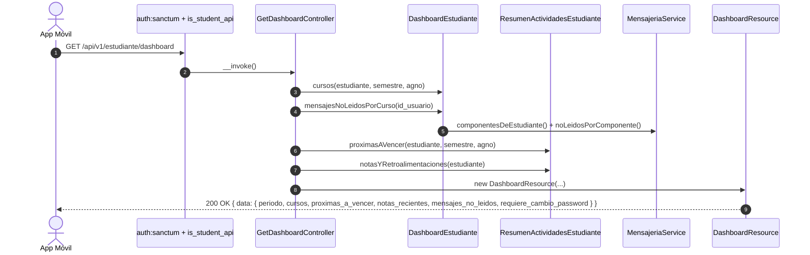

# Plan de Implementación: APP-04 · Dashboard Principal y Alertas Académicas

**Tarjeta Trello:** [APP-04 · [5 pts] Dashboard Principal y Alertas Académicas](https://trello.com/c/ofOMi4p8)  
**Estimación:** 5 puntos Fibonacci  
**Release:** R1 (Autenticación Móvil, Identidad y Dashboard)  
**Rama Git:** `app-movil`  
**Documento Backlog:** `docs/backlogs/2026-10-29_modulo_api_estudiante_app_movil.md`  
**Estado del plan:** Aprobado (auto-aprobado por solicitud del usuario, 2026-11-02)

---

## 1. Descripción del Objetivo

Implementar `GET /api/v1/estudiante/dashboard`, que entrega en un solo payload la pantalla de inicio de la app móvil:

- Cursos del semestre/año vigente con el docente titular de la sección del estudiante.
- Actividades próximas a vencer (7 días) con plazo real calculado con holguras base y personal.
- Últimas 5 notas y retroalimentaciones individuales.
- Conteo de mensajes no leídos del **Mensajero** (`curso.mensaje`) por curso.
- Aviso de cambio de contraseña (`requiere_cambio_password`), sin bloqueo (decisión de APP-03).

La lógica ya existe en el portal web (`Student\DashboardController`, `ResumenActividadesEstudiante`, `MensajeriaService`); el trabajo es reutilizarla sin duplicarla y serializarla como JSON.

### Criterios de Aceptación (DoD)
- [ ] Retorna cursos del semestre y año vigente con docente titular de la sección/componente asignado.
- [ ] Retorna lista `proximas_a_vencer` con fecha límite calculada incluyendo holguras.
- [ ] Retorna `notas_recientes` individuales del estudiante.
- [ ] Retorna badge con conteo de `mensajes_no_leidos` del **Mensajero** por cada curso.
- [ ] No incluye integración ni referencias al sistema SGEQ.

---

## 2. Decisiones de Diseño (User Review Required)

> [!IMPORTANT]
> **Extracción a servicio compartido (sin duplicar lógica)**:
> La resolución del docente de la sección y el agrupado de mensajes no leídos hoy viven dentro de `Student\DashboardController` (el segundo como método privado `mensajesSinLeer`). Se moverán **tal cual** a un servicio nuevo `App\Services\Student\DashboardEstudiante`, y el controlador web pasará a delegar en él. El comportamiento del portal web no cambia: sigue mostrando todos los cursos `INSCRITO` (sin filtro de período) y el texto `(sin docente asignado)`.

> [!IMPORTANT]
> **Período vigente**: se usa el mismo criterio del portal web (`mes > 6 ? 2 : 1`, año actual) y se filtra por `curso.semestre_real` / `curso.agno_real`. `proximas_a_vencer` usa el mismo período, como en la web.

> [!IMPORTANT]
> **Aviso de contraseña en el dashboard**: el payload incluye `requiere_cambio_password` y `motivo_cambio_password`, para que la pantalla de inicio muestre el aviso sin llamar a `/auth/me`. No se bloquea nada (decisión del usuario, 2026-11-02).

> [!NOTE]
> **Docente**: en la API el campo `docente` es `null` cuando no hay docente asignado (el cliente decide el texto). El servicio devuelve `?string` y el controlador web aplica `?? '(sin docente asignado)'`.

> [!NOTE]
> **Fechas**: fechas de calendario en `Y-m-d` (`fecha_inicio`, `fecha_fin`, `fecha_limite`, `plazo_hasta`) y eventos cronológicos (`notas_recientes[].fecha`) en ISO-8601, según la sección 2.2 del backlog.

> [!NOTE]
> **Sin SGEQ**: el controlador API no inyecta `SgeqSsoService` y el payload no trae `puedeAbrirSgeq` ni `isAyudante` (este último es propio del portal web).

---

## 3. Preguntas Abiertas

*Ninguna*.

---

## 4. Flujo



---

## 5. Cambios Propuestos

### Componente 1: Servicio Compartido del Dashboard

#### [NEW] `app/Services/Student/DashboardEstudiante.php`
Código movido desde `Student\DashboardController` sin cambios de criterio; se añade el filtro opcional de período.

```php
<?php

namespace App\Services\Student;

use App\Models\Curso\InscripcionCurso;
use App\Models\Usuario\Estudiante;
use App\Services\MensajeriaService;
use Carbon\Carbon;

/**
 * Datos del inicio del estudiante compartidos por el portal web y la API móvil.
 */
class DashboardEstudiante
{
    public function __construct(private readonly MensajeriaService $mensajeria) {}

    /** Período vigente: mismo criterio que el portal web. */
    public static function periodoActual(): array
    {
        return ['semestre' => Carbon::now()->month > 6 ? 2 : 1, 'agno' => Carbon::now()->year];
    }

    /**
     * Cursos INSCRITO del alumno con el docente titular de su sección.
     * Sin período = todos los cursos inscritos (comportamiento del portal web).
     *
     * @return \Illuminate\Support\Collection<int, array<string, mixed>>
     */
    public function cursos(Estudiante $estudiante, ?int $semestre = null, ?int $agno = null)
    {
        $inscripciones = InscripcionCurso::where('id_estudiante', $estudiante->id_estudiante)
            ->where('estado_inscripcion', 'INSCRITO')
            ->when($semestre !== null, fn ($q) => $q->whereHas('curso', fn ($c) => $c->where('semestre_real', $semestre)))
            ->when($agno !== null, fn ($q) => $q->whereHas('curso', fn ($c) => $c->where('agno_real', $agno)))
            ->with([
                'curso.asignacionPlan.asignatura',
                'curso.asignacionPlan.plan.carrera',
                // Docentes de cada componente, con es_titular para poder priorizar.
                'curso.componentes.docenteComponentes.docente.usuario',
                // Marca qué componentes son la sección del alumno.
                'curso.componentes.inscripcionComponentes' => fn ($q) => $q->where('id_estudiante', $estudiante->id_estudiante),
            ])
            ->get();

        return $inscripciones->map(function ($inscripcion) {
            $curso = $inscripcion->curso;

            // El profesor es el titular de la sección del alumno (mismo criterio
            // que StudentSyllabusPresenter). Sin inscripción por componente se
            // cae a los componentes del curso.
            $componentes = $curso->componentes ?? collect();
            $propios = $componentes->filter(fn ($componente) => $componente->inscripcionComponentes->isNotEmpty());
            $relevantes = $propios->isNotEmpty() ? $propios : $componentes;

            $primerDocente = $relevantes
                ->sortBy('id_componente')
                ->flatMap(fn ($componente) => $componente->docenteComponentes
                    ->sortBy(fn ($dc) => [!$dc->es_titular, $dc->id_docente_componente]))
                ->first()?->docente?->usuario;

            return [
                'id_curso' => $curso->id_curso,
                'nombre' => $curso->nombre,
                'cod_curso' => $curso->cod_curso,
                'cod_asignatura' => $curso->asignacionPlan?->asignatura?->cod_asignatura,
                'asignatura_nombre' => $curso->asignacionPlan?->asignatura?->nombre ?? 'N/A',
                'carrera_nombre' => $curso->asignacionPlan?->plan?->carrera?->nombre ?? 'N/A',
                'fecha_inicio' => $curso->fecha_inicio,
                'fecha_fin' => $curso->fecha_fin,
                'semestre_real' => $curso->semestre_real,
                'agno_real' => $curso->agno_real,
                'profesor' => $primerDocente ? trim("{$primerDocente->nombre1} {$primerDocente->apellido1}") : null,
            ];
        });
    }

    /**
     * Mensajes del Mensajero (`curso.mensaje`) sin abrir, agrupados por curso.
     * (Docblock original de DashboardController::mensajesSinLeer se conserva.)
     *
     * @return array{no_leidos:int, cursos:array<int,array{id_curso:int, nombre:string, cod_curso:string, cod_asignatura:?string, no_leidos:int}>}
     */
    public function mensajesNoLeidosPorCurso(int $idUsuario): array
    {
        // Cuerpo idéntico al actual DashboardController::mensajesSinLeer,
        // usando $this->mensajeria.
    }
}
```

---

### Componente 2: Portal Web (delegación, sin cambio de comportamiento)

#### [MODIFY] `app/Http/Controllers/Student/DashboardController.php`

```diff
-    public function index(MensajeriaService $mensajeria, SgeqSsoService $sgeq, ResumenActividadesEstudiante $resumen)
+    public function index(DashboardEstudiante $dashboard, SgeqSsoService $sgeq, ResumenActividadesEstudiante $resumen)
@@
-        $inscripciones = InscripcionCurso::where(...)->...->get();
-        $cursosData = $inscripciones->map(function ($inscripcion) { ... });
+        $cursosData = $dashboard->cursos($estudiante)
+            ->map(fn (array $curso) => [...$curso, 'profesor' => $curso['profesor'] ?? '(sin docente asignado)']);
@@
-        $semestreActual = Carbon::now()->month > 6 ? 2 : 1;
-        $agnoActual = Carbon::now()->year;
+        ['semestre' => $semestreActual, 'agno' => $agnoActual] = DashboardEstudiante::periodoActual();
@@
-            'mensajeria' => $this->mensajesSinLeer($mensajeria, (int) $user->id_usuario),
+            'mensajeria' => $dashboard->mensajesNoLeidosPorCurso((int) $user->id_usuario),
@@
-    private function mensajesSinLeer(MensajeriaService $mensajeria, int $idUsuario): array { ... }
```

> [!WARNING]
> Las props de Inertia (`cursos`, `mensajeria`, `proximasAVencer`, `notasRecientes`, `stats`, `isAyudante`, `puedeAbrirSgeq`, `periodoActual`) deben quedar idénticas. `tests/Feature/DashboardTest.php` sirve de red de no-regresión.

---

### Componente 3: Serialización

#### [NEW] `app/Api/V1/Resources/Student/DashboardResource.php`

```php
<?php

namespace App\Api\V1\Resources\Student;

use App\Models\Usuario\Usuario;
use Carbon\Carbon;
use Illuminate\Http\Request;
use Illuminate\Http\Resources\Json\JsonResource;
use Illuminate\Support\Collection;

/**
 * Pantalla de inicio de la app móvil del estudiante.
 *
 * @property Usuario $resource
 */
class DashboardResource extends JsonResource
{
    public function __construct(
        Usuario $usuario,
        private readonly array $periodo,
        private readonly Collection $cursos,
        private readonly array $proximasAVencer,
        private readonly array $notasRecientes,
        private readonly array $mensajesNoLeidos,
    ) {
        parent::__construct($usuario);
    }

    public function toArray(Request $request): array
    {
        $noLeidosPorCurso = collect($this->mensajesNoLeidos['cursos'])->pluck('no_leidos', 'id_curso');
        $fecha = fn ($valor) => $valor ? Carbon::parse($valor)->format('Y-m-d') : null;

        return [
            'periodo' => $this->periodo,
            // Aviso para la app; la API no bloquea rutas por clave vencida.
            'requiere_cambio_password' => $this->resource->debeCambiarPassword(),
            'motivo_cambio_password' => $this->resource->motivoCambioPasswordObligatorio(),
            'cursos' => $this->cursos->map(fn (array $c) => [
                'id_curso' => (int) $c['id_curso'],
                'nombre' => $c['nombre'],
                'cod_curso' => $c['cod_curso'],
                'cod_asignatura' => $c['cod_asignatura'],
                'asignatura_nombre' => $c['asignatura_nombre'],
                'carrera_nombre' => $c['carrera_nombre'],
                'fecha_inicio' => $fecha($c['fecha_inicio']),
                'fecha_fin' => $fecha($c['fecha_fin']),
                'semestre_real' => $c['semestre_real'],
                'agno_real' => $c['agno_real'],
                'docente' => $c['profesor'],
                'mensajes_no_leidos' => (int) ($noLeidosPorCurso[$c['id_curso']] ?? 0),
            ])->values(),
            'proximas_a_vencer' => $this->proximasAVencer,
            'notas_recientes' => collect($this->notasRecientes)
                ->map(fn (array $n) => [...$n, 'fecha' => Carbon::parse($n['fecha'])->toIso8601String()])
                ->values(),
            'mensajes_no_leidos' => [
                'total' => $this->mensajesNoLeidos['no_leidos'],
                'cursos' => $this->mensajesNoLeidos['cursos'],
            ],
        ];
    }
}
```

**Forma del payload:**

```json
{
  "data": {
    "periodo": { "semestre": 2, "agno": 2026 },
    "requiere_cambio_password": false,
    "motivo_cambio_password": null,
    "cursos": [
      { "id_curso": 10, "nombre": "...", "cod_curso": "...", "cod_asignatura": "...", "asignatura_nombre": "...",
        "carrera_nombre": "...", "fecha_inicio": "2026-08-03", "fecha_fin": "2026-12-18",
        "semestre_real": 2, "agno_real": 2026, "docente": "ANA ROJAS", "mensajes_no_leidos": 3 }
    ],
    "proximas_a_vencer": [
      { "id_actividad": 5, "id_curso": 10, "curso": "MED101", "nombre": "...", "es_sumativa": true,
        "fecha_limite": "2026-11-05", "plazo_hasta": "2026-11-07", "es_vencida": false }
    ],
    "notas_recientes": [
      { "id_agenda": 99, "id_actividad": 4, "id_curso": 10, "curso": "MED101", "nombre": "...", "es_sumativa": true,
        "tipo": "evaluacion", "nota": 6.2, "resultado": null, "comentario": "...", "fecha": "2026-10-30T14:12:00-03:00" }
    ],
    "mensajes_no_leidos": { "total": 3, "cursos": [ { "id_curso": 10, "nombre": "...", "cod_curso": "...", "cod_asignatura": "...", "no_leidos": 3 } ] }
  }
}
```

---

### Componente 4: Controlador de Acción Única

#### [NEW] `app/Api/V1/Controllers/Student/GetDashboardController.php`

```php
<?php

namespace App\Api\V1\Controllers\Student;

use App\Api\V1\Resources\Student\DashboardResource;
use App\Models\Usuario\Usuario;
use App\Services\Student\DashboardEstudiante;
use App\Services\Student\ResumenActividadesEstudiante;
use Illuminate\Http\Request;

/**
 * Pantalla de inicio móvil: cursos vigentes, entregas próximas, notas recientes
 * y mensajes sin leer del Mensajero. Sin SGEQ.
 */
class GetDashboardController
{
    public function __construct(
        private readonly DashboardEstudiante $dashboard,
        private readonly ResumenActividadesEstudiante $resumen,
    ) {}

    public function __invoke(Request $request): DashboardResource
    {
        /** @var Usuario $user */
        $user = $request->user();
        $estudiante = $user->estudiante;
        $periodo = DashboardEstudiante::periodoActual();

        return new DashboardResource(
            usuario: $user,
            periodo: $periodo,
            cursos: $this->dashboard->cursos($estudiante, $periodo['semestre'], $periodo['agno']),
            proximasAVencer: $this->resumen->proximasAVencer($estudiante, $periodo['semestre'], $periodo['agno']),
            notasRecientes: $this->resumen->notasYRetroalimentaciones($estudiante),
            mensajesNoLeidos: $this->dashboard->mensajesNoLeidosPorCurso((int) $user->id_usuario),
        );
    }
}
```

---

### Componente 5: Rutas (con comentario `//` obligatorio)

#### [MODIFY] `routes/api.php`

```diff
+use App\Api\V1\Controllers\Student\GetDashboardController;
 use App\Api\V1\Controllers\Student\GetProfileController;
@@
     Route::middleware(['auth:sanctum', 'is_student_api'])->prefix('estudiante')->group(function () {
         // Ficha oficial de perfil, cohorte, matrícula y foto de credencial Intranet (solo lectura)
         Route::get('perfil', GetProfileController::class)->name('api.v1.estudiante.perfil');
+        // Inicio: cursos del período, entregas próximas, notas recientes y no leídos del Mensajero
+        Route::get('dashboard', GetDashboardController::class)->name('api.v1.estudiante.dashboard');
     });
```

---

### Componente 6: Pruebas Automatizadas

#### [NEW] `tests/Feature/Api/V1/Student/DashboardApiTest.php`
Pest + `DatabaseTransactions`, fijando la fecha con `Carbon::setTestNow()` para que el período sea determinista:
1. `200` con la estructura completa (`periodo`, `cursos`, `proximas_a_vencer`, `notas_recientes`, `mensajes_no_leidos`, `requiere_cambio_password`).
2. Solo cursos `INSCRITO` del período vigente: excluye un curso de otro semestre y uno `RETIRADO`.
3. `docente` = titular del componente donde está inscrito el alumno, no el de otra sección del mismo curso.
4. `proximas_a_vencer` incluye `plazo_hasta` cuando hay holgura base + personal.
5. `mensajes_no_leidos` por curso coincide con mensajes de `curso.mensaje` no leídos; los de `agenda.agenda` no cuentan.
6. El JSON no contiene claves `sgeq`, `puedeAbrirSgeq` ni `isAyudante`.
7. Clave vencida → `200` con `requiere_cambio_password = true` (aviso, sin bloqueo).
8. Sin token → `401`; docente → `403`.

#### [MODIFY] `tests/Feature/Student/ResumenActividadesEstudianteTest.php`
- Sin cambios previstos; se ejecuta como no-regresión del servicio reutilizado.

---

## 6. Plan de Verificación

> [!NOTE]
> Por instrucción del usuario, en esta etapa no se ejecutan pruebas. Los comandos quedan listos para cuando se implemente.

### Pruebas Automatizadas
```bash
DB_PORT=15432 php artisan test tests/Feature/Api/V1/Student/DashboardApiTest.php
# No-regresión del portal web tras la extracción al servicio
DB_PORT=15432 php artisan test tests/Feature/DashboardTest.php tests/Feature/Student/ResumenActividadesEstudianteTest.php
DB_PORT=15432 php artisan test tests/Feature/Api/V1
```

### Verificación Manual
1. Obtener un estudiante con `php artisan dev:pair --unlock` y hacer login en `POST /api/v1/auth/login`.
2. `GET /api/v1/estudiante/dashboard` con `Authorization: Bearer <token>`.
3. Contrastar con `/estudiante/dashboard` en el portal web del mismo alumno: mismos cursos del período, mismo docente, mismas próximas entregas y mismo total de mensajes no leídos.
4. Confirmar que el portal web sigue mostrando `(sin docente asignado)` donde corresponda.
