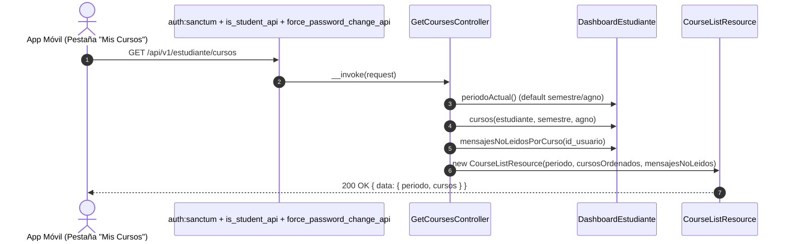

# Plan de Implementación: APP-05 · Catálogo de Cursos Inscritos del Período Actual

**Tarjeta Trello:** [APP-05 · [3 pts] Catálogo de Cursos Inscritos del Período Actual](https://trello.com/c/zi6jFyLu)  
**Estimación:** 3 puntos Fibonacci  
**Release:** R2 (Cursos, Rendimiento Académico, Syllabus y Calendario)  
**Rama Git:** `app-movil` (o sugerida `feature/app-api-cursos-rendimiento-syllabus`)  
**Documento Backlog:** `docs/backlogs/2026-10-29_modulo_api_estudiante_app_movil.md`  
**Estado del plan:** Diseñado y acordado con el usuario (2026-11-02)

---

## 1. Descripción del Objetivo

Implementar el endpoint `GET /api/v1/estudiante/cursos`, que entrega el catálogo de asignaturas inscritas por el estudiante en la app móvil.

Por definición de negocio y diseño de producto:
- **Enfoque exclusivo en el período vigente**: La aplicación móvil restringe la visibilidad a las asignaturas del período académico actual (`periodoActual()`). El historial académico de semestres anteriores queda explícitamente fuera de alcance en la interfaz móvil.
- **Soporte opcional en backend**: Para fines de interoperabilidad técnica, robustez y pruebas automatizadas, el backend acepta opcionalmente parámetros `semestre` y `agno`, pero responde el período vigente por defecto.
- **Endpoint independiente y ligero**: Proporciona un recurso rápido para la pestaña "Mis Cursos", evitando el sobrecosto de recalcular entregas próximas a vencer (`proximas_a_vencer`), notas recientes (`notas_recientes`) ni holguras evaluativas que se procesan en el Dashboard (APP-04).
- **Ordenamiento alfabético**: Los cursos se devuelven ordenados alfabéticamente de forma ascendente por nombre de asignatura.

### Criterios de Aceptación (DoD)
- [x] Retorna por defecto los cursos del semestre y año vigente calculados con `DashboardEstudiante::periodoActual()`.
- [x] Soporte opcional de parámetros `semestre` y `agno` en backend para compatibilidad técnica y testing.
- [x] Retorna estructura JSON con bloque `periodo` y array `cursos` (`{ "data": { "periodo": { ... }, "cursos": [ ... ] } }`).
- [x] Ordena los cursos alfabéticamente de forma ascendente por nombre de asignatura.
- [x] Incluye datos completos del curso: `id_curso`, `nombre`, `cod_curso`, `cod_asignatura`, `asignatura_nombre`, `carrera_nombre`, `letra_grupo`, `fecha_inicio`, `fecha_fin`, `semestre_real`, `agno_real`, `docente` (titular de la sección) e `imagen_url`.
- [x] Incluye flag `tiene_programa` indicando si existe syllabus aprobado o completo (`APROBADO`, `BASICO_COMPLETO` y `es_actual = true`).
- [x] Incluye conteo de `mensajes_no_leidos` del módulo Mensajero (`curso.mensaje`) por curso.
- [x] Excluye explícitamente historial de semestres previos de la interfaz móvil.

---

## 2. Decisiones de Diseño (Acordadas en Entrevista /grill-me)

> [!IMPORTANT]
> **Arquitectura de Controladores Únicos (Single-Action Controllers)**:
> Se crea `App\Api\V1\Controllers\Student\GetCoursesController` implementando estrictamente el método mágico `__invoke`. La ruta se registra en `routes/api.php` sin sintaxis de arreglo: `Route::get('cursos', GetCoursesController::class)`.

> [!IMPORTANT]
> **Reutilización y Enriquecimiento de `DashboardEstudiante`**:
> Para evitar duplicidad de queries SQL complejas (resolución del docente titular de sección y pertenencia a componentes), se extiende el método `cursos()` de `App\Services\Student\DashboardEstudiante` para eager-load de `programas` (con filtro `es_actual = true` y estados `['APROBADO', 'BASICO_COMPLETO']`), entregando el flag booleano `tiene_programa`, `letra_grupo` e `imagen_url`.

> [!NOTE]
> **Estructura del Payload**:
> Se adopta un envelope estandarizado coherente con el Dashboard:
> ```json
> {
>   "data": {
>     "periodo": {
>       "semestre": 2,
>       "agno": 2026
>     },
>     "cursos": [
>       {
>         "id_curso": 101,
>         "nombre": "Medicina Interna I",
>         "cod_curso": "MED-101-1",
>         "cod_asignatura": "MED-101",
>         "asignatura_nombre": "Medicina Interna I",
>         "carrera_nombre": "Medicina",
>         "letra_grupo": "A",
>         "fecha_inicio": "2026-08-01",
>         "fecha_fin": "2026-12-15",
>         "semestre_real": 2,
>         "agno_real": 2026,
>         "docente": "Dr. Juan Pérez",
>         "mensajes_no_leidos": 2,
>         "tiene_programa": true,
>         "imagen_url": "/img/utamed.webp"
>       }
>     ]
>   }
> }
> ```

> [!NOTE]
> **Ordenamiento**:
> En el controlador, la colección de cursos se ordena alfabéticamente por `nombre` de forma natural y case-insensitive (`sortBy('nombre', SORT_NATURAL | SORT_FLAG_CASE)->values()`).

---

## 3. Flujo de Secuencia



---

## 4. Archivos a Crear y Modificar

### Archivos a Modificar

1. **`app/Services/Student/DashboardEstudiante.php`**:
   - Eager-load de relación `curso.programas` filtrando `es_actual = true` y estado en `['APROBADO', 'BASICO_COMPLETO']`.
   - Incluir en el mapeo `letra_grupo`, `imagen_url` y `tiene_programa`.

2. **`routes/api.php`**:
   - Registrar la ruta en el grupo protegido `prefix('estudiante')`:
     ```php
     Route::get('cursos', GetCoursesController::class)->name('api.v1.estudiante.cursos');
     ```

### Archivos a Crear

3. **`app/Api/V1/Controllers/Student/GetCoursesController.php`**:
   - Single-Action Controller invocable (`__invoke`).
   - Obtiene usuario autenticado y perfil estudiante.
   - Determina semestre y año (por defecto período actual, o query params si vienen informados).
   - Consulta cursos y mensajes no leídos.
   - Aplica ordenamiento alfabético ascendente por nombre.
   - Retorna `CourseListResource`.

4. **`app/Api/V1/Resources/Student/CourseListResource.php`**:
   - Recurso JSON que formatea fechas en `Y-m-d` y entrega el objeto `{ periodo, cursos }`.

5. **`tests/Feature/Api/V1/Student/CoursesApiTest.php`**:
   - Pruebas unitarias/funcionales con Pest:
     - 401 si no hay token Bearer.
     - 403 si el usuario no tiene rol o perfil de estudiante.
     - 200 OK con estructura completa para el período vigente por defecto.
     - Filtrado opcional por semestre/año cuando se envían en la query.
     - Validación del orden alfabético ascendente por nombre de asignatura.
     - Validación del flag `tiene_programa` (true cuando hay programa aprobado/completo, false cuando no).
     - Validación del conteo de `mensajes_no_leidos`.
     - Caso borde: lista vacía de cursos cuando el estudiante no tiene inscripciones en el período solicitado.

---

## 5. Plan de Verificación y Testing

1. **Pruebas Automatizadas (Pest)**:
   ```bash
   php artisan test tests/Feature/Api/V1/Student/CoursesApiTest.php
   ```
2. **Pruebas de Regresión**:
   Verificar que no se rompa el dashboard existente:
   ```bash
   php artisan test tests/Feature/Api/V1/Student/DashboardApiTest.php
   ```
3. **Análisis de Tipos y Estándares**:
   ```bash
   ./vendor/bin/pint --test
   ```
