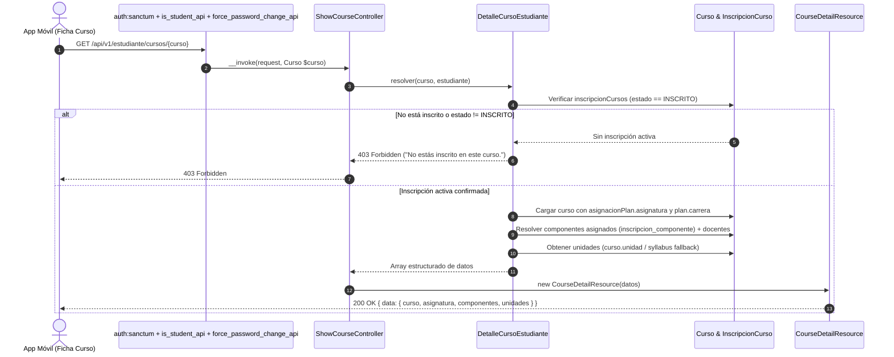

# Plan de Implementación: APP-06 · Ficha Detallada del Curso y Componentes Asignados

**Tarjeta Trello:** [APP-06 · [3 pts] Ficha Detallada del Curso y Componentes Asignados](https://trello.com/c/2rHuKpYx/145-app-06-3-pts-ficha-detallada-del-curso-y-componentes-asignados)  
**Estimación:** 3 puntos Fibonacci  
**Release:** R2 (Cursos, Rendimiento Académico, Syllabus y Calendario)  
**Rama Git:** `app-movil` (o sugerida `feature/app-api-cursos-rendimiento-syllabus`)  
**Documento Backlog:** `docs/backlogs/2026-10-29_modulo_api_estudiante_app_movil.md`  
**Estado del plan:** En revisión / Solicitud de Feedback (2026-11-02)

---

## 1. Descripción del Objetivo

Implementar el endpoint `GET /api/v1/estudiante/cursos/{curso}`, que entrega la ficha completa de un curso inscrito por el estudiante en la aplicación móvil, incluyendo los componentes docentes asignados a su sección, el desglose de créditos y horas de la asignatura, y las unidades de aprendizaje.

Por definición de negocio y diseño de producto:
- **Protección Anti-IDOR Estricta**: Valida que el estudiante autenticado tenga matrícula activa (`INSCRITO`) en el curso solicitado. Si el estudiante no pertenece al curso o su estado es distinto a `INSCRITO` (ej. `RETIRADO`, `ELIMINADO`), el endpoint deniega el acceso inmediatamente con `403 Forbidden`.
- **Componentes Asignados y Docentes**: Expone los componentes específicos en los que el alumno está registrado (`curso.inscripcion_componente`) con su tipo (Cátedra, Taller, Laboratorio), reglas de aprobación/asistencia y el equipo docente titular y secundario asignado. Aplica un fallback resiliente a todos los componentes del curso si no existen filas de inscripción por componente a nivel de base de datos (garantizando consistencia con la lógica del portal web y Dashboard).
- **Créditos y Carga Horaria de Asignatura**: Desglosa los créditos SCT y la distribución horaria oficial (horas de cátedra, taller, laboratorio, dirigidas y autónomas) provenientes del plan de estudios y asignatura.
- **Unidades de Aprendizaje**: Entrega las unidades del curso (`curso.unidad`) ordenadas cronológicamente por número de unidad, con fallback a las unidades del syllabus aprobado si la tabla relacional no contuviese registros.
- **Arquitectura Single-Action Controller**: Implementa un controlador invocable desacoplado (`ShowCourseController`), delegando la lógica de consulta y resolución de datos a un servicio de dominio (`DetalleCursoEstudiante`) y serializando mediante `CourseDetailResource`.

### Criterios de Aceptación (DoD)
- [ ] Deniega con `403 Forbidden` si el alumno no está inscrito en el curso solicitado o su estado no es `INSCRITO`.
- [ ] Expone componentes asignados (Cátedra, Taller, Laboratorio) y créditos/horas del ramo.
- [ ] Retorna datos identificatorios del curso: `id_curso`, `nombre`, `cod_curso`, `cod_asignatura`, `asignatura_nombre`, `etiqueta`, `carrera_nombre`, `letra_grupo`, `semestre_real`, `agno_real`, `fecha_inicio`, `fecha_fin`, `docente_titular`, `tiene_programa` e `imagen_url`.
- [ ] Expone desglose de horas y créditos SCT en bloque dedicado `asignatura`.
- [ ] Expone unidades de aprendizaje ordenadas por `num_unidad`.

---

## 2. Decisiones de Diseño y Arquitectura

> [!IMPORTANT]
> **Single-Action Controller en Módulo API**:
> Se crea `App\Api\V1\Controllers\Student\ShowCourseController` implementando exclusivamente el método `__invoke`. La ruta se declara limpiamente en `routes/api.php` sin sintaxis de arreglo: `Route::get('cursos/{curso}', ShowCourseController::class)`.

> [!IMPORTANT]
> **Servicio de Dominio Especializado (`DetalleCursoEstudiante`)**:
> En cumplimiento estricto del principio de responsabilidad única (SRP) y las reglas de `AGENTS.md`, la resolución de componentes, equipo docente, unidades y validación anti-IDOR se aísla en `App\Services\Student\DetalleCursoEstudiante`, manteniendo el controlador delgado y reutilizable.

> [!NOTE]
> **Estructura Estandarizada del Payload JSON**:
> ```json
> {
>   "data": {
>     "curso": {
>       "id_curso": 101,
>       "nombre": "Medicina Interna I",
>       "cod_curso": "MED-101-1",
>       "cod_asignatura": "MED-101",
>       "asignatura_nombre": "Medicina Interna I",
>       "etiqueta": "Medicina Interna I Grupo A",
>       "carrera_nombre": "Medicina",
>       "letra_grupo": "A",
>       "semestre_real": 2,
>       "agno_real": 2026,
>       "fecha_inicio": "2026-08-01",
>       "fecha_fin": "2026-12-15",
>       "docente_titular": "Dr. Juan Pérez",
>       "tiene_programa": true,
>       "imagen_url": "/img/utamed.webp"
>     },
>     "asignatura": {
>       "cod_asignatura": "MED-101",
>       "nombre": "Medicina Interna I",
>       "creditos_sct": 6,
>       "horas_catedra": 2,
>       "horas_taller": 2,
>       "horas_laboratorio": 0,
>       "horas_dirigidas": 0,
>       "horas_autonomas": 0,
>       "descripcion": "Tipo: FE"
>     },
>     "componentes": [
>       {
>         "id_componente": 1,
>         "tipo": "Cátedra",
>         "porcentaje_aprobacion": 60.0,
>         "aprobacion_obligatoria": false,
>         "porcentaje_asistencia_obligatoria": 75.0,
>         "genera_acta": true,
>         "docentes": [
>           {
>             "nombre": "Dr. Juan Pérez",
>             "email": "juan.perez@uta.cl",
>             "es_titular": true
>           }
>         ]
>       }
>     ],
>     "unidades": [
>       {
>         "id_unidad": 1,
>         "num_unidad": 1,
>         "nombre": "Introducción a la Patología Médica",
>         "descripcion": "Bases fisiopatológicas y semiología básica"
>       }
>     ]
>   }
> }
> ```

---

## 3. Diagrama de Secuencia y Flujo de Datos



---

## 4. Archivos a Modificar y Crear

### Archivos a Crear

#### [NEW] `app/Services/Student/DetalleCursoEstudiante.php`
Servicio de dominio para el cálculo y ensamblado de los datos de la ficha del curso:
```php
<?php

namespace App\Services\Student;

use App\Models\Curso\Componente;
use App\Models\Curso\Curso;
use App\Models\Curso\Programa;
use App\Models\Curso\Unidad;
use App\Models\Usuario\Estudiante;
use Illuminate\Support\Collection;
use Symfony\Component\HttpKernel\Exception\HttpException;

class DetalleCursoEstudiante
{
    private const DEFAULT_COURSE_IMAGE = '/img/utamed.webp';

    /**
     * Valida inscripción activa y arma la ficha completa del curso para el estudiante.
     *
     * @throws HttpException 403 si el alumno no está inscrito o su estado no es INSCRITO.
     */
    public function resolver(Curso $curso, Estudiante $estudiante): array
    {
        $this->asegurarInscripcionActiva($curso, $estudiante);

        $curso->loadMissing([
            'asignacionPlan.asignatura',
            'asignacionPlan.plan.carrera',
            'docenteTitular.usuario',
            'programas' => fn ($q) => $q->where('es_actual', true)
                ->whereIn('estado', ['APROBADO', 'BASICO_COMPLETO']),
        ]);

        $asignatura = $curso->asignacionPlan?->asignatura;
        $componentes = $this->resolverComponentes($curso, $estudiante);
        $unidades = $this->resolverUnidades($curso);

        $primerDocente = $componentes->flatMap(fn ($c) => $c['docentes'])
            ->firstWhere('es_titular', true)['nombre']
            ?? $curso->docenteTitular?->usuario?->nombre_completo;

        $tienePrograma = $curso->relationLoaded('programas')
            ? $curso->programas->isNotEmpty()
            : Programa::where('id_curso', $curso->id_curso)
                ->where('es_actual', true)
                ->whereIn('estado', ['APROBADO', 'BASICO_COMPLETO'])
                ->exists();

        return [
            'curso' => [
                'id_curso' => (int) $curso->id_curso,
                'nombre' => $curso->nombre,
                'cod_curso' => $curso->cod_curso,
                'cod_asignatura' => $asignatura?->cod_asignatura ?? '',
                'asignatura_nombre' => $asignatura?->nombre ?? 'N/A',
                'etiqueta' => $curso->etiqueta(),
                'carrera_nombre' => $curso->asignacionPlan?->plan?->carrera?->nombre ?? 'N/A',
                'letra_grupo' => $curso->letra_grupo,
                'semestre_real' => (int) $curso->semestre_real,
                'agno_real' => (int) $curso->agno_real,
                'fecha_inicio' => $curso->fecha_inicio?->format('Y-m-d'),
                'fecha_fin' => $curso->fecha_fin?->format('Y-m-d'),
                'docente_titular' => $primerDocente,
                'tiene_programa' => $tienePrograma,
                'imagen_url' => $curso->imagen_url ?? self::DEFAULT_COURSE_IMAGE,
            ],
            'asignatura' => [
                'cod_asignatura' => $asignatura?->cod_asignatura ?? '',
                'nombre' => $asignatura?->nombre ?? 'N/A',
                'creditos_sct' => $asignatura?->creditos_sct ? (int) $asignatura->creditos_sct : null,
                'horas_catedra' => $asignatura?->horas_catedra !== null ? (int) $asignatura->horas_catedra : null,
                'horas_taller' => $asignatura?->horas_taller !== null ? (int) $asignatura->horas_taller : null,
                'horas_laboratorio' => $asignatura?->horas_laboratorio !== null ? (int) $asignatura->horas_laboratorio : null,
                'horas_dirigidas' => $asignatura?->horas_dirigidas !== null ? (int) $asignatura->horas_dirigidas : null,
                'horas_autonomas' => $asignatura?->horas_autonomas !== null ? (int) $asignatura->horas_autonomas : null,
                'descripcion' => $asignatura?->descripcion,
            ],
            'componentes' => $componentes->values()->all(),
            'unidades' => $unidades->values()->all(),
        ];
    }

    private function asegurarInscripcionActiva(Curso $curso, Estudiante $estudiante): void
    {
        $inscrito = $estudiante->inscripcionCursos()
            ->where('id_curso', $curso->id_curso)
            ->where('estado_inscripcion', 'INSCRITO')
            ->exists();

        if (!$inscrito) {
            abort(403, 'No estás inscrito en este curso.');
        }
    }

    private function resolverComponentes(Curso $curso, Estudiante $estudiante): Collection
    {
        $query = Componente::where('id_curso', $curso->id_curso)
            ->with([
                'tipoComponente',
                'docenteComponentes.docente.usuario',
                'inscripcionComponentes' => fn ($q) => $q->where('id_estudiante', $estudiante->id_estudiante),
            ]);

        $todos = $query->get();
        $propios = $todos->filter(fn ($c) => $c->inscripcionComponentes->isNotEmpty());
        $relevantes = $propios->isNotEmpty() ? $propios : $todos;

        return $relevantes->sortBy('id_componente')->map(function (Componente $componente) {
            $docentes = $componente->docenteComponentes
                ->sortBy(fn ($dc) => [!$dc->es_titular, $dc->id_docente_componente])
                ->map(function ($dc) {
                    $u = $dc->docente?->usuario;
                    return $u ? [
                        'nombre' => $u->nombre_completo,
                        'email' => $u->email,
                        'es_titular' => (bool) $dc->es_titular,
                    ] : null;
                })
                ->filter()
                ->values()
                ->all();

            return [
                'id_componente' => (int) $componente->id_componente,
                'tipo' => $componente->tipoComponente?->tipo ?? 'Componente',
                'porcentaje_aprobacion' => $componente->porcentaje_aprobacion !== null ? (float) $componente->porcentaje_aprobacion : null,
                'aprobacion_obligatoria' => (bool) $componente->aprobacion_obligatoria,
                'porcentaje_asistencia_obligatoria' => $componente->porcentaje_asistencia_obligatoria !== null ? (float) $componente->porcentaje_asistencia_obligatoria : null,
                'genera_acta' => (bool) $componente->genera_acta,
                'docentes' => $docentes,
            ];
        });
    }

    private function resolverUnidades(Curso $curso): Collection
    {
        $unidades = Unidad::where('id_curso', $curso->id_curso)
            ->orderBy('num_unidad', 'asc')
            ->get();

        if ($unidades->isNotEmpty()) {
            return $unidades->map(fn ($u) => [
                'id_unidad' => (int) $u->id_unidad,
                'num_unidad' => (int) $u->num_unidad,
                'nombre' => $u->nombre,
                'descripcion' => $u->descripcion,
            ]);
        }

        // Fallback al syllabus vigente si existe
        $programa = Programa::where('id_curso', $curso->id_curso)
            ->where('es_actual', true)
            ->whereIn('estado', ['APROBADO', 'BASICO_COMPLETO'])
            ->first();

        if (!$programa) {
            return collect();
        }

        $data = is_array($programa->data_syllabus)
            ? $programa->data_syllabus
            : json_decode($programa->data_syllabus ?? '[]', true);

        $unidadesSyllabus = $data['secciones']['seccionVI']['unidades'] ?? [];

        return collect($unidadesSyllabus)->map(function ($u, $idx) {
            return [
                'id_unidad' => null,
                'num_unidad' => (int) ($u['num_unidad'] ?? ($idx + 1)),
                'nombre' => $u['titulo'] ?? $u['nombre'] ?? 'Unidad ' . ($idx + 1),
                'descripcion' => $u['descripcion'] ?? null,
            ];
        });
    }
}
```

---

#### [NEW] `app/Api/V1/Controllers/Student/ShowCourseController.php`
Single-Action Controller invocable (`__invoke`):
```php
<?php

namespace App\Api\V1\Controllers\Student;

use App\Api\V1\Resources\Student\CourseDetailResource;
use App\Models\Curso\Curso;
use App\Models\Usuario\Usuario;
use App\Services\Student\DetalleCursoEstudiante;
use Illuminate\Http\Request;

/**
 * Ficha detallada del curso y componentes asignados al estudiante.
 */
class ShowCourseController
{
    public function __construct(
        private readonly DetalleCursoEstudiante $service,
    ) {}

    public function __invoke(Request $request, Curso $curso): CourseDetailResource
    {
        /** @var Usuario $user */
        $user = $request->user();
        $estudiante = $user->estudiante;

        $datos = $this->service->resolver($curso, $estudiante);

        return new CourseDetailResource($datos);
    }
}
```

---

#### [NEW] `app/Api/V1/Resources/Student/CourseDetailResource.php`
Recurso JSON para serializar la ficha del curso:
```php
<?php

namespace App\Api\V1\Resources\Student;

use Illuminate\Http\Request;
use Illuminate\Http\Resources\Json\JsonResource;

/**
 * Ficha detallada del curso, asignatura, componentes y unidades.
 *
 * @property array $resource
 */
class CourseDetailResource extends JsonResource
{
    public function toArray(Request $request): array
    {
        return [
            'curso' => $this->resource['curso'],
            'asignatura' => $this->resource['asignatura'],
            'componentes' => $this->resource['componentes'],
            'unidades' => $this->resource['unidades'],
        ];
    }
}
```

---

### Archivos a Modificar

#### [MODIFY] `routes/api.php`
Registrar el nuevo endpoint dentro del grupo de rutas del estudiante:
```php
Route::get('cursos/{curso}', ShowCourseController::class)->name('api.v1.estudiante.cursos.show');
```

---

#### [NEW] `tests/Feature/Api/V1/Student/CourseDetailApiTest.php`
Suite completa de pruebas Pest para `GET /api/v1/estudiante/cursos/{curso}`:
- **`rechaza peticion no autenticada con 401`**
- **`rechaza con 403 a usuario sin rol o perfil estudiante`**
- **`rechaza con 403 Forbidden cuando el alumno no esta inscrito en el curso (Anti-IDOR)`**
- **`rechaza con 403 Forbidden cuando el alumno tiene estado de inscripcion RETIRADO`**
- **`retorna 404 cuando el curso solicitado no existe`**
- **`retorna 200 con la estructura completa de curso, asignatura, componentes y unidades`**
- **`filtra y expone exclusivamente los componentes en los que el alumno esta inscrito`**
- **`aplica fallback a todos los componentes del curso si no existen filas de inscripcion_componente`**
- **`expone creditos SCT y horas de catedra, taller y laboratorio de la asignatura`**
- **`expone lista de docentes asignados con indicador de titular por componente`**
- **`expone unidades de aprendizaje ordenadas por num_unidad`**

---

## 5. Plan de Verificación y Testing

### Pruebas Automatizadas (Pest)
Ejecutar la suite de pruebas unitarias y de integración pasando explícitamente `DB_PORT=15432`:
```bash
DB_PORT=15432 php artisan test tests/Feature/Api/V1/Student/CourseDetailApiTest.php
```

Adicionalmente, verificar que las pruebas existentes no hayan sufrido regresiones:
```bash
DB_PORT=15432 php artisan test tests/Feature/Api/V1/Student/CoursesApiTest.php
```

### Verificación Manual
1. Generar token Bearer de prueba mediante `POST /api/v1/auth/login`.
2. Realizar petición `GET /api/v1/estudiante/cursos/1` con el Bearer token del alumno inscrito y comprobar respuesta `200 OK` con datos completos.
3. Realizar petición a un curso donde el alumno no esté inscrito (`GET /api/v1/estudiante/cursos/9999`) y verificar denegación inmediata con `403 Forbidden`.
