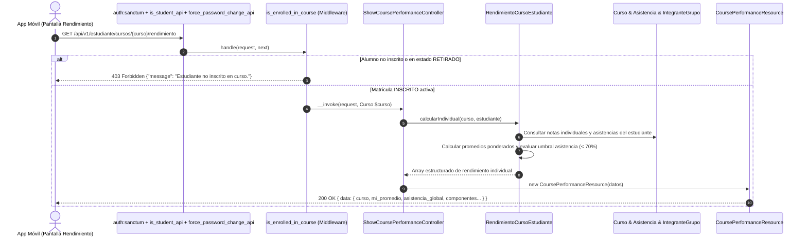

# Plan de Implementación: APP-07 · Monitoreo de Rendimiento Académico Individual y Asistencia por Curso

**Tarjeta Trello:** [APP-07 · [5 pts] Monitoreo de Rendimiento Académico Individual y Asistencia por Curso](https://trello.com/c/miLUPKaf/146-app-07-5-pts-monitoreo-de-rendimiento-acad%C3%A9mico-individual-y-asistencia-por-curso)  
**Estimación:** 5 puntos Fibonacci  
**Release:** R2 (Cursos, Rendimiento Académico, Syllabus y Calendario)  
**Rama Git:** `app-movil` (o sugerida `feature/app-api-cursos-rendimiento-syllabus`)  
**Documento Backlog:** `docs/backlogs/2026-10-29_modulo_api_estudiante_app_movil.md`  
**Estado del plan:** En revisión / Solicitud de Feedback (2026-11-03)

---

## 1. Descripción del Objetivo

Implementar el endpoint `GET /api/v1/estudiante/cursos/{curso}/rendimiento`, que entrega el resumen completo de notas parciales, ponderaciones por componente, promedio individual y asistencia acumulada del estudiante autenticado en un curso específico, optimizado para la aplicación móvil.

Por definición de negocio, directrices de arquitectura y resguardo de privacidad:
- **Enfoque Estrictamente Individual**: Se omite de forma categórica la métrica `promedio_curso` y cualquier dato estadístico agregado o comparativo de otros alumnos. La aplicación móvil se enfoca exclusivamente en el avance y desempeño del estudiante solicitante.
- **Protección Anti-IDOR y Middleware de Curso**: Valida que el estudiante autenticado cuente con matrícula activa (`INSCRITO`) en el curso solicitado. Además de la validación interna en el servicio de dominio, la ruta se protege a nivel de middleware con `is_enrolled_in_course` (`App\Api\V1\Middleware\IsEnrolledInCourse`). Si el alumno no pertenece al curso o su estado es distinto a `INSCRITO` (ej. `RETIRADO`, `ELIMINADO`), el endpoint aborta inmediatamente con `403 Forbidden` (`{"message": "Estudiante no inscrito en curso."}`).
- **Desglose de Notas Ponderadas y Actividades Sumativas**: Para cada componente docente (Cátedra, Taller, Laboratorio), se calculan las notas individuales (con décimas si existen, o grupales), las actividades evaluadas, el porcentaje de peso curricular evaluado a la fecha y el promedio ponderado del componente.
- **Monitoreo de Asistencia y Alerta Temprana (< 70%)**: Calcula la asistencia registrada en `curso.asistencia` tanto a nivel de componente como acumulada global del curso, emitiendo una bandera booleana de alerta (`alerta_asistencia = true`) si el porcentaje se encuentra por debajo del 70% reglamentario (`ASISTENCIA_MINIMA = 70`).
- **Arquitectura Single-Action Controller**: Se organiza dentro del subdirectorio de dominio `Course` (`app/Api/V1/Controllers/Student/Course/ShowCoursePerformanceController.php`), con método `__invoke` exclusivo y ruta desacoplada en `routes/api.php`.

### Criterios de Aceptación (DoD)
- [ ] Retorna `mi_promedio` individual y notas ponderadas por componente del alumno.
- [ ] Retorna porcentaje de asistencia acumulada en `curso.asistencia` y alerta si está bajo el 70%.
- [ ] No incluye `promedio_curso` ni datos estadísticos agregados de otros estudiantes.
- [ ] Deniega con `403 Forbidden` si el estudiante no tiene matrícula activa (`INSCRITO`) en el curso solicitado.
- [ ] Expone listado de actividades sumativas con su ponderación, nota y estado de evaluación.

---

## 2. Decisiones de Diseño y Arquitectura

> [!IMPORTANT]
> **Single-Action Controller en el Dominio `Course`**:
> En conformidad con las directrices de `AGENTS.md` y la organización por dominios, el controlador se ubicará en `App\Api\V1\Controllers\Student\Course\ShowCoursePerformanceController`, implementando únicamente el método mágico `__invoke`. La ruta en `routes/api.php` se declara limpiamente sin sintaxis de arreglo: `Route::get('cursos/{curso}/rendimiento', ShowCoursePerformanceController::class)`.

> [!IMPORTANT]
> **Protección en Capas con `is_enrolled_in_course`**:
> Se integra el middleware de ruta `is_enrolled_in_course` (`App\Api\V1\Middleware\IsEnrolledInCourse`), asegurando una barrera perimetral anti-IDOR que intercepta la petición antes de invocar la lógica de negocio, validando que el usuario autenticado sea estudiante y mantenga su matrícula en estado `INSCRITO`.

> [!IMPORTANT]
> **Privacidad y Exclusión de `promedio_curso` (DoD #3)**:
> A diferencia de la vista web monolítica (`Inertia::render`), el método de cálculo individual para la API móvil solo consulta registros pertenecientes al `id_estudiante` autenticado. No se calculan promedios de cohorte ni se serializa `promedio_curso` en ningún nivel del payload JSON, optimizando drásticamente las consultas en base de datos y previniendo filtración de datos de terceros.

> [!NOTE]
> **Estructura Estandarizada del Payload JSON**:
> ```json
> {
>   "data": {
>     "curso": {
>       "id_curso": 101,
>       "nombre": "Medicina Interna I",
>       "cod_curso": "MED-101-1",
>       "asignatura_nombre": "Medicina Interna I"
>     },
>     "mi_promedio": 5.4,
>     "asistencia_minima": 70,
>     "asistencia_global": {
>       "presentes": 14,
>       "total": 18,
>       "porcentaje": 78,
>       "alerta_asistencia": false
>     },
>     "totales": {
>       "actividades_sumativas": 4,
>       "actividades_evaluadas": 2,
>       "ponderacion_evaluada": 50
>     },
>     "componentes": [
>       {
>         "id_componente": 1,
>         "tipo": "Cátedra",
>         "mi_promedio": 5.6,
>         "actividades_sumativas": 3,
>         "actividades_evaluadas": 2,
>         "ponderacion_evaluada": 50,
>         "syllabus": {
>           "porcentaje": 60.0,
>           "aprobacion_obligatoria": false
>         },
>         "exigencia": 60.0,
>         "asistencia": {
>           "presentes": 10,
>           "total": 12,
>           "porcentaje": 83,
>           "minimo_exigido": 70,
>           "alerta_asistencia": false
>         },
>         "actividades": [
>           {
>             "id_actividad": 15,
>             "nombre": "Prueba Parcial 1",
>             "ponderacion": 25.0,
>             "nota": 5.8,
>             "es_evaluada": true,
>             "fecha_limite": "2026-09-15"
>           },
>           {
>             "id_actividad": 16,
>             "nombre": "Prueba Parcial 2",
>             "ponderacion": 25.0,
>             "nota": 5.4,
>             "es_evaluada": true,
>             "fecha_limite": "2026-10-20"
>           },
>           {
>             "id_actividad": 17,
>             "nombre": "Examen Final",
>             "ponderacion": 50.0,
>             "nota": null,
>             "es_evaluada": false,
>             "fecha_limite": "2026-12-10"
>           }
>         ]
>       }
>     ]
>   }
> }
> ```

---

## 3. Diagrama de Secuencia y Flujo de Datos



---

## 4. Cambios Propuestos y Especificaciones de Código

### Componente 1: Middleware Perimetral de Matrícula (`app/Api/V1/Middleware/IsEnrolledInCourse.php`)
#### [DONE] `app/Api/V1/Middleware/IsEnrolledInCourse.php`
- Implementa validación perimetral de matrícula activa (`INSCRITO`).
- Resuelve `$request->route('curso')` tanto si es instancia `Curso` como si es ID numérico.
- Retorna `403 Forbidden` con mensaje `'Estudiante no inscrito en curso.'` si el usuario no tiene matrícula activa.
- Registrado en `bootstrap/app.php` bajo el alias `'is_enrolled_in_course'`.
- Validado mediante suite Pest `tests/Feature/Api/V1/Middleware/IsEnrolledInCourseTest.php`.

---

### Componente 2: Servicio de Dominio (`app/Services/Student/RendimientoCursoEstudiante.php`)
#### [MODIFY] `app/Services/Student/RendimientoCursoEstudiante.php`
- Se preserva el método existente `calcular()` para garantizar total retrocompatibilidad con las vistas web monolíticas Inertia (`CourseController.php`).
- Se añade el método `calcularIndividual(Curso $curso, Estudiante $estudiante, ?array $componentesSyllabus = null): array`:
  1. Ejecuta validación anti-IDOR con `abort(403, 'No estás inscrito en este curso.')` si el estudiante no cuenta con inscripción activa `INSCRITO`.
  2. Resuelve los componentes docentes del estudiante (con fallback resiliente a todos los componentes del curso si no hay filas en `curso.inscripcion_componente`).
  3. Resuelve automáticamente las ponderaciones del syllabus vía `StudentSyllabusPresenter` si no se pasaron explícitamente.
  4. Realiza consulta de notas filtrando **exclusivamente** por `integrante_grupo.id_estudiante = $estudiante->id_estudiante`, sin cargar notas de otros alumnos.
  5. Construye el array de actividades sumativas con `id_actividad`, `nombre`, `ponderacion`, `nota`, `es_evaluada` y `fecha_limite`.
  6. Calcula la asistencia del componente y emite `alerta_asistencia = ($porcentaje !== null && $porcentaje < self::ASISTENCIA_MINIMA)`.
  7. Calcula la asistencia global acumulada y `mi_promedio` general del curso ponderado por componentes.
  8. Omite por completo cualquier referencia a `promedio_curso`.

```php
    /**
     * Calcula el resumen de rendimiento individual y asistencia del alumno para la API móvil.
     *
     * @param  array<int, array{componente: string, porcentaje: int|float|string, aprobacion_obligatoria?: bool}>|null  $componentesSyllabus
     */
    public function calcularIndividual(Curso $curso, Estudiante $estudiante, ?array $componentesSyllabus = null): array
    {
        $this->asegurarInscripcionActiva($curso, $estudiante);

        // Si no se pasaron las ponderaciones del syllabus, obtenerlas vía presenter
        if ($componentesSyllabus === null) {
            $syllabus = StudentSyllabusPresenter::build($curso, $estudiante);
            $componentesSyllabus = $syllabus['datos']['componentes'] ?? [];
        }

        $componentes = Componente::where('id_curso', $curso->id_curso)
            ->whereHas('inscripcionComponentes', fn ($q) => $q->where('id_estudiante', $estudiante->id_estudiante))
            ->with('tipoComponente')
            ->get();

        // Fallback resiliente: si no tiene inscripción por componente, evaluar componentes del curso
        if ($componentes->isEmpty()) {
            $componentes = Componente::where('id_curso', $curso->id_curso)
                ->with('tipoComponente')
                ->get();
        }

        $componentes = TipoComponente::ordenarCTL($componentes);

        $syllabusPorTipo = collect($componentesSyllabus)
            ->keyBy(fn ($c) => mb_strtoupper(trim((string) ($c['componente'] ?? ''))));

        $totalPresentes = 0;
        $totalClases = 0;
        $totalActividadesSumativas = 0;
        $totalActividadesEvaluadas = 0;

        $filas = $componentes->map(function (Componente $componente) use (
            $estudiante,
            $syllabusPorTipo,
            &$totalPresentes,
            &$totalClases,
            &$totalActividadesSumativas,
            &$totalActividadesEvaluadas
        ) {
            $tipo = $componente->tipoComponente?->tipo ?? 'Componente';
            $syllabus = $syllabusPorTipo->get(mb_strtoupper(trim($tipo)));

            $sumativas = Actividad::where('id_componente', $componente->id_componente)
                ->where('visible', true)
                ->where('tipo_actividad', TipoActividad::SUMATIVA->value)
                ->orderBy('fecha_limite', 'asc')
                ->get(['id_actividad', 'nombre', 'ponderacion', 'fecha_limite']);

            $notas = $this->notasIndividualesEstudiante($estudiante->id_estudiante, $sumativas->pluck('id_actividad'));
            $ponderaciones = $sumativas->pluck('ponderacion', 'id_actividad')->map(fn ($p) => (float) $p);

            $miPromedio = $this->promedioPonderado($notas, $ponderaciones);

            $ponderacionTotal = $ponderaciones->sum();
            $ponderacionEvaluada = $ponderaciones->only($notas->keys()->all())->sum();

            $asistencia = $this->asistencia($componente, $estudiante);
            $totalPresentes += $asistencia['presentes'];
            $totalClases += $asistencia['total'];
            $totalActividadesSumativas += $sumativas->count();
            $totalActividadesEvaluadas += $notas->count();

            $actividades = $sumativas->map(function ($act) use ($notas) {
                $tieneNota = $notas->has($act->id_actividad);
                return [
                    'id_actividad' => (int) $act->id_actividad,
                    'nombre' => $act->nombre,
                    'ponderacion' => $act->ponderacion !== null ? (float) $act->ponderacion : null,
                    'nota' => $tieneNota ? (float) $notas->get($act->id_actividad) : null,
                    'es_evaluada' => $tieneNota,
                    'fecha_limite' => $act->fecha_limite?->format('Y-m-d'),
                ];
            })->values()->all();

            $alertaAsistencia = $asistencia['porcentaje'] !== null && $asistencia['porcentaje'] < self::ASISTENCIA_MINIMA;

            return [
                'id_componente' => (int) $componente->id_componente,
                'tipo' => $tipo,
                'mi_promedio' => $miPromedio,
                'actividades_sumativas' => $sumativas->count(),
                'actividades_evaluadas' => $notas->count(),
                'ponderacion_evaluada' => $ponderacionTotal > 0 ? round($ponderacionEvaluada / $ponderacionTotal * 100) : null,
                'syllabus' => [
                    'porcentaje' => isset($syllabus['porcentaje']) ? (float) $syllabus['porcentaje'] : null,
                    'aprobacion_obligatoria' => (bool) ($syllabus['aprobacion_obligatoria'] ?? false),
                ],
                'exigencia' => $componente->porcentaje_aprobacion !== null ? (float) $componente->porcentaje_aprobacion : null,
                'asistencia' => array_merge($asistencia, [
                    'minimo_exigido' => self::ASISTENCIA_MINIMA,
                    'alerta_asistencia' => $alertaAsistencia,
                ]),
                'actividades' => $actividades,
            ];
        })->values();

        $pctGlobal = $totalClases > 0 ? (int) round($totalPresentes / $totalClases * 100) : null;
        $asignatura = $curso->asignacionPlan?->asignatura;

        return [
            'curso' => [
                'id_curso' => (int) $curso->id_curso,
                'nombre' => $curso->nombre,
                'cod_curso' => $curso->cod_curso,
                'asignatura_nombre' => $asignatura?->nombre ?? 'N/A',
            ],
            'mi_promedio' => $this->combinar($filas, 'mi_promedio'),
            'asistencia_minima' => self::ASISTENCIA_MINIMA,
            'asistencia_global' => [
                'presentes' => $totalPresentes,
                'total' => $totalClases,
                'porcentaje' => $pctGlobal,
                'alerta_asistencia' => $pctGlobal !== null && $pctGlobal < self::ASISTENCIA_MINIMA,
            ],
            'totales' => [
                'actividades_sumativas' => $totalActividadesSumativas,
                'actividades_evaluadas' => $totalActividadesEvaluadas,
                'ponderacion_evaluada' => $this->calcularPonderacionEvaluadaTotal($filas),
            ],
            'componentes' => $filas->all(),
        ];
    }
```

---

### Componente 3: Recurso API JSON (`app/Api/V1/Resources/Student/CoursePerformanceResource.php`)
#### [NEW] `app/Api/V1/Resources/Student/CoursePerformanceResource.php`
- Serializa el payload estructurado conteniendo `curso`, `mi_promedio`, `asistencia_minima`, `asistencia_global`, `totales` y `componentes`:
```php
<?php

namespace App\Api\V1\Resources\Student;

use Illuminate\Http\Request;
use Illuminate\Http\Resources\Json\JsonResource;

/**
 * Resumen de rendimiento académico individual y asistencia del curso.
 *
 * @property array $resource
 */
class CoursePerformanceResource extends JsonResource
{
    public function toArray(Request $request): array
    {
        return [
            'curso' => $this->resource['curso'],
            'mi_promedio' => $this->resource['mi_promedio'],
            'asistencia_minima' => $this->resource['asistencia_minima'],
            'asistencia_global' => $this->resource['asistencia_global'],
            'totales' => $this->resource['totales'],
            'componentes' => $this->resource['componentes'],
        ];
    }
}
```

---

### Componente 4: Single-Action Controller (`app/Api/V1/Controllers/Student/Course/ShowCoursePerformanceController.php`)
#### [NEW] `app/Api/V1/Controllers/Student/Course/ShowCoursePerformanceController.php`
- Single-Action Controller invocable (`__invoke`) dentro del subdirectorio de dominio `Course`:
```php
<?php

namespace App\Api\V1\Controllers\Student\Course;

use App\Api\V1\Resources\Student\CoursePerformanceResource;
use App\Models\Curso\Curso;
use App\Models\Usuario\Usuario;
use App\Services\Student\RendimientoCursoEstudiante;
use Illuminate\Http\Request;

/**
 * Endpoint de rendimiento académico individual y asistencia del curso.
 */
class ShowCoursePerformanceController
{
    public function __construct(
        private readonly RendimientoCursoEstudiante $service,
    ) {}

    public function __invoke(Request $request, Curso $curso): CoursePerformanceResource
    {
        /** @var Usuario $user */
        $user = $request->user();
        $estudiante = $user->estudiante;

        $datos = $this->service->calcularIndividual($curso, $estudiante);

        return new CoursePerformanceResource($datos);
    }
}
```

---

### Componente 5: Rutas API (`routes/api.php`)
#### [MODIFY] `routes/api.php`
- Importa `ShowCoursePerformanceController` y registra la ruta con el middleware perimetral `is_enrolled_in_course`:
```php
// Rendimiento académico individual y asistencia acumulada por curso (APP-07)
Route::get('cursos/{curso}/rendimiento', ShowCoursePerformanceController::class)
    ->middleware('is_enrolled_in_course')
    ->name('api.v1.estudiante.cursos.rendimiento');
```

---

### Componente 6: Pruebas Automatizadas Feature (`tests/Feature/Api/V1/Student/CoursePerformanceApiTest.php`)
#### [NEW] `tests/Feature/Api/V1/Student/CoursePerformanceApiTest.php`
- Cobertura integral con Pest PHP:
  1. `401 Unauthorized` si no hay token Bearer válido.
  2. `403 Forbidden` si el usuario no tiene rol o perfil de estudiante.
  3. `404 Not Found` si el curso no existe.
  4. `403 Forbidden` si el estudiante no está inscrito en el curso (Anti-IDOR por middleware `is_enrolled_in_course`).
  5. `403 Forbidden` si la inscripción del estudiante está en estado `RETIRADO`.
  6. `200 OK` con cálculo correcto de `mi_promedio` ponderado normalizado sobre lo evaluado.
  7. `200 OK` retornando `null` en `mi_promedio` cuando no existen actividades evaluadas aún.
  8. Asistencia acumulada calcula correctamente `presentes`, `total` y `porcentaje`.
  9. Flag `alerta_asistencia: true` se activa cuando la asistencia es estrictamente menor al 70%.
  10. Flag `alerta_asistencia: false` cuando la asistencia es igual o superior al 70%.
  11. Verificación estricta de que la respuesta **NO** contiene la clave `promedio_curso` en ningún nivel del JSON.
  12. Verificación de que el detalle de actividades sumativas lista ponderaciones y notas individuales.

---

## 5. Plan de Verificación

### Pruebas Automatizadas
Ejecutar la suite Pest apuntando a la base de datos de pruebas (puerto 15432):
```bash
DB_PORT=15432 ./vendor/bin/pest tests/Feature/Api/V1/Student/CoursePerformanceApiTest.php
```
Adicionalmente, re-ejecutar las pruebas unitarias y de integración existentes para validar cero regresiones:
```bash
DB_PORT=15432 ./vendor/bin/pest tests/Feature/Api/V1/Middleware/IsEnrolledInCourseTest.php tests/Unit/Services/RendimientoPromedioTest.php tests/Feature/Api/V1/Student/CourseDetailApiTest.php tests/Feature/Api/V1/Student/CoursesApiTest.php
```

### Verificación Manual
1. Iniciar sesión con RUT y contraseña vía `POST /api/v1/auth/login`.
2. Realizar petición con Bearer token a `GET /api/v1/estudiante/cursos/{curso}/rendimiento`.
3. Comprobar que el JSON responde con código HTTP 200 y la estructura definida.
4. Probar acceso a un curso en el que el alumno no está matriculado y confirmar que deniega con `403 Forbidden` y mensaje `"Estudiante no inscrito en curso."`.
5. Verificar que el JSON no expone ninguna propiedad `promedio_curso`.
