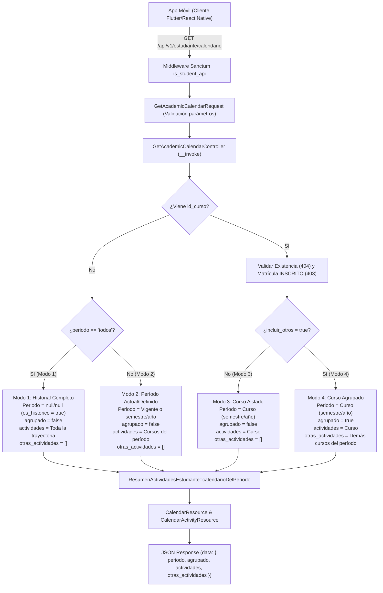

# Plan de Implementación: APP-09 · Calendario Académico Integrado y Flexible de Entregas

**Tarjeta Trello:** [APP-09 · [5 pts] Calendario Académico Integrado y Flexible de Entregas](https://trello.com/c/iMadBSPN/148-app-09-5-pts-calendario-acad%C3%A9mico-integrado-y-flexible-de-entregas)  
**Estimación:** 5 puntos Fibonacci  
**Release:** R2 (Cursos, Rendimiento Académico, Syllabus y Calendario)  
**Rama Git:** `app-movil` (o sugerida `feature/app-api-cursos-rendimiento-syllabus`)  
**Documento Backlog:** `docs/backlogs/2026-10-29_modulo_api_estudiante_app_movil.md`  
**Estado del plan:** En revisión / Solicitud de Aprobación (2026-11-05)

---

## 1. Descripción del Objetivo

Diseñar e implementar el endpoint `GET /api/v1/estudiante/calendario` en el módulo API V1 para la aplicación móvil de UTAMED. Este endpoint permite al estudiante consultar de forma unificada, tipada y cronológica las fechas límite de todas las actividades evaluativas y tareas en las que participa.

La solución aborda cuatro modos de operación esenciales para la experiencia móvil:
1. **Modo 1 (Historial completo sin filtro temporal):** Consulta de toda la trayectoria del estudiante a través de `?periodo=todos`.
2. **Modo 2 (Período académico vigente o específico sin agrupar):** Consulta por defecto del semestre y año actual calculados mediante `DashboardEstudiante::periodoActual()`, o especificados puntualmente con `semestre` y `agno`.
3. **Modo 3 (Curso aislado sin agrupar):** Consulta de las actividades pertenecientes exclusivamente a una asignatura mediante `?id_curso={id}`, validando con guardrail IDOR que el estudiante tenga matrícula activa (`INSCRITO`).
4. **Modo 4 (Curso agrupado con concurrencia de otros cursos):** Consulta comparativa mediante `?id_curso={id}&incluir_otros=true`, que entrega las actividades del curso seleccionado en `actividades` y las de las demás asignaturas del mismo período en `otras_actividades`, permitiendo a la UI móvil advertir sobrecargas o colisiones de fechas.

### Criterios de Aceptación (DoD)
- [x] Implementa Single-Action Controller `GetAcademicCalendarController` en `app/Api/V1/Controllers/Student/Calendar/`.
- [x] Soporta Modo 1: `periodo=todos` devuelve todas las actividades visibles con fecha límite de la trayectoria del estudiante sin filtrar por semestre/año.
- [x] Soporta Modo 2: Sin parámetros de período, consulta y retorna automáticamente las actividades del período vigente (`DashboardEstudiante::periodoActual()`).
- [x] Soporta Modo 3: Con `id_curso`, filtra únicamente las actividades de dicho curso. Valida que el estudiante tenga matrícula activa (`INSCRITO`) mediante guardrail IDOR (403 Forbidden si no está inscrito, 404 si el curso no existe).
- [x] Soporta Modo 4: Con `id_curso` e `incluir_otros=true`, retorna las actividades del curso en `actividades` y las de las demás asignaturas en `otras_actividades`, alineando el período de las demás asignaturas al período del curso seleccionado.
- [x] Serializa fechas estrictamente en formato `'Y-m-d'` para prevenir desajustes horarios entre UTC y huso horario de Chile.
- [x] Filtra exclusivamente actividades visibles (`visible = true`) y con fecha límite definida (`whereNotNull('fecha_limite')`), ordenadas cronológicamente por `fecha_limite` ascendente.
- [x] Respuesta tipada y consistente: el payload siempre contiene `periodo`, `agrupado` (bool), `actividades` (array) y `otras_actividades` (array vacío en modos 1, 2 y 3).

---

## 2. Decisiones de Diseño y Arquitectura



### 2.1. Arquitectura de Controladores Single-Action
En cumplimiento estricto con las directrices de `AGENTS.md`:
- El controlador reside en `App\Api\V1\Controllers\Student\Calendar\GetAcademicCalendarController`.
- Implementa únicamente el método `__invoke(GetAcademicCalendarRequest $request): CalendarResource`.
- En `routes/api.php` se declara de forma desacoplada y limpia:
  ```php
  Route::get('calendario', GetAcademicCalendarController::class)->name('calendario');
  ```

### 2.2. Validación Perimetral y Protección Anti-IDOR
- **Validación Sintáctica**: `GetAcademicCalendarRequest` valida los tipos de `periodo` (`in:todos`), `semestre` (`in:1,2`), `agno` (`min:2000|max:2100`), `id_curso` (`integer`) e `incluir_otros` (`boolean`).
- **Guardrail IDOR Semántico**: Si se envía `id_curso`:
  1. Si `Curso::find($idCurso)` es nulo $\rightarrow$ `abort(404, 'Curso no encontrado.')`.
  2. Si `!IsEnrolledInCourse::estaInscritoEnCurso($user, $curso)` $\rightarrow$ `abort(403, 'No estás inscrito en este curso.')`.
  Esto asegura consistencia con las tarjetas previas (APP-06, APP-07, APP-10, APP-11, APP-12).

### 2.3. Formato y Normalización de Fechas (`Y-m-d`)
Para evitar discrepancias horarias causadas por diferencias entre UTC y huso horario chileno (`America/Santiago`, UTC-3 o UTC-4):
- Las fechas `fecha_limite` y `fecha_entrega` se emiten estrictamente en formato `Y-m-d`.
- `CalendarActivityResource` intercepta cualquier objeto `Carbon` o string y fuerza `Carbon::parse($val)->format('Y-m-d')` (o `null` si `fecha_entrega` está vacía).

### 2.4. Estructura Unificada de Respuesta
El payload siempre cumple con la siguiente estructura simétrica:
```json
{
  "data": {
    "periodo": {
      "semestre": 2,
      "agno": 2026,
      "es_historico": false
    },
    "agrupado": false,
    "actividades": [
      {
        "id_actividad": 101,
        "id_curso": 123,
        "curso": "MED-201",
        "asignatura": "Fisiología Médica",
        "nombre": "Informe de Laboratorio 1",
        "es_sumativa": true,
        "componente_tipo": "Laboratorio",
        "con_entrega": true,
        "es_grupal": true,
        "max_integrantes": 4,
        "fecha_limite": "2026-11-15",
        "visible": true,
        "estado": "ACTIVA",
        "ya_entregada": false,
        "fecha_entrega": null,
        "ya_evaluada": false
      }
    ],
    "otras_actividades": []
  }
}
```

---

## 3. Cambios Propuestos

### Componente: Capa de Servicios (`app/Services/Student/`)

#### [MODIFY] `app/Services/Student/ResumenActividadesEstudiante.php`
- Extender `componentesDelEstudiante` para aceptar parámetro opcional `?int $idCurso = null`.
- Extender `calendarioDelPeriodo` para recibir `?int $idCurso = null`.
- Cuando `$idCurso` está presente, filtra `$queryCursos->where('c.id_curso', $idCurso)`.
- Si `$semestre === null && $agno === null`, no aplica filtros de semestre ni año, obteniendo el historial completo.
- Asegurar ordenamiento consistente: `orderBy('fecha_limite')->orderBy('id_actividad')`.

```php
// Modificación en ResumenActividadesEstudiante.php

public function calendarioDelPeriodo(
    Estudiante $estudiante,
    ?int $semestre = null,
    ?int $agno = null,
    ?int $idCurso = null
): array {
    $componentes = $this->componentesDelEstudiante($estudiante, $semestre, $agno, $idCurso);

    if ($componentes->isEmpty()) {
        return [];
    }

    $actividades = Actividad::whereIn('id_componente', $componentes->keys())
        ->where('visible', true)
        ->whereNotNull('fecha_limite')
        ->with('componente.tipoComponente')
        ->orderBy('fecha_limite')
        ->orderBy('id_actividad')
        ->get();

    return $this->paraAlumno($estudiante, $actividades)
        ->map(function (array $item, int $i) use ($actividades, $componentes) {
            $curso = $componentes->get($actividades[$i]->id_componente);

            return [
                ...$item,
                'id_curso'   => (int) $curso->id_curso,
                'curso'      => $curso->cod_asignatura ?: $curso->cod_curso,
                'asignatura' => $curso->asignatura,
            ];
        })
        ->all();
}

private function componentesDelEstudiante(
    Estudiante $estudiante,
    ?int $semestre = null,
    ?int $agno = null,
    ?int $idCurso = null
): Collection {
    $queryCursos = DB::table('curso.inscripcion_curso as ic')
        ->join('curso.curso as c', 'c.id_curso', '=', 'ic.id_curso')
        ->leftJoin('administrativo.asignacion_plan as ap', 'ap.id_asignacion_plan', '=', 'c.id_asignacion_plan')
        ->leftJoin('administrativo.asignatura as a', 'a.id_asignatura', '=', 'ap.id_asignatura')
        ->where('ic.id_estudiante', $estudiante->id_estudiante)
        ->where('ic.estado_inscripcion', 'INSCRITO');

    if ($idCurso !== null) {
        $queryCursos->where('c.id_curso', $idCurso);
    }
    if ($semestre !== null) {
        $queryCursos->where('c.semestre_real', $semestre);
    }
    if ($agno !== null) {
        $queryCursos->where('c.agno_real', $agno);
    }

    $cursos = $queryCursos->get(['c.id_curso', 'c.cod_curso', 'a.cod_asignatura', 'a.nombre as asignatura'])
        ->keyBy('id_curso');

    if ($cursos->isEmpty()) {
        return collect();
    }

    $componentes = DB::table('curso.componente')
        ->whereIn('id_curso', $cursos->keys())
        ->get(['id_componente', 'id_curso']);

    $inscritos = DB::table('curso.inscripcion_componente')
        ->where('id_estudiante', $estudiante->id_estudiante)
        ->whereIn('id_componente', $componentes->pluck('id_componente'))
        ->pluck('id_componente')
        ->all();

    $cursosConInscripcion = $componentes
        ->whereIn('id_componente', $inscritos)
        ->pluck('id_curso')
        ->unique()
        ->all();

    return $componentes
        ->filter(fn ($c) => in_array($c->id_componente, $inscritos)
            || !in_array($c->id_curso, $cursosConInscripcion))
        ->mapWithKeys(fn ($c) => [(int) $c->id_componente => $cursos->get($c->id_curso)]);
}
```

---

### Componente: Capa de Solicitudes y Recursos API (`app/Api/V1/`)

#### [NEW] `app/Api/V1/Requests/Student/Calendar/GetAcademicCalendarRequest.php`
Validación de los parámetros de consulta admitidos.
```php
<?php

namespace App\Api\V1\Requests\Student\Calendar;

use Illuminate\Foundation\Http\FormRequest;

class GetAcademicCalendarRequest extends FormRequest
{
    public function authorize(): bool
    {
        return true;
    }

    public function rules(): array
    {
        return [
            'periodo' => ['sometimes', 'nullable', 'string', 'in:todos'],
            'semestre' => ['sometimes', 'nullable', 'integer', 'in:1,2'],
            'agno' => ['sometimes', 'nullable', 'integer', 'min:2000', 'max:2100'],
            'id_curso' => ['sometimes', 'nullable', 'integer'],
            'incluir_otros' => ['sometimes', 'nullable', 'boolean'],
        ];
    }
}
```

#### [NEW] `app/Api/V1/Resources/Student/Calendar/CalendarActivityResource.php`
Garantiza el tipado y normalización de fechas de cada ítem de actividad.
```php
<?php

namespace App\Api\V1\Resources\Student\Calendar;

use Carbon\Carbon;
use Illuminate\Http\Request;
use Illuminate\Http\Resources\Json\JsonResource;

class CalendarActivityResource extends JsonResource
{
    public function toArray(Request $request): array
    {
        $fecha = fn ($val) => $val ? Carbon::parse($val)->format('Y-m-d') : null;

        return [
            'id_actividad'    => (int) $this['id_actividad'],
            'id_curso'        => (int) $this['id_curso'],
            'curso'           => (string) $this['curso'],
            'asignatura'      => (string) $this['asignatura'],
            'nombre'          => (string) $this['nombre'],
            'es_sumativa'     => (bool) $this['es_sumativa'],
            'componente_tipo' => $this['componente_tipo'] !== null ? (string) $this['componente_tipo'] : null,
            'con_entrega'     => (bool) $this['con_entrega'],
            'es_grupal'       => (bool) $this['es_grupal'],
            'max_integrantes' => (int) ($this['max_integrantes'] ?? 1),
            'fecha_limite'    => $fecha($this['fecha_limite']),
            'visible'         => (bool) $this['visible'],
            'estado'          => (string) $this['estado'],
            'ya_entregada'    => (bool) $this['ya_entregada'],
            'fecha_entrega'   => $fecha($this['fecha_entrega'] ?? null),
            'ya_evaluada'     => (bool) $this['ya_evaluada'],
        ];
    }
}
```

#### [NEW] `app/Api/V1/Resources/Student/Calendar/CalendarResource.php`
Estructura envolvente del payload del calendario académico.
```php
<?php

namespace App\Api\V1\Resources\Student\Calendar;

use Illuminate\Http\Request;
use Illuminate\Http\Resources\Json\JsonResource;

class CalendarResource extends JsonResource
{
    /**
     * @param  array{semestre: ?int, agno: ?int, es_historico: bool}  $periodo
     * @param  bool  $agrupado
     * @param  array<int, array<string, mixed>>  $actividades
     * @param  array<int, array<string, mixed>>  $otrasActividades
     */
    public function __construct(
        private readonly array $periodo,
        private readonly bool $agrupado,
        private readonly array $actividades,
        private readonly array $otrasActividades = [],
    ) {
        parent::__construct([
            'periodo' => $this->periodo,
            'agrupado' => $this->agrupado,
            'actividades' => $this->actividades,
            'otras_actividades' => $this->otrasActividades,
        ]);
    }

    public function toArray(Request $request): array
    {
        return [
            'periodo' => $this->periodo,
            'agrupado' => $this->agrupado,
            'actividades' => CalendarActivityResource::collection($this->actividades),
            'otras_actividades' => CalendarActivityResource::collection($this->otrasActividades),
        ];
    }
}
```

---

### Componente: Controlador API (`app/Api/V1/Controllers/Student/Calendar/`)

#### [NEW] `app/Api/V1/Controllers/Student/Calendar/GetAcademicCalendarController.php`
Single-Action Controller que orquesta la resolución de los 4 modos.
```php
<?php

namespace App\Api\V1\Controllers\Student\Calendar;

use App\Api\V1\Middleware\IsEnrolledInCourse;
use App\Api\V1\Requests\Student\Calendar\GetAcademicCalendarRequest;
use App\Api\V1\Resources\Student\Calendar\CalendarResource;
use App\Models\Curso\Curso;
use App\Models\Usuario\Usuario;
use App\Services\Student\DashboardEstudiante;
use App\Services\Student\ResumenActividadesEstudiante;

/**
 * Calendario académico de entregas y actividades evaluativas para la app móvil.
 *
 * Soporta 4 modos de consulta:
 * 1. Historial completo (periodo=todos).
 * 2. Período actual o definido sin agrupar.
 * 3. Curso aislado sin agrupar (id_curso).
 * 4. Curso agrupado con actividades concurrentes (id_curso e incluir_otros=true).
 */
class GetAcademicCalendarController
{
    public function __construct(
        private readonly ResumenActividadesEstudiante $resumen,
    ) {}

    public function __invoke(GetAcademicCalendarRequest $request): CalendarResource
    {
        /** @var Usuario $user */
        $user = $request->user();
        $estudiante = $user->estudiante;

        $periodoActual = DashboardEstudiante::periodoActual();

        // Si se provee id_curso, se aplican los guardrails IDOR
        if ($request->filled('id_curso')) {
            $idCurso = $request->integer('id_curso');
            $curso = Curso::find($idCurso);

            if (! $curso) {
                abort(404, 'Curso no encontrado.');
            }

            if (! IsEnrolledInCourse::estaInscritoEnCurso($user, $curso)) {
                abort(403, IsEnrolledInCourse::NO_INSCRITO_MENSAJE);
            }

            $semestre = (int) $curso->semestre_real;
            $agno = (int) $curso->agno_real;
            $esHistorico = ($semestre !== $periodoActual['semestre'] || $agno !== $periodoActual['agno']);

            $periodo = [
                'semestre' => $semestre,
                'agno' => $agno,
                'es_historico' => $esHistorico,
            ];

            // Modo 4: Curso agrupado con concurrencia de otros cursos
            if ($request->boolean('incluir_otros')) {
                $todas = $this->resumen->calendarioDelPeriodo($estudiante, $semestre, $agno);

                $actividades = array_values(array_filter($todas, fn ($a) => (int) $a['id_curso'] === $idCurso));
                $otrasActividades = array_values(array_filter($todas, fn ($a) => (int) $a['id_curso'] !== $idCurso));

                return new CalendarResource(
                    periodo: $periodo,
                    agrupado: true,
                    actividades: $actividades,
                    otrasActividades: $otrasActividades,
                );
            }

            // Modo 3: Curso aislado no agrupado
            $actividades = $this->resumen->calendarioDelPeriodo($estudiante, $semestre, $agno, $idCurso);

            return new CalendarResource(
                periodo: $periodo,
                agrupado: false,
                actividades: $actividades,
                otrasActividades: [],
            );
        }

        // Modo 1: Historial completo no agrupado
        if ($request->query('periodo') === 'todos') {
            $actividades = $this->resumen->calendarioDelPeriodo($estudiante, null, null);

            return new CalendarResource(
                periodo: [
                    'semestre' => null,
                    'agno' => null,
                    'es_historico' => true,
                ],
                agrupado: false,
                actividades: $actividades,
                otrasActividades: [],
            );
        }

        // Modo 2: Período actual o parametrizado no agrupado
        $semestre = $request->filled('semestre')
            ? (int) $request->query('semestre')
            : $periodoActual['semestre'];

        $agno = $request->filled('agno')
            ? (int) $request->query('agno')
            : $periodoActual['agno'];

        $esHistorico = ($semestre !== $periodoActual['semestre'] || $agno !== $periodoActual['agno']);

        $actividades = $this->resumen->calendarioDelPeriodo($estudiante, $semestre, $agno);

        return new CalendarResource(
            periodo: [
                'semestre' => $semestre,
                'agno' => $agno,
                'es_historico' => $esHistorico,
            ],
            agrupado: false,
            actividades: $actividades,
            otrasActividades: [],
        );
    }
}
```

---

### Componente: Enrutamiento (`routes/api.php`)

#### [MODIFY] `routes/api.php`
Registrar la ruta dentro del grupo del estudiante protegido con Sanctum, `is_student_api` y `force_password_change_api`.
```diff
--- a/routes/api.php
+++ b/routes/api.php
@@ -4,6 +4,7 @@
 use App\Api\V1\Controllers\Auth\LoginController;
 use App\Api\V1\Controllers\Auth\LogoutController;
 use App\Api\V1\Controllers\Auth\MeController;
+use App\Api\V1\Controllers\Student\Calendar\GetAcademicCalendarController;
 use App\Api\V1\Controllers\Student\Activity\DownloadActivityStatementController;
 use App\Api\V1\Controllers\Student\Activity\DownloadActivitySubmissionController;
@@ -51,6 +52,7 @@
             // Perfil y dashboard
             Route::get('perfil', GetProfileController::class)->name('perfil');
             Route::get('dashboard', GetDashboardController::class)->name('dashboard');
+            Route::get('calendario', GetAcademicCalendarController::class)->name('calendario');
 
             // Cursos
             Route::prefix('cursos')->name('cursos.')->group(function () {
```

---

### Componente: Pruebas Automatizadas (`tests/Feature/Api/V1/Student/`)

#### [NEW] `tests/Feature/Api/V1/Student/AcademicCalendarApiTest.php`
Cobertura exhaustiva mediante Pest y transacciones de base de datos (`DatabaseTransactions`):
1. **Autenticación y Seguridad**:
   - Deniega con 401 si no hay token Bearer.
   - Deniega con 403 si el usuario autenticado no tiene rol `Estudiante`.
   - Deniega con 403 / redirect si tiene contraseña vencida (`force_password_change_api`).
2. **Modo 1 (Historial Completo `?periodo=todos`)**:
   - Retorna todas las actividades de cursos inscritos sin importar el año o semestre.
   - Valida `periodo: { semestre: null, agno: null, es_historico: true }` y `agrupado: false`.
   - `otras_actividades` es un array vacío `[]`.
3. **Modo 2 (Período Vigente o Específico)**:
   - Sin parámetros, resuelve automáticamente el semestre y año actual (`DashboardEstudiante::periodoActual()`).
   - Con `semestre=1&agno=2025`, filtra solo las actividades de ese período y marca `es_historico = true`.
4. **Modo 3 (Curso Aislado `?id_curso={id}`)**:
   - Retorna exclusivamente las actividades de dicho curso.
   - Retorna 404 si el curso no existe.
   - Retorna 403 (`No estás inscrito en este curso.`) si el estudiante no tiene matrícula `INSCRITO` (ej. ajeno o `RETIRADO`).
5. **Modo 4 (Curso Agrupado `?id_curso={id}&incluir_otros=true`)**:
   - Retorna las actividades del curso en `actividades` y las de los demás cursos inscritos del mismo semestre en `otras_actividades`.
   - Marca `agrupado = true`.
   - Si no hay otros cursos concurrentes, `otras_actividades` es `[]` pero `agrupado` sigue siendo `true`.
6. **Formato e Invariantes**:
   - Verifica que `fecha_limite` y `fecha_entrega` cumplan con la expresión regular `/^\d{4}-\d{2}-\d{2}$/`.
   - Verifica que solo incluya actividades visibles (`visible = true`) y con fecha límite definida (`whereNotNull('fecha_limite')`).
   - Verifica que las listas vengan ordenadas cronológicamente de forma ascendente.

---

## 4. Plan de Verificación

### Pruebas Automatizadas
```bash
# 1. Ejecutar las nuevas pruebas del calendario académico
vendor/bin/pest tests/Feature/Api/V1/Student/AcademicCalendarApiTest.php

# 2. Ejecutar pruebas de regresión del servicio ResumenActividadesEstudiante
vendor/bin/pest tests/Feature/Student/ResumenActividadesEstudianteTest.php

# 3. Ejecutar suite completa de endpoints del estudiante en la API móvil
vendor/bin/pest tests/Feature/Api/V1/Student/
```

### Verificación Manual
1. Iniciar sesión vía `POST /api/v1/auth/login` con un estudiante con asignaturas inscritas.
2. Probar **Modo 2**: `GET /api/v1/estudiante/calendario` $\rightarrow$ Verificar que el bloque `periodo` contenga el semestre actual y que `agrupado` sea `false`.
3. Probar **Modo 1**: `GET /api/v1/estudiante/calendario?periodo=todos` $\rightarrow$ Verificar que `periodo.semestre` y `periodo.agno` sean `null`, con `es_historico: true`.
4. Probar **Modo 3**: `GET /api/v1/estudiante/calendario?id_curso={id_propio}` $\rightarrow$ Verificar que solo aparezcan actividades de dicho curso.
5. Probar **IDOR**: `GET /api/v1/estudiante/calendario?id_curso={id_ajeno}` $\rightarrow$ Verificar respuesta 403 con mensaje `"No estás inscrito en este curso."`.
6. Probar **Modo 4**: `GET /api/v1/estudiante/calendario?id_curso={id_propio}&incluir_otros=true` $\rightarrow$ Verificar que `agrupado` sea `true` y que `otras_actividades` contenga entregas de los demás cursos.
