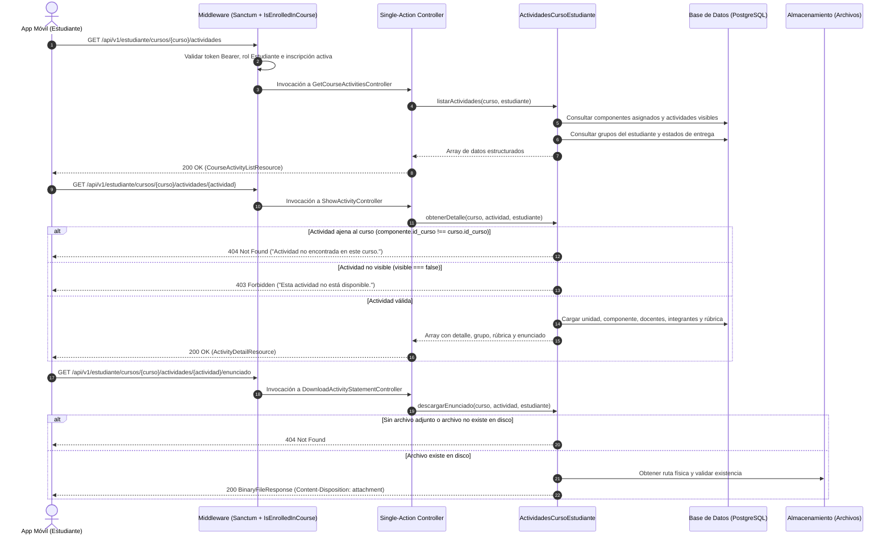

# Plan de Implementación: APP-10 · Consulta de Actividades Evaluativas, Rúbricas y Enunciados

**Tarjeta Trello:** [APP-10 · [5 pts] Consulta de Actividades Evaluativas, Rúbricas y Enunciados](https://trello.com/c/I99dZfI8/149-app-10-5-pts-consulta-de-actividades-evaluativas-r%C3%BAbricas-y-enunciados)  
**Estimación:** 5 puntos Fibonacci  
**Release:** R3 (Actividades, Entregas y Mensajero)  
**Rama Git:** `app-movil` (o sugerida `feature/app-api-actividades-entregas-mensajero`)  
**Documento Backlog:** `docs/backlogs/2026-10-29_modulo_api_estudiante_app_movil.md`  
**Estado del plan:** En revisión / Solicitud de Feedback (2026-11-03)

---

## 1. Descripción del Objetivo

Desarrollar y exponer los endpoints del dominio de **Actividades** para estudiantes en la API móvil (`App\Api\V1\Controllers\Student\Activity`), permitiendo a los alumnos consultar el listado de actividades de un curso, inspeccionar la ficha detallada de una actividad (con pautas, rúbrica asignada, fechas con holgura e integrantes del grupo de trabajo) y descargar de forma segura el archivo de enunciado oficial.

### Contexto y Alcance
En el modelo académico de UTAMED:
- Un curso (`curso.curso`) agrupa componentes pedagógicos (`curso.componente`: Cátedra, Taller, Laboratorio).
- Cada actividad (`agenda.actividad`) pertenece a un componente específico y puede ser sumativa o formativa, individual o grupal, con o sin entrega de archivos requerida.
- La visualización estudiantil debe respetar estrictamente:
  1. Matrícula activa del estudiante (`INSCRITO`).
  2. Componentes asignados al alumno en el curso (`curso.inscripcion_componente`), evitando mostrar actividades de secciones/talleres ajenos.
  3. Visibilidad de la actividad (`visible = true`).
  4. Pertenencia de la actividad al curso solicitado (`componente.id_curso === curso.id_curso`) para blindar contra accesos cruzados IDOR.
  5. Asignación grupal (`agenda.actividad_asignada_grupo` e `integrante_grupo`), resolviendo si la actividad es individual o en equipo, junto al estado de entrega y holguras de tiempo.
  6. Rúbrica oficial vigente (`agenda.rubrica`), serializando criterios, descriptores y puntajes para que el estudiante prepare su entrega conociendo las pautas de evaluación.
  7. Descarga binaria con encabezados de seguridad (`Content-Type`, `Content-Disposition`, `X-Content-Type-Options`) del enunciado (`operaciones.archivo`).

---

## 2. Criterios de Aceptación (DoD)

- [x] **DoD #1: Guardrails Anti-IDOR y Verificación de Matrícula**:
  - Deniega con `401 Unauthorized` si no hay sesión Sanctum activa.
  - Deniega con `403 Forbidden` si el usuario no tiene rol o perfil `Estudiante`.
  - Deniega con `403 Forbidden` (`{"message": "No estás inscrito en este curso."}`) si el estudiante no tiene matrícula activa (`INSCRITO`) en el curso vía middleware `is_enrolled_in_course`.
  - Responde con `404 Not Found` (`{"message": "Actividad no encontrada en este curso."}`) si la actividad solicitada no existe o pertenece a un curso diferente (`componente.id_curso !== curso.id_curso`).
  - Responde con `403 Forbidden` (`{"message": "Esta actividad no está disponible."}`) si la actividad tiene `visible = false`.
- [x] **DoD #2: Listado de Actividades del Curso (`GET .../actividades`)**:
  - Filtra las actividades visibles de los componentes asignados al estudiante (o de los componentes del curso si no hay sub-asignación específica).
  - Retorna información básica: ID, nombre, tipo de actividad (`SUMATIVA` / `FORMATIVA`), tipo de entrega, obligatoriedad de entrega, modalidad (individual o grupal con `max_integrantes`), ponderación, exigencia, fecha límite nominal, estado (`ACTIVA`, `CERRADA`, etc.), tipo de componente (Cátedra, Taller, etc.), flags `tiene_enunciado`, `tiene_rubrica`, y estado del grupo del alumno (`ya_entregada`, `ya_evaluada`, `fecha_entrega`).
  - Ordena cronológicamente por `fecha_limite` ascendente.
- [x] **DoD #3: Detalle de Actividad y Rúbrica Asignada (`GET .../actividades/{actividad}`)**:
  - Retorna datos completos de la actividad: identificación, descripción, unidad curricular, componente y equipo docente.
  - Retorna el grupo asignado al estudiante (`id_actividad_asignada_grupo`, `nombre_grupo`, `estado`), especificando todos los integrantes con `id_estudiante`, `nombre_completo`, `rut`, `email` y flag `es_usuario_actual`.
  - Calcula la fecha límite efectiva considerando tanto la holgura base de la actividad (`nro_dias_adicionales_para_bloqueo`) como la holgura personal del grupo (`nro_dias_adicionales_para_bloqueo_personal`).
  - Retorna la rúbrica vigente asignada a la actividad (`id_rubrica`, `estado_rubrica`, `columnas`, `niveles` con escalas y criterios). Si no existe rúbrica creada, retorna `rubrica: null`.
  - Retorna metadatos del enunciado si existe (`uuid_archivo`, `nombre_original`, `mime_type`, `peso_bytes`, `url_descarga`).
- [x] **DoD #4: Descarga Segura de Enunciado Oficial (`GET .../actividades/{actividad}/enunciado`)**:
  - Verifica guardrails anti-IDOR de curso y actividad.
  - Verifica que la actividad posea archivo de enunciado asociado (`uuid_archivo_enunciado`), respondiendo con `404 Not Found` si no tiene archivo.
  - Verifica existencia física del archivo en el disco configurado (`config('files.storage.disk', 'local_archives')`), respondiendo con `404 Not Found` si no existe en disco.
  - Entrega una respuesta binaria con encabezados apropiados: `Content-Type` correspondiente al mime type, `Content-Disposition: attachment; filename="..."` (o `inline` si se solicita con query `ver=1`), y `X-Content-Type-Options: nosniff`.

---

## 3. Decisiones de Diseño y Arquitectura

> [!IMPORTANT]
> **Arquitectura Single-Action Controllers en el Dominio `Student/Activity`**:
> Conforme a las directrices de `AGENTS.md` (reglas 1, 2 y 3):
> - Todos los controladores del módulo API son de acción única (Single-Action Controllers) implementando únicamente `__invoke`.
> - Se ubican en el subdirectorio de dominio `app/Api/V1/Controllers/Student/Activity/`:
>   1. `GetCourseActivitiesController.php`: para el listado del curso.
>   2. `ShowActivityController.php`: para la ficha detallada, rúbrica y grupo.
>   3. `DownloadActivityStatementController.php`: para la descarga binaria del enunciado.
> - Las rutas en `routes/api.php` se declaran limpiamente sin sintaxis de arreglo, manteniéndose desacopladas de las carpetas internas.

> [!IMPORTANT]
> **Alineación con la Solicitud del Prompt (`App/Api/V1/Students/Activities`)**:
> El usuario solicitó implementar en el módulo `App/Api/V1/Students/Activities`. La estructura oficial del repositorio y el namespace canónico fijado por `composer.json` y `AGENTS.md` es `App\Api\V1\Controllers\Student\Activity` (singular). Para total claridad y consistencia con los controladores existentes (`Course/`, `Profile/`, `Dashboard/`), los controladores se ubicarán en `App\Api\V1\Controllers\Student\Activity` y los recursos en `App\Api\V1\Resources\Student\Activity`, cumpliendo al 100% el requerimiento arquitectónico.

> [!IMPORTANT]
> **Separación de Responsabilidades con Servicio de Dominio**:
> Para mantener los controladores livianos, la lógica de resolución de componentes, consulta de grupos, cálculo de holguras y validaciones de enunciado se encapsula en el servicio `App\Services\Student\ActividadesCursoEstudiante`.

> [!NOTE]
> **Delimitación de Alcance frente a APP-11 y APP-12**:
> - **APP-10 (Esta tarjeta)**: Consulta de catálogo de actividades, detalle con rúbrica asignada/pautas, integrantes de grupo y descarga del enunciado.
> - **APP-11**: Consulta de calificaciones, desglose de rúbrica ya evaluada y descarga de entregas evaluadas (`.../actividades/{actividad}/evaluacion`).
> - **APP-12**: Subida de tareas, mensajes de agenda, cancelación de entregas y lectura de agenda (`.../grupos-asignados/{grupo}/...`).

---

## 4. Especificación de Endpoints y Payloads JSON

### Endpoint 1: Listado de Actividades del Curso
- **Ruta:** `GET /api/v1/estudiante/cursos/{curso}/actividades`
- **Nombre:** `api.v1.estudiante.cursos.actividades.index`
- **Middleware:** `['auth:sanctum', 'is_student_api', 'force_password_change_api', 'is_enrolled_in_course']`
- **Respuesta Exitosa (200 OK):**
```json
{
  "data": {
    "curso": {
      "id_curso": 101,
      "nombre": "Medicina Interna I",
      "cod_curso": "MED-101-1"
    },
    "totales": {
      "total": 5,
      "sumativas": 3,
      "formativas": 2,
      "pendientes_entrega": 2
    },
    "actividades": [
      {
        "id_actividad": 15,
        "nombre": "Caso Clínico 1: Insuficiencia Cardíaca",
        "descripcion": "Análisis de caso práctico grupal.",
        "tipo_actividad": "SUMATIVA",
        "es_sumativa": true,
        "tipo_entrega": "CON_ENTREGA",
        "con_entrega": true,
        "es_grupal": true,
        "max_integrantes": 4,
        "ponderacion": 25.0,
        "exigencia": 60.0,
        "fecha_limite": "2026-11-20",
        "estado": "ACTIVA",
        "componente": {
          "id_componente": 12,
          "tipo": "Cátedra"
        },
        "unidad": {
          "id_unidad": 3,
          "nombre": "Unidad I: Cardiología"
        },
        "tiene_enunciado": true,
        "tiene_rubrica": true,
        "grupo": {
          "id_actividad_asignada_grupo": 88,
          "nombre_grupo": "Grupo A1",
          "estado": "ACTIVA",
          "ya_entregada": false,
          "fecha_entrega": null,
          "ya_evaluada": false
        }
      }
    ]
  }
}
```

### Endpoint 2: Ficha Detallada de Actividad y Rúbrica
- **Ruta:** `GET /api/v1/estudiante/cursos/{curso}/actividades/{actividad}`
- **Nombre:** `api.v1.estudiante.cursos.actividades.show`
- **Middleware:** `['auth:sanctum', 'is_student_api', 'force_password_change_api', 'is_enrolled_in_course']`
- **Respuesta Exitosa (200 OK):**
```json
{
  "data": {
    "actividad": {
      "id_actividad": 15,
      "nombre": "Caso Clínico 1: Insuficiencia Cardíaca",
      "descripcion": "Análisis detallado de anamnesis y tratamiento.",
      "tipo_actividad": "SUMATIVA",
      "es_sumativa": true,
      "tipo_entrega": "CON_ENTREGA",
      "entrega_obligatoria": true,
      "es_grupal": true,
      "max_integrantes": 4,
      "ponderacion": 25.0,
      "exigencia": 60.0,
      "fecha_limite": "2026-11-20",
      "dias_holgura_base": 2,
      "dias_holgura_personal": 1,
      "plazo_final_con_holgura": "2026-11-23",
      "estado": "ACTIVA",
      "componente": {
        "id_componente": 12,
        "tipo": "Cátedra"
      },
      "unidad": {
        "id_unidad": 3,
        "nombre": "Unidad I: Cardiología"
      },
      "equipo_docente": [
        {
          "nombre": "Dr. Carlos Valenzuela",
          "es_titular": true
        }
      ]
    },
    "grupo": {
      "id_actividad_asignada_grupo": 88,
      "nombre_grupo": "Grupo A1",
      "estado": "ACTIVA",
      "es_individual": false,
      "integrantes": [
        {
          "id_estudiante": 45,
          "nombre_completo": "JUAN PÉREZ GONZÁLEZ",
          "rut": "12.345.678-5",
          "email": "juan.perez@alumnos.uta.cl",
          "es_usuario_actual": true
        },
        {
          "id_estudiante": 46,
          "nombre_completo": "MARÍA ROJAS CASTRO",
          "rut": "13.456.789-2",
          "email": "maria.rojas@alumnos.uta.cl",
          "es_usuario_actual": false
        }
      ]
    },
    "rubrica": {
      "id_rubrica": 10,
      "estado_rubrica": "POSTULADA",
      "datos": {
        "columnas": [
          {"id": "col1", "nombre": "Insuficiente", "puntos": 0},
          {"id": "col2", "nombre": "Aceptable", "puntos": 10},
          {"id": "col3", "nombre": "Excelente", "puntos": 20}
        ],
        "niveles": [
          {
            "id": "niv1",
            "nombre": "Diagnóstico Diferencial",
            "descripcion": "Precisión en el descarte de patologías.",
            "ponderacion": 50,
            "escalas": [
              {"id": "esc1", "puntos": 0, "criterio": "No plantea diagnóstico diferencial"},
              {"id": "esc2", "puntos": 10, "criterio": "Plantea diagnóstico incompleto"},
              {"id": "esc3", "puntos": 20, "criterio": "Plantea diagnóstico exhaustivo y justificado"}
            ]
          }
        ]
      }
    },
    "archivo_enunciado": {
      "uuid_archivo": "018f3a5e-b9b2-7000-8000-000000000001",
      "nombre_original": "Pauta_Caso_Clinico_1.pdf",
      "mime_type": "application/pdf",
      "peso_bytes": 245800,
      "url_descarga": "https://utamed.uta.cl/api/v1/estudiante/cursos/101/actividades/15/enunciado"
    }
  }
}
```

### Endpoint 3: Descarga de Enunciado Oficial
- **Ruta:** `GET /api/v1/estudiante/cursos/{curso}/actividades/{actividad}/enunciado`
- **Nombre:** `api.v1.estudiante.cursos.actividades.enunciado`
- **Middleware:** `['auth:sanctum', 'is_student_api', 'force_password_change_api', 'is_enrolled_in_course']`
- **Parámetros Query:** `ver` (booleano opcional, `ver=1` para visualización `inline` si el mime type es soportado en navegadores).
- **Respuesta:** Flujo binario (`BinaryFileResponse`) con encabezados:
  - `Content-Type: application/pdf` (o mime correspondiente)
  - `Content-Disposition: attachment; filename="Pauta_Caso_Clinico_1.pdf"` (o `inline`)
  - `X-Content-Type-Options: nosniff`

---

## 5. Diagramas Mermaid

### Diagrama de Secuencia General


---

## 6. Archivos Propuestos / Modificaciones

### Componente 1: Servicio de Dominio
#### [NEW] `app/Services/Student/ActividadesCursoEstudiante.php`
Encapsula la lógica de:
- Validación anti-IDOR de curso y visibilidad de actividad.
- Filtrado por componentes del estudiante en el curso (`curso.inscripcion_componente`).
- Carga de grupos, integrantes con detalles y cálculo de holgura.
- Carga de rúbrica más reciente de la actividad.
- Verificación física y descarga del enunciado con `BinaryFileResponse`.

### Componente 2: Controladores Single-Action
#### [NEW] `app/Api/V1/Controllers/Student/Activity/GetCourseActivitiesController.php`
- Invokable controller (`__invoke(Request $request, Curso $curso): CourseActivityListResource`).
- Inyecta `ActividadesCursoEstudiante`.

#### [NEW] `app/Api/V1/Controllers/Student/Activity/ShowActivityController.php`
- Invokable controller (`__invoke(Request $request, Curso $curso, Actividad $actividad): ActivityDetailResource`).
- Inyecta `ActividadesCursoEstudiante`.

#### [NEW] `app/Api/V1/Controllers/Student/Activity/DownloadActivityStatementController.php`
- Invokable controller (`__invoke(Request $request, Curso $curso, Actividad $actividad): BinaryFileResponse`).
- Inyecta `ActividadesCursoEstudiante`.

### Componente 3: API Resources
#### [NEW] `app/Api/V1/Resources/Student/Activity/CourseActivityListResource.php`
- Formatea la respuesta del catálogo de actividades del curso con totales y metadatos de grupo.

#### [NEW] `app/Api/V1/Resources/Student/Activity/ActivityDetailResource.php`
- Formatea la respuesta detallada de la actividad, compañeros de equipo, rúbrica asignada y archivo enunciado.

### Componente 4: Rutas de la API
#### [MODIFY] `routes/api.php`
- Importa los 3 nuevos controladores de `App\Api\V1\Controllers\Student\Activity\*`.
- Añade las 3 rutas bajo el grupo protegido de `Route::prefix('estudiante')`, vinculando el middleware `is_enrolled_in_course`:
```php
// Actividades del curso, detalle con rúbrica y descarga de enunciado (APP-10)
Route::get('cursos/{curso}/actividades', GetCourseActivitiesController::class)
    ->middleware('is_enrolled_in_course')
    ->name('api.v1.estudiante.cursos.actividades.index');

Route::get('cursos/{curso}/actividades/{actividad}', ShowActivityController::class)
    ->middleware('is_enrolled_in_course')
    ->name('api.v1.estudiante.cursos.actividades.show');

Route::get('cursos/{curso}/actividades/{actividad}/enunciado', DownloadActivityStatementController::class)
    ->middleware('is_enrolled_in_course')
    ->name('api.v1.estudiante.cursos.actividades.enunciado');
```

### Componente 5: Pruebas Automatizadas
#### [NEW] `tests/Feature/Api/V1/Student/CourseActivitiesApiTest.php`
- Pruebas exhaustivas con Pest y `DatabaseTransactions` cubriendo:
  1. Autenticación y rol estudiante (401 / 403).
  2. Matrícula activa en el curso (403 si no está inscrito o si está `RETIRADO`).
  3. Anti-IDOR: 404 si la actividad pertenece a otro curso.
  4. Visibilidad: 403 si `visible = false`.
  5. Listado de actividades con filtrado por componentes y resolución de estados.
  6. Detalle de actividad con integrantes de grupo, cálculo de holgura base + personal, y serialización de rúbrica.
  7. Descarga de enunciado con encabezados binarios correctos y manejo de errores (404 si no tiene archivo o si falta en disco).

---

## 7. Plan de Verificación

### Pruebas Automatizadas
Ejecutar la suite completa de pruebas Pest con el puerto de base de datos local:
```bash
DB_PORT=15432 php artisan test tests/Feature/Api/V1/Student/CourseActivitiesApiTest.php
```
Adicionalmente, verificar que las pruebas existentes de la API del estudiante sigan pasando sin regresiones:
```bash
DB_PORT=15432 php artisan test tests/Feature/Api/V1/Student/
```

### Verificación Manual
1. **Listado de actividades**:
   - Autenticarse vía `POST /api/v1/auth/login` con credenciales de estudiante.
   - Realizar `GET /api/v1/estudiante/cursos/{curso}/actividades` con Bearer Token.
   - Comprobar que solo se listen actividades visibles pertenecientes a los componentes del alumno.
2. **Ficha y rúbrica**:
   - Realizar `GET /api/v1/estudiante/cursos/{curso}/actividades/{actividad}`.
   - Comprobar que incluya los compañeros de grupo si es grupal, la rúbrica si existe, y las fechas de plazo calculadas con holgura.
   - Intentar acceder a una actividad de otro curso y verificar que retorne `404 Not Found`.
3. **Descarga de enunciado**:
   - Realizar `GET /api/v1/estudiante/cursos/{curso}/actividades/{actividad}/enunciado`.
   - Comprobar que el archivo se descargue íntegramente con `Content-Type` y `Content-Disposition`.
