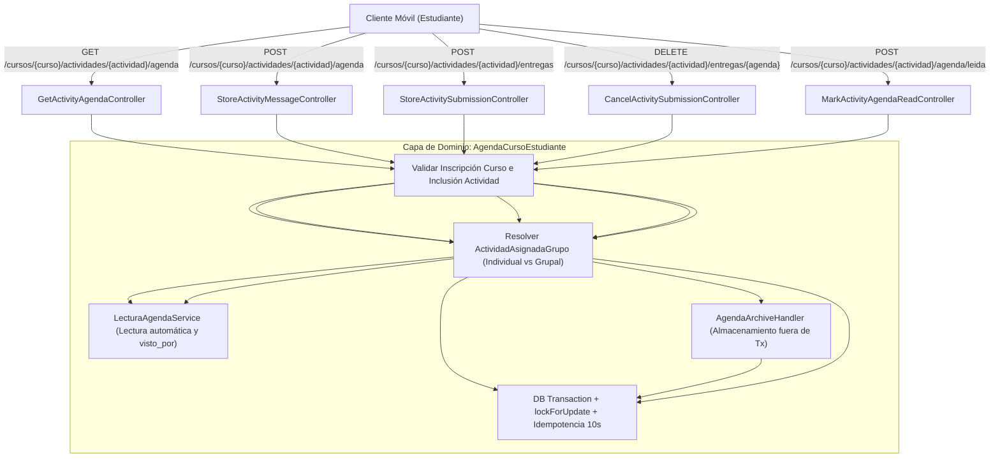

# Plan de Implementación: APP-12 · Gestión de Entregas de Tareas y Mensajes de Agenda por Actividad

**Tarjeta Trello:** [APP-12 · [8 pts] Gestión de Entregas de Tareas y Mensajes de Agenda por Actividad](https://trello.com/c/9yhJWL6D/151-app-12-8-pts-gesti%C3%B3n-de-entregas-de-tareas-y-mensajes-de-agenda-por-actividad)  
**Estimación:** 8 puntos Fibonacci  
**Release:** R3 (Actividades, Entregas y Mensajero)  
**Rama Git:** `app-movil` (o sugerida `feature/app-api-actividades-entregas-mensajero`)  
**Documento Backlog:** `docs/backlogs/2026-10-29_modulo_api_estudiante_app_movil.md`  
**Estado del plan:** Implementado y Verificado (2026-11-05)

---

## 1. Descripción del Objetivo

Desarrollar y exponer los endpoints del dominio de **Agenda de Actividad y Entregas** para estudiantes en la API móvil (`App\Api\V1\Controllers\Student\Agenda`), permitiendo al alumno interactuar en el hilo cronológico de su actividad: consultar mensajes, entregas y eventos con confirmación de lectura integrada; enviar dudas y mensajes al equipo docente sin categorías artificiales; subir archivos de entrega bajo estrictos controles de holgura, concurrencia y validación antivirus/almacenamiento; y cancelar la entrega más reciente no evaluada dentro de los plazos reglamentarios.

### Contexto y Jerarquía de Rutas
A diferencia del backend web monolítico (que expone rutas vinculadas directamente al ID numérico de `ActividadAsignadaGrupo`), en la API móvil el cliente consume recursos desde la perspectiva natural del estudiante autenticado:
```text
/api/v1/estudiante/cursos/{curso}/actividades/{actividad}/agenda
/api/v1/estudiante/cursos/{curso}/actividades/{actividad}/entregas
```
Dado que en UTAMED cada estudiante pertenece **a lo sumo a un grupo por actividad** (sea este un grupo colectivo conformado por el docente o un grupo individual de 1 integrante), la API resuelve internamente el grupo correspondiente al alumno sin exigir que la aplicación móvil conozca, almacene o transmita el identificador interno del grupo (`id_actividad_asignada_grupo`).

---

## 2. Criterios de Aceptación (DoD)

- [x] **DoD #1: Rutas Desacopladas del ID de Grupo**:
  - Los endpoints se organizan bajo el prefijo jerárquico `/api/v1/estudiante/cursos/{curso}/actividades/{actividad}/...`.
  - La API resuelve transparentemente la relación `IntegranteGrupo -> ActividadAsignadaGrupo` para el estudiante autenticado.
  - Para actividades individuales, se garantiza la existencia del grupo unitario invocando `GrupoIndividualService::asegurarGrupo()`.
  - Para actividades grupales donde el docente aún no conforma grupos o no ha incorporado al alumno, se responde de forma estricta con `404 Not Found` o `403 Forbidden` (`{"message": "No tienes un grupo asignado para esta actividad."}`), bloqueando cualquier intento de visualización o envío.
- [x] **DoD #2: Consulta Cronológica de Agenda y Lectura Automática**:
  - `GET .../agenda` devuelve el hilo completo de interacciones en **orden cronológico ascendente (ASC)** (más antiguo al más reciente, estilo chat).
  - Incluye metadatos de emisor (nombre, si es el usuario actual, rol docente/estudiante), marcas temporales legibles, estado de entregas y el bloque de confirmaciones de lectura `visto_por` para cada mensaje.
  - Al consultar el hilo mediante `GET`, la API registra automáticamente la confirmación de lectura en `agenda.lectura_agenda` para todos los mensajes recibidos no leídos (utilizando `LecturaAgendaService`), optimizando la experiencia móvil y evitando roundtrips obligatorios.
- [x] **DoD #3: Envío de Mensajes y Consultas al Docente**:
  - `POST .../agenda` permite al alumno enviar un mensaje o duda sobre la actividad al equipo docente.
  - El payload valida exclusivamente el contenido del mensaje (`mensaje`: string requerido de 2 a 5000 caracteres), registrando directamente en base de datos `tipo_mensaje = 'Mensaje al profesor'` (`TipoMensaje::MENSAJE_AL_PROFESOR`), eliminando selectores de tipo hardcodeados en el frontend web que no tienen correlato en el schema relacional.
  - Retorna `201 Created` con el recurso de la interacción generada.
- [x] **DoD #4: Subida de Entregas con Blindajes de Concurrencia y Holgura**:
  - `POST .../entregas` procesa la carga del archivo mediante `AgendaArchiveHandler::store` **fuera de la transacción de base de datos** para evitar retención prolongada de conexiones PostgreSQL.
  - Valida que la actividad admita entrega (`tipo_entrega !== 'SIN_ENTREGA'`).
  - Deniega con `422 Unprocessable Entity` si la entrega ya fue evaluada (`yaFueEvaluado()`).
  - Deniega con `422 Unprocessable Entity` si la fecha límite con holgura total (base de la actividad + personal del grupo) ha expirado.
  - Aplica `lockForUpdate()` sobre el grupo en una transacción relacional corta para serializar peticiones concurrentes y detectar envíos duplicados idempotentes dentro de una ventana de 10 segundos sin generar filas redundantes.
  - Registra el evento con `tipo_mensaje = 'Entrega de archivo'` y asocia `uuid_archivo_subido`.
- [x] **DoD #5: Cancelación Segura de la Última Entrega**:
  - `DELETE .../entregas/{agenda}` permite revocar una entrega previa.
  - Valida que el ID de agenda corresponda a una `Entrega de archivo` emitida por un integrante del grupo.
  - Restringe la cancelación **exclusivamente a la entrega más reciente no evaluada** del grupo. Si el registro no es el último activo o ya fue evaluado, rechaza con `422 Unprocessable Entity`.
  - Verifica que el plazo límite con holgura no haya expirado.
  - Ejecuta transacción atómica: marca el archivo físico en `operaciones.archivo` como `pendiente_de_borrado = true` y crea una nueva entrada en `agenda.agenda` con `tipo_mensaje = 'Cancelación de entrega'`, preservando la trazabilidad de auditoría.
- [x] **DoD #6: Confirmación Explícita de Lectura**:
  - `POST .../agenda/leida` expone el marcado manual diferido de lectura, registrando en `agenda.lectura_agenda` los mensajes recibidos del grupo que aún figuren pendientes.

---

## 3. Decisiones de Diseño y Arquitectura



### 3.1. Single-Action Controllers en `Student/Agenda`
Siguiendo la regla de oro de arquitectura API de UTAMED, cada operación se aislará en un controlador invokable único dentro del namespace `App\Api\V1\Controllers\Student\Agenda`:
1. `GetActivityAgendaController`: Consulta de hilo cronológico, resumen de entregas, estado y marcado automático de lectura.
2. `StoreActivityMessageController`: Creación de mensaje/consulta docente (`TipoMensaje::MENSAJE_AL_PROFESOR`).
3. `StoreActivitySubmissionController`: Recepción de archivo, validación de tipo/peso, holgura, serialización concurrente y registro de entrega.
4. `CancelActivitySubmissionController`: Cancelación de la última entrega activa con soft-delete de archivo y log de auditoría.
5. `MarkActivityAgendaReadController`: Marcado explícito de mensajes recibidos como leídos.

### 3.2. Desacoplamiento de Rutas y Resolución del Grupo Asignado
1. **Perímetro de Seguridad**:
   - Middleware `auth:sanctum`: Verifica token Bearer stateless.
   - Middleware `is_student_api`: Exige rol institucional de Estudiante.
   - Middleware `force_password_change_api`: Bloquea acceso si la clave está vencida.
   - Middleware `is_enrolled_in_course`: Verifica que el estudiante tenga matrícula activa en el curso.
2. **Validación de Actividad**:
   - Se valida que `actividad.id_componente` pertenezca al curso solicitado y que `visible = true`.
3. **Resolución de Grupo**:
   - Si `actividad.es_grupal === false`: Se delega en `GrupoIndividualService::asegurarGrupo($actividad, $estudiante->id_estudiante)`, garantizando que el grupo unitario exista.
   - Si `actividad.es_grupal === true`: Se consulta la membresía en `IntegranteGrupo`. Si el estudiante no pertenece a ningún grupo, se aborta inmediatamente con `404 Not Found` (`{"message": "No tienes un grupo asignado para esta actividad grupal."}`).

### 3.3. Manejo de Subida de Archivos y Concurrencia
- **Pipeline de Archivos (`AgendaArchiveHandler`)**: La recepción física del archivo, su validación MIME, desinfección y almacenamiento en disco se realiza **antes** de abrir cualquier transacción relacional. Si el procesamiento de archivos falla, no se consume tiempo de conexión en PostgreSQL.
- **Transacción Relacional Rápida (`DB::transaction`)**:
  - Se adquiere bloqueo pesimista `lockForUpdate()` sobre `ActividadAsignadaGrupo`.
  - Se verifica que `$grupo->yaFueEvaluado()` sea `false`.
  - Se calcula el límite real con holgura: `fecha_limite + nro_dias_adicionales_para_bloqueo + nro_dias_adicionales_para_bloqueo_personal`.
  - Se comprueba idempotencia: si el mismo estudiante envió un archivo idéntico o una petición duplicada en una ventana de 10 segundos, se descarta el archivo físico redundante y se retorna éxito sin crear una fila duplicada.

---

## 4. Especificación de Endpoints y Payloads JSON

### Endpoint 1: Consulta de Agenda de la Actividad
* **Ruta:** `GET /api/v1/estudiante/cursos/{curso}/actividades/{actividad}/agenda`
* **Query Params opcionales:** `?marcar_leido=true` (por defecto `true`).
* **Respuesta Exitosa (200 OK):**
```json
{
  "data": {
    "curso": {
      "id_curso": 105,
      "nombre": "Bases de la Medicina Interna",
      "cod_curso": "MED-301"
    },
    "actividad": {
      "id_actividad": 42,
      "nombre": "Caso Clínico: Síndrome Coronario Agudo",
      "tipo_actividad": "Sumativa",
      "tipo_entrega": "ARCHIVO",
      "es_grupal": true,
      "fecha_limite": "2026-11-15T23:59:59Z",
      "plazo_final_con_holgura": "2026-11-17T23:59:59Z",
      "permite_entrega": true,
      "puede_cancelar_entrega": true
    },
    "grupo": {
      "id_actividad_asignada_grupo": 312,
      "nombre_grupo": "Grupo 4 - Rotación A",
      "estado": "PLANIFICADA",
      "evaluado": false,
      "integrantes": [
        {
          "id_estudiante": 84,
          "nombre_completo": "Matías Morales",
          "es_usuario_actual": true
        },
        {
          "id_estudiante": 91,
          "nombre_completo": "Camila Soto",
          "es_usuario_actual": false
        }
      ]
    },
    "resumen_entregas": {
      "total_entregas_realizadas": 1,
      "ultima_entrega_vigente": {
        "id_agenda": 789,
        "fecha_envio": "2026-11-10T14:32:00Z",
        "archivo": {
          "uuid_archivo": "c1f7b8a2-3b4c-4e5f-6a7b-8c9d0e1f2a3b",
          "nombre_original": "informe_caso_clinico_grupo4.pdf",
          "peso_bytes": 2458120,
          "extension": "pdf",
          "url_descarga": "http://localhost:8000/api/v1/estudiante/cursos/105/actividades/42/entregas/789/descargar"
        },
        "puede_cancelar": true
      }
    },
    "interacciones": [
      {
        "id_agenda": 750,
        "tipo_mensaje": "Mensaje al profesor",
        "mensaje": "Profesor, ¿la discusión fisiopatológica requiere incluir electrocardiograma de control?",
        "fecha_envio": "2026-11-08T10:15:00Z",
        "emisor": {
          "id_usuario": 142,
          "nombre": "Matías Morales",
          "es_usuario_actual": true,
          "rol": "estudiante"
        },
        "archivo": null,
        "visto_por": [
          {
            "nombre": "Dr. Fernando Gutiérrez",
            "fecha_lectura": "2026-11-08T11:02:15Z"
          }
        ]
      },
      {
        "id_agenda": 752,
        "tipo_mensaje": "Feedback",
        "mensaje": "Sí, estimad@s, idealmente adjunten el trazado de derivaciones precordiales en el anexo.",
        "fecha_envio": "2026-11-08T11:30:00Z",
        "emisor": {
          "id_usuario": 45,
          "nombre": "Dr. Fernando Gutiérrez",
          "es_usuario_actual": false,
          "rol": "docente"
        },
        "archivo": null,
        "visto_por": [
          {
            "nombre": "Matías Morales",
            "fecha_lectura": "2026-11-08T12:00:00Z"
          }
        ]
      },
      {
        "id_agenda": 789,
        "tipo_mensaje": "Entrega de archivo",
        "mensaje": "Entrega final del informe corregido.",
        "fecha_envio": "2026-11-10T14:32:00Z",
        "emisor": {
          "id_usuario": 142,
          "nombre": "Matías Morales",
          "es_usuario_actual": true,
          "rol": "estudiante"
        },
        "archivo": {
          "uuid_archivo": "c1f7b8a2-3b4c-4e5f-6a7b-8c9d0e1f2a3b",
          "nombre_original": "informe_caso_clinico_grupo4.pdf",
          "peso_bytes": 2458120,
          "extension": "pdf",
          "url_descarga": "http://localhost:8000/api/v1/estudiante/cursos/105/actividades/42/entregas/789/descargar"
        },
        "es_cancelable": true,
        "visto_por": []
      }
    ]
  }
}
```

---

### Endpoint 2: Envío de Mensaje al Docente
* **Ruta:** `POST /api/v1/estudiante/cursos/{curso}/actividades/{actividad}/agenda`
* **Request Body:**
```json
{
  "mensaje": "Estimado docente, quisiéramos confirmar si la entrega puede enviarse en formato Word o solo PDF."
}
```
* **Respuesta Exitosa (201 Created):**
```json
{
  "message": "Mensaje enviado exitosamente.",
  "data": {
    "id_agenda": 810,
    "tipo_mensaje": "Mensaje al profesor",
    "mensaje": "Estimado docente, quisiéramos confirmar si la entrega puede enviarse en formato Word o solo PDF.",
    "fecha_envio": "2026-11-05T12:30:00Z",
    "emisor": {
      "id_usuario": 142,
      "nombre": "Matías Morales",
      "es_usuario_actual": true,
      "rol": "estudiante"
    }
  }
}
```

---

### Endpoint 3: Subida de Entrega de Archivo
* **Ruta:** `POST /api/v1/estudiante/cursos/{curso}/actividades/{actividad}/entregas`
* **Content-Type:** `multipart/form-data`
* **Form Fields:**
  - `archivo`: Archivo binario (PDF, DOCX, ZIP, etc., máx 100MB).
  - `mensaje`: Texto explicativo u observación opcional (máx 1000 caracteres).
* **Respuesta Exitosa (201 Created):**
```json
{
  "message": "Entrega subida exitosamente.",
  "data": {
    "id_agenda": 815,
    "tipo_mensaje": "Entrega de archivo",
    "fecha_envio": "2026-11-05T12:35:00Z",
    "archivo": {
      "uuid_archivo": "d4e5f6a7-b8c9-4012-9345-6789abcdef01",
      "nombre_original": "entrega_grupo4_medicina.pdf",
      "peso_bytes": 1845920,
      "extension": "pdf",
      "url_descarga": "http://localhost:8000/api/v1/estudiante/cursos/105/actividades/42/entregas/815/descargar"
    }
  }
}
```
* **Errores Controlados:**
  - `422 Unprocessable Entity`: `"La entrega ya ha sido evaluada por el docente. No es posible subir ni reemplazar archivos."`
  - `422 Unprocessable Entity`: `"La fecha límite de entrega ha vencido. No se pueden subir nuevos archivos."`
  - `422 Unprocessable Entity`: `"Esta actividad no requiere entrega de archivos."`

---

### Endpoint 4: Cancelación de la Última Entrega
* **Ruta:** `DELETE /api/v1/estudiante/cursos/{curso}/actividades/{actividad}/entregas/{agenda}`
* **Respuesta Exitosa (200 OK):**
```json
{
  "message": "Entrega cancelada exitosamente."
}
```
* **Errores Controlados:**
  - `403 Forbidden`: `"Solo se puede cancelar una entrega de archivo perteneciente a tu grupo."`
  - `422 Unprocessable Entity`: `"Esta entrega ya fue cancelada previamente."`
  - `422 Unprocessable Entity`: `"Solo se puede cancelar la entrega más reciente del grupo."`
  - `422 Unprocessable Entity`: `"La entrega ya ha sido evaluada por el docente. No es posible cancelarla."`
  - `422 Unprocessable Entity`: `"La fecha límite de entrega ha vencido. No se pueden cancelar entregas."`

---

### Endpoint 5: Confirmación Explícita de Lectura
* **Ruta:** `POST /api/v1/estudiante/cursos/{curso}/actividades/{actividad}/agenda/leida`
* **Respuesta Exitosa (200 OK):**
```json
{
  "message": "Agenda marcada como leída.",
  "no_leidos": 0
}
```

---

## 5. Cambios Propuestos en el Código

### 5.1. Controladores Invokables
Crear en `app/Api/V1/Controllers/Student/Agenda/`:
- `GetActivityAgendaController.php`
- `StoreActivityMessageController.php`
- `StoreActivitySubmissionController.php`
- `CancelActivitySubmissionController.php`
- `MarkActivityAgendaReadController.php`

### 5.2. Servicio de Dominio
Crear `app/Services/Student/AgendaCursoEstudiante.php`:
- `validarPertenenciaYGrupo(Curso $curso, Actividad $actividad, Estudiante $estudiante): ActividadAsignadaGrupo`: Valida curso, actividad y resuelve el grupo individual o grupal.
- `obtenerAgenda(Curso $curso, Actividad $actividad, Estudiante $estudiante, bool $marcarLeido = true): array`: Obtiene metadatos, interacciones cronológicas enriquecidas con `LecturaAgendaService`, recibos `visto_por`, y resumen de entrega cancelable.
- `enviarMensaje(ActividadAsignadaGrupo $grupo, Usuario $usuario, string $mensaje): Agenda`: Registra mensaje `MENSAJE_AL_PROFESOR`.
- `subirEntrega(ActividadAsignadaGrupo $grupo, Usuario $usuario, UploadedFile $archivo, ?string $mensaje): Agenda`: Pipeline de validación de plazos, almacenamiento con `AgendaArchiveHandler` fuera de Tx, bloqueo pesimista y guardado idempotente.
- `cancelarEntrega(ActividadAsignadaGrupo $grupo, Agenda $agenda, Usuario $usuario): void`: Validación de última entrega activa, no evaluada y con plazo vigente, y transacción con soft-delete de archivo y log de auditoría.
- `marcarLectura(ActividadAsignadaGrupo $grupo, int $idUsuario): void`: Ejecuta registro masivo de lectura para mensajes pendientes.

### 5.3. FormRequests y Resources
- `app/Api/V1/Requests/Student/Agenda/StoreActivityMessageRequest.php`: Valida `mensaje: required|string|min:2|max:5000`.
- `app/Api/V1/Requests/Student/Agenda/StoreActivitySubmissionRequest.php`: Extiende `AgendaFileRequest` para procesar uploads en contexto de API móvil.
- `app/Api/V1/Resources/Student/Agenda/ActivityAgendaResource.php`: Serializa el payload de la agenda, grupo e interacciones.
- `app/Api/V1/Resources/Student/Agenda/AgendaMessageResource.php`: Serializa cada mensaje individual.

### 5.4. Registro de Rutas en `routes/api.php`
Dentro del grupo protegido `prefix('estudiante')`:
```php
// Agenda de actividad, interacciones y entregas de tareas (APP-12)
Route::prefix('cursos/{curso}/actividades/{actividad}')->middleware('is_enrolled_in_course')->group(function () {
    Route::get('agenda', GetActivityAgendaController::class)->name('api.v1.estudiante.cursos.actividades.agenda.show');
    Route::post('agenda', StoreActivityMessageController::class)->name('api.v1.estudiante.cursos.actividades.agenda.store');
    Route::post('agenda/leida', MarkActivityAgendaReadController::class)->name('api.v1.estudiante.cursos.actividades.agenda.leida');
    Route::post('entregas', StoreActivitySubmissionController::class)->name('api.v1.estudiante.cursos.actividades.entregas.store');
    Route::delete('entregas/{agenda}', CancelActivitySubmissionController::class)->name('api.v1.estudiante.cursos.actividades.entregas.cancel');
});
```

---

## 6. Plan de Verificación

Se diseñará una suite de pruebas automatizadas con Pest PHP en `tests/Feature/Api/Student/Agenda/ActivityAgendaTest.php`:
1. **Acceso y Perímetro**:
   - Deniega sin token Bearer (`401`).
   - Deniega si el usuario no es estudiante (`403`).
   - Deniega si el alumno no está matriculado en el curso (`403`).
   - Deniega si la actividad no pertenece al curso (`404`) o si está oculta (`403`).
   - Deniega si la actividad es grupal y el alumno no tiene grupo (`404` / `403`).
2. **Consulta y Lectura Automática (`GET .../agenda`)**:
   - Garantiza grupo individual automáticamente para actividades individuales.
   - Lista mensajes cronológicamente ordenados (ASC).
   - Verifica que los mensajes recibidos no leídos queden registrados en `agenda.lectura_agenda`.
   - Verifica que `visto_por` identifique a los lectores correctos sin incluir al usuario emisor.
3. **Envío de Mensajes (`POST .../agenda`)**:
   - Valida longitud mínima y máxima del mensaje.
   - Registra correctamente `tipo_mensaje = 'Mensaje al profesor'`.
4. **Subida de Entregas (`POST .../entregas`)**:
   - Rechaza subida si `tipo_entrega === 'SIN_ENTREGA'`.
   - Rechaza si la fecha límite con holguras base y personal venció.
   - Rechaza si el grupo ya fue calificado (`yaFueEvaluado()`).
   - Sube archivo exitosamente y crea registro `Entrega de archivo`.
   - Prueba de idempotencia: reintentos en ventana corta no generan entregas duplicadas.
5. **Cancelación de Entrega (`DELETE .../entregas/{agenda}`)**:
   - Rechaza cancelar una entrega de otro grupo (`403`).
   - Rechaza cancelar si ya fue evaluada o si el plazo expiró (`422`).
   - Rechaza cancelar una entrega previa que ya fue superada por una nueva entrega (`422`).
   - Cancela exitosamente la última entrega: verifica que el archivo quede marcado `pendiente_de_borrado = true` y se inserte el registro `Cancelación de entrega`.
6. **Marcado Explícito de Lectura (`POST .../agenda/leida`)**:
   - Confirma lectura de mensajes pendientes y responde `200 OK`.

---

## 7. Decisiones de Negocio y Arquitectura Cerradas

1. **Rutas REST Pluralizadas**: Se adopta `/api/v1/estudiante/cursos/{curso}/actividades/{actividad}/agenda` manteniendo estricta homogeneidad con APP-05, APP-06, APP-07, APP-10 y APP-11.
2. **Desacoplamiento Absoluto de Grupos**: El cliente móvil nunca manipula `id_actividad_asignada_grupo`; la API resuelve el grupo del alumno en base al token de autenticación.
3. **Actividades Grupales Sin Grupo**: Si un alumno no ha sido asignado por el docente, la API responde `404 Not Found` impidiendo visualizaciones o entregas anómalas.
4. **Simplificación del Payload de Mensajes**: Se suprime la taxonomía arbitraria de la web (`Consulta`, `Duda sobre Rúbrica`, `Otro`) para ajustarse al schema de PostgreSQL (`TipoMensaje::MENSAJE_AL_PROFESOR`).
5. **Lectura Inteligente y Marcado Diferido**: `GET` registra lectura de forma automática para evitar roundtrips móviles adicionales, manteniendo disponible `POST .../agenda/leida` para flujos que requieran marcado explícito.
6. **Descarga de Entregas**: Se reutiliza el endpoint ya implementado y protegido en APP-11: `GET .../actividades/{actividad}/entregas/{agenda}/descargar`.
