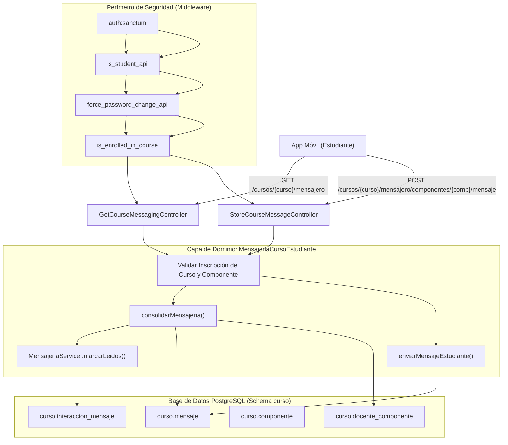

# Plan de Implementación: APP-13 · Mensajero: Canales y Avisos por Componente de Curso

**Tarjeta Trello:** [APP-13 · [5 pts] Mensajero: Canales y Avisos por Componente de Curso](https://trello.com/c/V9pfvds5)  
**Estimación:** 5 puntos Fibonacci  
**Release:** R3 (Actividades, Entregas y Mensajero)  
**Rama sugerida:** `feature/app-api-actividades-entregas-mensajero` (o rama activa de trabajo)  
**Documento Backlog:** `docs/backlogs/2026-10-29_modulo_api_estudiante_app_movil.md`  
**Estado del plan:** Propuesto para revisión y aprobación (2026-11-05)

---

## 1. Descripción del Objetivo

Diseñar, implementar y verificar los endpoints del módulo de **Mensajero del Curso** para la aplicación móvil de UTAMED (`App\Api\V1\Controllers\Student\Messaging`), permitiendo a los estudiantes consultar en un único recurso estructurado los canales de comunicación oficial de cada componente (Cátedra, Taller, Laboratorio) en el que se encuentren inscritos, visualizar avisos de difusión, consultar el historial privado de mensajes con el equipo docente, consultar los docentes disponibles por componente, marcar lecturas automáticamente y enviar nuevos mensajes/consultas al equipo docente con asignación automática o selección explícita del docente destinatario.

### Contexto y Jerarquía de Rutas
A diferencia de la plataforma web monolítica (que carga la vista de mensajería como una pestaña diferida de la ficha del curso y resuelve paneles bajo demanda por cada componente individual), la aplicación móvil requiere optimizar la experiencia de usuario y el consumo de red mediante un **endpoint único GET consolidado**:
```text
GET  /api/v1/estudiante/cursos/{curso}/mensajero
POST /api/v1/estudiante/cursos/{curso}/mensajero/componentes/{componente}/mensaje
```
Esto permite al cliente móvil:
1. Obtener de un solo viaje HTTP todos los componentes asignados al estudiante en el curso, con sus respectivos docentes, conteos de no leídos, avisos generales (`difusiones`) y conversación privada (`mensajes`).
2. Alternar instantáneamente entre pestañas de componentes (por ejemplo, "Cátedra", "Laboratorio", "Taller") en la interfaz móvil mediante filtrado puramente local en memoria, sin latencia ni peticiones HTTP secundarias.
3. Marcar de forma automática y transparente la lectura de mensajes no leídos al abrir la vista de mensajería del curso.

---

## 2. Criterios de Aceptación (DoD)

- [x] **DoD #1: Validación de Inscripción Activa**:
  - Aplica middleware `is_enrolled_in_course` para asegurar que el estudiante autenticado tenga matrícula activa (`INSCRITO`) en el curso.
  - En la consulta `GET`, filtra y consolida únicamente aquellos componentes (`curso.componente`) donde el estudiante esté efectivamente inscrito (`curso.inscripcion_componente`).
  - En el envío `POST`, valida de forma estricta que el `{componente}` pertenezca al curso y que el estudiante esté formalmente inscrito en dicho componente. En caso contrario, rechaza con `403 Forbidden` (`{"message": "No estás inscrito en este componente."}`).

- [x] **DoD #2: Endpoint Único Consolidado GET Serializado**:
  - Expone `GET /api/v1/estudiante/cursos/{curso}/mensajero` serializado mediante `CourseMessagingResource`.
  - La respuesta agrupa la información del curso (`id_curso`, `nombre`, `cod_curso`, `cod_asignatura`) y la colección de `componentes` inscritos.
  - Cada componente contiene: metadatos (`id_componente`, `tipo`), contador de no leídos (`no_leidos`), listado de docentes (`docentes`), avisos de difusión (`difusiones`) e historial de conversación privada del estudiante con el equipo docente (`mensajes`).

- [x] **DoD #3: Estructura Completa de Difusiones y Mensajes Privados**:
  - `difusiones`: Avisos generales dirigidos a todo el componente (`tipo_mensaje = MENSAJE_PARA_TODO_EL_CURSO`), ordenados cronológicamente (ASC), con `id_mensaje`, `tema`, `mensaje`, `fecha_creacion`, `emisor` y bandera booleana `es_mio`.
  - `mensajes`: Hilo bidireccional privado del alumno con el equipo docente del componente (`tipo_mensaje = MENSAJE_INDIVIDUAL`), ordenados cronológicamente (ASC), con `id_mensaje`, `tema`, `mensaje`, `fecha_creacion`, `emisor`, `receptor`, `es_alumno` y `es_mio`.
  - `docentes`: Lista del equipo docente del componente (`id_usuario`, `nombre`, `es_titular`), permitiendo a la app móvil renderizar un selector de destinatarios.

- [x] **DoD #4: Marcado Automático de Lectura**:
  - Al consultar el endpoint `GET`, la API registra automáticamente acuse de lectura en `curso.interaccion_mensaje` para todos los mensajes y difusiones no leídos pertenecientes a los componentes del curso del estudiante.
  - Soporta el query parameter `?marcar_leido=false` para previsualizaciones, conteos o sincronizaciones en segundo plano sin alterar los badges.

- [x] **DoD #5: Envío de Mensajes al Equipo Docente (POST)**:
  - `POST /api/v1/estudiante/cursos/{curso}/mensajero/componentes/{componente}/mensaje` validado mediante `StoreCourseMessageRequest`.
  - Payload valida: `mensaje` (requerido, string entre 2 y 2000 caracteres), `tema` (opcional, string max 150 caracteres), `id_usuario_receptor` (opcional, integer).
  - Si el componente no tiene docentes asignados, responde con `422 Unprocessable Entity` (`{"message": "Este componente todavía no tiene docentes asignados."}`).
  - Asigna automáticamente el destinatario: el docente elegido si pertenece al equipo del componente; si no se especifica o no pertenece, asigna al docente titular; si no hay titular asignado, asigna al primer docente del componente.
  - Si no se especifica `tema`, resuelve automáticamente el asunto heredando el tema inicial de la conversación del canal, o defaulting a `"Consulta"`.
  - Retorna `201 Created` con el recurso del mensaje creado (`CourseMessageResource`) y confirmación de envío.

---

## 3. Decisiones de Diseño y Arquitectura



### 3.1. Single-Action Controllers en `Student/Messaging`
En cumplimiento estricto con las directrices arquitectónicas de UTAMED (`AGENTS.md`):
- Los controladores se ubican en el subdirectorio de dominio `app/Api/V1/Controllers/Student/Messaging/`.
- Cada controlador implementa únicamente el método `__invoke`.
- Las rutas en `routes/api.php` se declaran directamente con la clase del controlador (`GetCourseMessagingController::class`), desacopladas de las estructuras de directorios.

### 3.2. Delegación a la Capa de Servicios
El controlador delega la lógica de negocio a `App\Services\Student\MensajeriaCursoEstudiante` y `App\Services\MensajeriaService`:
1. `MensajeriaCursoEstudiante::consolidarMensajeria(Curso $curso, int $idUsuario, bool $marcarLeidos = true): array`:
   - Obtiene los componentes del curso donde el estudiante está inscrito.
   - Calcula los no leídos antes del marcado.
   - Para cada componente, consulta difusiones, mensajes privados del canal e información de docentes.
   - Si `$marcarLeidos` es verdadero, recolecta los IDs de mensajes no leídos y llama a `MensajeriaService::marcarLeidos()`.
   - Retorna un array asociativo preparado para serialización.
2. `MensajeriaCursoEstudiante::enviarMensajeEstudiante(Curso $curso, int $idComponente, int $idUsuario, string $mensaje, ?string $tema, ?int $idReceptor): Mensaje`:
   - Valida pertenencia del componente al curso y la inscripción del alumno.
   - Obtiene el listado de docentes del componente; aborta con 422 si no hay docentes.
   - Resuelve el destinatario final (`$idReceptor` si es válido, o titular, o primero de la lista).
   - Ejecuta `MensajeriaService::enviarIndividual()`.
   - Carga y retorna la instancia del modelo `Mensaje` con sus relaciones (`emisor`, `receptor`, `componente`).

---

## 4. Cambios Propuestos

### Componente 1: Servicios de Dominio (`app/Services/`)

#### [MODIFY] `app/Services/Student/MensajeriaCursoEstudiante.php`
- Agregar método `consolidarMensajeria(Curso $curso, int $idUsuario, bool $marcarLeidos = true): array`.
- Agregar método `enviarMensajeEstudiante(Curso $curso, int $idComponente, int $idUsuario, string $mensaje, ?string $tema = null, ?int $idReceptor = null): Mensaje`.
- Reutilizar `MensajeriaService` existente (`difusionesDeComponente`, `mensajesDelCanal`, `docentesDeComponente`, `noLeidosPorComponente`, `marcarLeidos`, `enviarIndividual`).

```php
/**
 * Consolida la mensajería completa de todos los componentes del curso para la app móvil.
 *
 * @return array<string, mixed>
 */
public function consolidarMensajeria(Curso $curso, int $idUsuario, bool $marcarLeidos = true): array
{
    $componentes = $this->componentesDelCurso($curso, $idUsuario);

    if ($componentes->isEmpty()) {
        return [
            'curso' => [
                'id_curso'       => $curso->id_curso,
                'nombre'         => $curso->nombre,
                'cod_curso'      => $curso->cod_curso,
                'cod_asignatura' => $curso->asignacionPlan?->asignatura?->cod_asignatura ?? '',
            ],
            'componentes' => [],
        ];
    }

    $componenteIds = $componentes->pluck('id_componente')->map(fn($id) => (int) $id)->all();

    // Contadores de no leídos previos al marcado
    $noLeidos = $this->mensajeria->noLeidosPorComponente($componenteIds, $idUsuario, esStaff: false);

    $todosMensajesParaMarcar = [];
    $componentesData = [];

    foreach ($componentes as $c) {
        $idComponente = (int) $c->id_componente;
        $difusiones = $this->mensajeria->difusionesDeComponente($idComponente, $idUsuario);
        $mensajes = $this->mensajeria->mensajesDelCanal($idComponente, $idUsuario, $idUsuario);
        $docentes = $this->mensajeria->docentesDeComponente($idComponente);

        if ($marcarLeidos) {
            $todosMensajesParaMarcar = array_merge(
                $todosMensajesParaMarcar,
                $difusiones->pluck('id_mensaje')->all(),
                $mensajes->pluck('id_mensaje')->all()
            );
        }

        $componentesData[] = [
            'id_componente' => $idComponente,
            'tipo'          => $c->tipo_componente,
            'no_leidos'     => $noLeidos[$idComponente] ?? 0,
            'docentes'      => $docentes->values()->all(),
            'difusiones'    => $difusiones->values()->all(),
            'mensajes'      => $mensajes->values()->all(),
        ];
    }

    if ($marcarLeidos && !empty($todosMensajesParaMarcar)) {
        $this->mensajeria->marcarLeidos(array_unique($todosMensajesParaMarcar), $idUsuario);
    }

    return [
        'curso' => [
            'id_curso'       => $curso->id_curso,
            'nombre'         => $curso->nombre,
            'cod_curso'      => $curso->cod_curso,
            'cod_asignatura' => $curso->asignacionPlan?->asignatura?->cod_asignatura ?? '',
        ],
        'componentes' => $componentesData,
    ];
}
```

---

### Componente 2: Form Requests (`app/Api/V1/Requests/Student/Messaging/`)

#### [NEW] `app/Api/V1/Requests/Student/Messaging/StoreCourseMessageRequest.php`
- Validación de datos de entrada para envío de mensajes:
  - `mensaje`: `'required|string|min:2|max:2000'`
  - `tema`: `'nullable|string|max:150'`
  - `id_usuario_receptor`: `'nullable|integer'`
- Mensajes de error personalizados en español.

---

### Componente 3: API Resources (`app/Api/V1/Resources/Student/Messaging/`)

#### [NEW] `app/Api/V1/Resources/Student/Messaging/CourseMessagingResource.php`
- Serialización del payload consolidado de mensajería del curso:
  - `curso`: datos de identificación de la asignatura.
  - `componentes`: colección de componentes con docentes, contadores, difusiones y mensajes.

#### [NEW] `app/Api/V1/Resources/Student/Messaging/CourseMessageResource.php`
- Serialización del mensaje individual recién creado en `POST`:
  - `id_mensaje`, `tema`, `mensaje`, `id_componente`, `fecha_creacion`, `emisor`, `receptor`, `es_mio`, `es_alumno`.

---

### Componente 4: Controladores API (`app/Api/V1/Controllers/Student/Messaging/`)

#### [NEW] `app/Api/V1/Controllers/Student/Messaging/GetCourseMessagingController.php`
- Single-Action Controller (`__invoke`).
- Recibe `Request $request` y `Curso $curso`.
- Invoca `MensajeriaCursoEstudiante::consolidarMensajeria()`.
- Retorna `CourseMessagingResource`.

#### [NEW] `app/Api/V1/Controllers/Student/Messaging/StoreCourseMessageController.php`
- Single-Action Controller (`__invoke`).
- Recibe `StoreCourseMessageRequest $request`, `Curso $curso`, e `int $componente`.
- Invoca `MensajeriaCursoEstudiante::enviarMensajeEstudiante()`.
- Retorna `201 Created` con mensaje de éxito y `CourseMessageResource`.

---

### Componente 5: Rutas API (`routes/api.php`)

#### [MODIFY] `routes/api.php`
- Registrar las dos rutas dentro del grupo protegido del estudiante:
```php
// Mensajero: Canales y Avisos por Componente de Curso (APP-13)
Route::get('cursos/{curso}/mensajero', GetCourseMessagingController::class)
    ->middleware('is_enrolled_in_course')
    ->name('api.v1.estudiante.cursos.mensajero.show');

Route::post('cursos/{curso}/mensajero/componentes/{componente}/mensaje', StoreCourseMessageController::class)
    ->middleware('is_enrolled_in_course')
    ->name('api.v1.estudiante.cursos.mensajero.componentes.mensaje.store');
```

---

### Componente 6: Tests Automatizados (`tests/Feature/Api/V1/Student/`)

#### [NEW] `tests/Feature/Api/V1/Student/CourseMessagingApiTest.php`
- Batería de pruebas Pest exhaustivas:
  1. `GET .../mensajero` retorna 200 con la estructura completa consolidada (curso, componentes, docentes, difusiones, mensajes).
  2. `GET .../mensajero` marca automáticamente como leídos los mensajes no leídos en `curso.interaccion_mensaje`.
  3. `GET .../mensajero?marcar_leido=false` devuelve los mensajes sin alterar las marcas de lectura en base de datos.
  4. `GET .../mensajero` deniega con 403 (`No estás inscrito en este curso.`) si el estudiante no está inscrito en el curso.
  5. `GET .../mensajero` retorna lista vacía de `componentes` si el estudiante no tiene componentes inscritos.
  6. `POST .../componentes/{comp}/mensaje` crea mensaje exitosamente con 201 y asigna al docente titular si no se especifica destinatario.
  7. `POST .../componentes/{comp}/mensaje` asigna al docente seleccionado explícitamente (`id_usuario_receptor`).
  8. `POST .../componentes/{comp}/mensaje` deniega con 403 si el alumno no está inscrito en ese componente.
  9. `POST .../componentes/{comp}/mensaje` rechaza con 422 si el componente no tiene docentes asignados.
  10. `POST .../componentes/{comp}/mensaje` valida longitud de mensaje (`min: 2`, `max: 2000`) y campos requeridos.
  11. Verificación de seguridad transversal: rechaza con 401 si no hay token Bearer, 403 si el rol no es Estudiante y 423 si la clave está vencida.

---

## 5. Plan de Verificación

### 5.1. Pruebas Automatizadas
Ejecutar la suite completa del dominio y verificar que todos los casos pasen en verde:
```bash
DB_PORT=15432 php artisan test tests/Feature/Api/V1/Student/CourseMessagingApiTest.php
```
Ejecutar además la suite de regresión del módulo API móvil para descartar efectos secundarios:
```bash
DB_PORT=15432 php artisan test tests/Feature/Api/V1/
```

### 5.2. Verificación Manual y Validación de Contrato JSON
1. Simular petición GET mediante token Bearer de un estudiante con inscripciones activas y verificar que el payload contenga la estructura unificada de componentes.
2. Confirmar que el conteo en `curso.interaccion_mensaje` aumente tras la consulta GET.
3. Simular petición POST y comprobar la inserción en `curso.mensaje` con `tipo_mensaje = 'MENSAJE_INDIVIDUAL'`.
