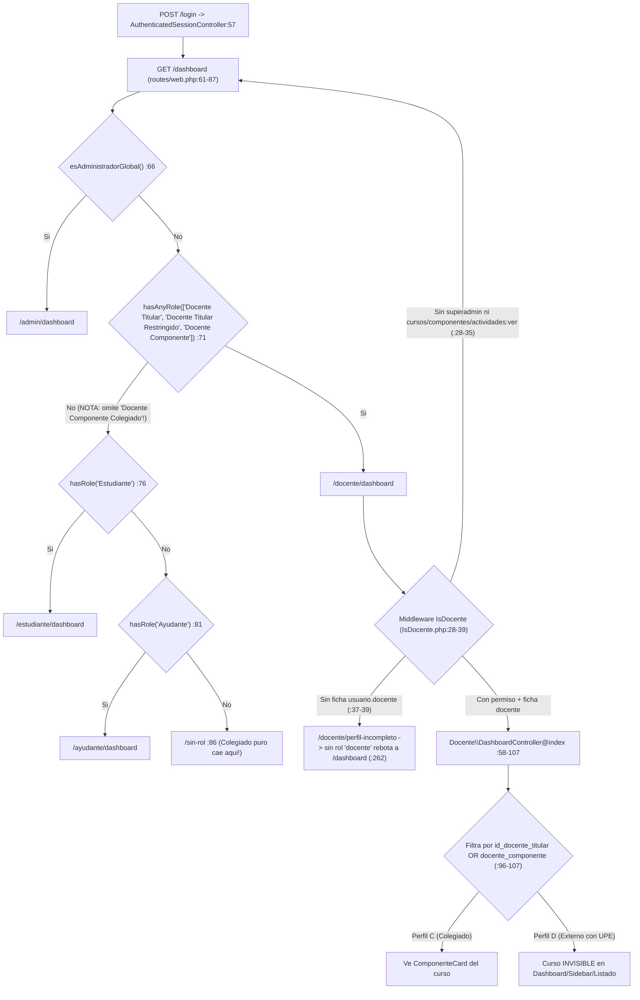

# 00. Mapa de Entrada: Login, Dashboard, Layouts, Sidebar y Middlewares (Capas 0, 1 y 2)

> Auditoría realizada sobre el código real en `C:\Users\dyri0n\Code\utamed-delegacion-permisos`.
> Perfiles evaluados: **A. Alumno del curso**, **B. Ayudante del curso**, **C. Colegiado puro** (en `docente_componente`, rol `Docente Componente Colegiado`), **D. Docente externo** (ficha `docente`, sin `docente_componente` en este curso).

---

## 1. Flujo Completo de Entrada (Login → Dashboard → Middleware → Controlador)

---

## 2. Condicionales Exactas por Archivo y Línea

### Capa 0 y 1 — Entrada, Inertia y Navegación

| Archivo | Línea(s) | Condicional literal | Impacto en perfiles A / B / C / D |
| :--- | :--- | :--- | :--- |
| `routes/web.php` | `:66-86` | `esAdministradorGlobal()` → `hasAnyRole(['Docente Titular', 'Docente Titular Restringido', 'Docente Componente'])` → `hasRole('Estudiante')` → `hasRole('Ayudante')` → `sin-rol` | Basado 100% en **nombres de rol**. **Bug crítico**: omite `'Docente Componente Colegiado'`, enviando a **Perfil C puro** a `/sin-rol`. Además, si **Perfil B** también es Estudiante, cae en `/estudiante/dashboard`. |
| `app/Http/Middleware/HandleInertiaRequests.php` | `:193-194` | `PermissionValidator::resolveEffectiveSlugsFor($user)` (`$resource = null`) | `auth.permissions` contiene **solo permisos del contexto Global**. Permisos delegados en curso o componente **NO** aparecen en `auth.permissions`. |
| `app/Http/Middleware/HandleInertiaRequests.php` | `:249-259` | `docente_courses` si `$docente`; `estudiante_courses` si `$estudiante`; `ayudante_courses` si `'ayudante'` en `$roles` | Un Alumno/Ayudante sin ficha `docente` nunca recibe `docente_courses`. |
| `app/Services/UserCoursesService.php` | `:70` | `Curso::where('id_docente_titular', $docente->id_docente)->where('es_plantilla', false)` | **Solo lista cursos donde es Titular de Curso**. Ni **Perfil C (Colegiado)** ni **Perfil D (Externo)** ven sus cursos en el sidebar docente. |
| `app/Services/UserCoursesService.php` | `:171-177` | `UsuarioRolAsignacion` con `LOWER(nombre) = 'ayudante'` | `ayudante_courses` depende del nombre de rol `'ayudante'`, no de permisos delegados. |
| `resources/js/components/custom/layout/RoleSidebar.svelte` | `:48-50` | `isDocente = userDocente !== null && can('cursos:ver')`; `isEstudiante = userEstudiante !== null`; `isAyudante = ayudanteCourses.length > 0` | **Bug crítico**: `can('cursos:ver')` consulta `auth.permissions` (**contexto Global**). Un docente con `cursos:ver` solo a nivel de curso pierde la sección Docente del sidebar. **Perfiles A y B** siempre tienen `userDocente === null`. |
| `resources/js/components/custom/layout/AppSidebarHeader.svelte` | `:81-84` | `isDocente: auth?.docente != null` | Inconsistente con `RoleSidebar.svelte:48`. |
| `app/Http/Controllers/Docente/DashboardController.php` | `:58-60, :96-107` | `if (!$user->docente) return $this->perfilIncompleto();` luego `where('id_docente_titular', $idDocente)` y `whereHas('componentes.docenteComponentes', ...)` | **Perfil D (Externo)** nunca ve cursos delegados en el Dashboard. |
| `app/Http/Controllers/Docente/DocenteCursoController.php` | `:51, :59-64` | `if (!$user->docente) return redirect('dashboard');` luego filtra por `id_docente_titular` OR `docenteComponentes` | **Perfil D** tampoco ve cursos delegados en `/docente/cursos`. |

### Capa 2 — Los 6 Middlewares `Is*.php`

| Middleware | Registrado en `bootstrap/app.php` | Condicional exacta | Comportamiento al fallar |
| :--- | :---: | :--- | :--- |
| `IsAdmin` (`IsAdmin.php:40`) | Sí (`is_admin`) | `!$user->esAdministradorGlobal()` | `302 -> dashboard`. Bloquea a A, B, C y D de todo `/admin/*`. |
| `IsDocente` (`IsDocente.php:28-39`) | Sí (`is_docente`) | `:28-31`: `isSuperAdmin \|\| getContextsFromPermission(CURSOS_VER \| COMPONENTES_VER \| ACTIVIDADES_VER)` `:37`: `if (!$user->docente)` | Sin permiso: `302 -> /dashboard`. Sin ficha `docente` (**A y B**): `302 -> /docente/perfil-incompleto` → `DashboardController@perfilIncompleto:262` rebota a `/dashboard` (loop silencioso). |
| `IsStudent` (`IsStudent.php:34-38`) | Sí (`is_estudiante`) | `$user->hasRole('Estudiante')` | `302 -> /dashboard`. |
| `IsAyudante` (`IsAyudante.php:35-39`) | Sí (`is_ayudante`) | `$user->hasRole('Ayudante')` | `302 -> /dashboard`. |
| `IsDocenteTitular` (`IsDocenteTitular.php:28-34`) | **NO** (sin uso) | `$user->docente` + `CURSOS_PROGRAMAS_AGREGAR \| CURSOS_UNIDADES_CREAR` | Huérfano, no montado en ninguna ruta. |
| `IsDocenteComponente` (`IsDocenteComponente.php:28-34`) | **NO** (sin uso) | `$user->docente` + `COMPONENTES_EDITAR \| ACTIVIDADES_EVALUAR` | Huérfano, no montado en ninguna ruta. |

---

## 3. Conclusión de Capa 0–2 por Perfil

- **A. Alumno** y **B. Ayudante** (sin fila en `usuario.docente`): **100% bloqueados** de todo el portal `/docente/*` por `IsDocente.php:37` (`if (!$user->docente)`), aunque reciban cualquier permiso delegado. En sus propios portales (`/estudiante/*` y `/ayudante/*`), las rutas no ofrecen vistas de evaluación, asistencia, unidades, grupos ni delegación.
- **C. Colegiado puro**: rebota a `/sin-rol` en `GET /dashboard` (`routes/web.php:71` omite `'Docente Componente Colegiado'`), y el sidebar omite sus cursos (`UserCoursesService:70` solo lista titular) y puede ocultar el ambiente Docente (`RoleSidebar:48` exige `cursos:ver` global). Si navega a `/docente/dashboard` o `/docente/cursos`, sí ve su curso.
- **D. Docente externo**: pasa `IsDocente` si tiene `cursos/componentes/actividades:ver` en algún curso, pero el curso delegado es **completamente invisible** en Dashboard, `/docente/cursos`, Sidebar, `/docente/asistencia`, `/docente/calendario` y `/docente/calificaciones`. Solo puede acceder por **URL directa**.
