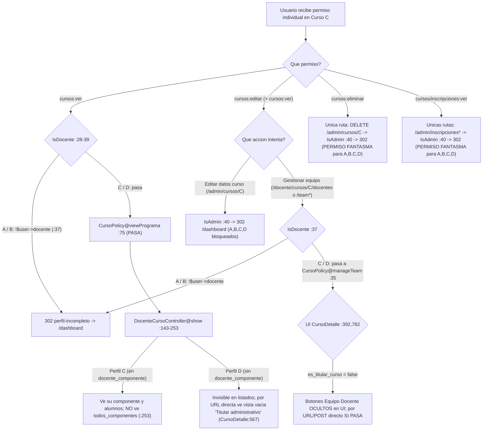

# 01. Alcance Individual: Curso (`cursos:*`) e Inscripciones (`cursos/inscripciones:ver`)

> Permisos auditados: `cursos:ver`, `cursos:editar`, `cursos:eliminar`, `cursos/inscripciones:ver`.
> Grafo (`CoursePermissionGraph.php:64-65`): `cursos:editar -> [cursos:ver]`, `cursos:eliminar -> [cursos:editar, cursos:ver]`.

---

## 1. Diagrama de Flujo Consolidado

---

## 2. Condicionales Exactas por Permiso

### 2.1 `cursos:ver`
- **Capa 2**: `IsDocente.php:29` lo acepta (`getContextsFromPermission(CURSOS_VER)`), pero `:37` exige `$user->docente`.
- **Capa 3**: `DocenteCursoController::show()` (`:143` `authorize('viewPrograma', $curso)`, `:147` `$user->docente->id_docente` — riesgo **500** si se relaja `IsDocente:37`). Filtra `misComponentes` por `docente_componente` (`:167-168`) y `todosComponentes` por `$esTitularCurso` (`:253`).
- **Capa 4**: `BaseCursoPolicy::viewAny()` (`:24-31`) valida `CURSOS_VER` en **contexto Global**; `CursoPolicy::viewPrograma()` (`:75`) lo valida en `$curso`.
- **Capa 6**: `CursoDetalle.svelte:567` muestra `"Titular administrativo"` cuando `mis_componentes.length === 0` (confuso para Perfil D). En `/estudiante/cursos/{C}` (`Student\CourseController:123-137`) y `/ayudante/cursos/{C}` (`Ayudante\CourseController:97-106`) **NO se usa `cursos:ver`** sino inscripción o rol `'ayudante'`.

### 2.2 `cursos:editar` (con prerrequisito `cursos:ver`)
- **Acción 1 (Editar atributos del curso)**: solo existe en `Admin\CursoController@{update,assignDocente,unassignDocente,*SincronizarIntranet}` detrás de `IsAdmin:40` → **inalcanzable para A, B, C, D**.
- **Acción 2 (Gestionar equipo — `CursoPolicy::manageTeam:35`)**:
  - Rutas `/docente/cursos/{C}/docentes` (`DocenteCursoController:439`), `/docente/cursos/{C}/team*` (`CourseTeamController:52,122,231`), `/team/{u}/permissions|sync-permissions` (`DocenteCursoController:707,785`).
  - **En UI (`CursoDetalle.svelte:392,440,782,893`)**: todos los botones (`Equipo docente`, `Gestionar equipo`, `Permisos del syllabus`) están condicionados a `{#if curso.es_titular_curso}`, **no** a `cursos:editar` → **inalcanzable desde UI para C y D**, pero **ejecutable por URL/POST directo**.
  - **BRECHA DE SEGURIDAD LATENTE (`CourseTeamController@store:134-147`)**: usa `$isDocente = $currentUser && $currentUser->docente;` y en el `else` asume **Admin** (permite asignar cualquier rol excepto SuperAdmin). Si se abriera `IsDocente` a un Alumno/Ayudante con `cursos:editar`, **podría auto-asignarse o asignar roles administrativos en el curso**.
  - **Crash 500 latente**: `DocenteCursoController::docentes:443` hace `$user->docente->id_docente` sin null-check.

### 2.3 `cursos:eliminar` (con prerrequisitos `cursos:editar`, `cursos:ver`)
- Única ruta: `DELETE /admin/cursos/{C}` (`routes/web.php:217`, `Admin\CursoController@destroy:1078`) tras `IsAdmin:40`.
- **100% inoperante** para A, B, C y D (permiso fantasma en `DELEGABLE_MATRIX:33`, aunque `Docente Titular` lo tiene con `puede_delegar = false`).

### 2.4 `cursos/inscripciones:ver`
- Únicas rutas: `Admin\InscripcionCursoController@{index,show,getEstudiantesDisponibles,getByCurso,exportCsv}` (`routes/web.php:322-336`) tras `IsAdmin:40`.
- `DocenteCursoController::show:178` carga `mis_estudiantes` solo por `$misComponentes` sin consultar `cursos/inscripciones:ver`.
- **Bug adicional**: `Admin\InscripcionCursoController.php:195-200` y `:242-249` intentan renderizar `docente/Inscripciones` y `docente/CreateInscripcion`, **componentes Svelte que no existen**.
- **100% inoperante** para A, B, C y D (permiso fantasma en `DELEGABLE_MATRIX:36`).

---

## 3. Resumen de Alcance por Perfil

| Permiso | A. Alumno | B. Ayudante | C. Colegiado puro | D. Docente externo |
| :--- | :--- | :--- | :--- | :--- |
| `cursos:ver` | Bloqueado `302` (`IsDocente:37`) | Bloqueado `302` (`IsDocente:37`) | Pasa `/docente/cursos/{C}` (sin `todos_componentes`, invisible en sidebar) | Invisible en UI; por URL directa entra con vista vacía `"Titular administrativo"` |
| `cursos:editar` | Bloqueado `302` (`IsAdmin`/`IsDocente:37`) | Bloqueado `302` (`IsAdmin`/`IsDocente:37`) | Edición curso: `302 IsAdmin`. Equipo: botones ocultos (`es_titular_curso`), URL/POST directo **SÍ pasa** | Edición curso: `302 IsAdmin`. Equipo: invisible en UI, URL/POST directo **SÍ pasa** |
| `cursos:eliminar` | Inalcanzable (`302 IsAdmin`) | Inalcanzable (`302 IsAdmin`) | Inalcanzable (`302 IsAdmin`) | Inalcanzable (`302 IsAdmin`) |
| `cursos/inscripciones:ver` | Inalcanzable (`302 IsAdmin`) | Inalcanzable (`302 IsAdmin`) | Inalcanzable (`302 IsAdmin`) | Inalcanzable (`302 IsAdmin`) |
