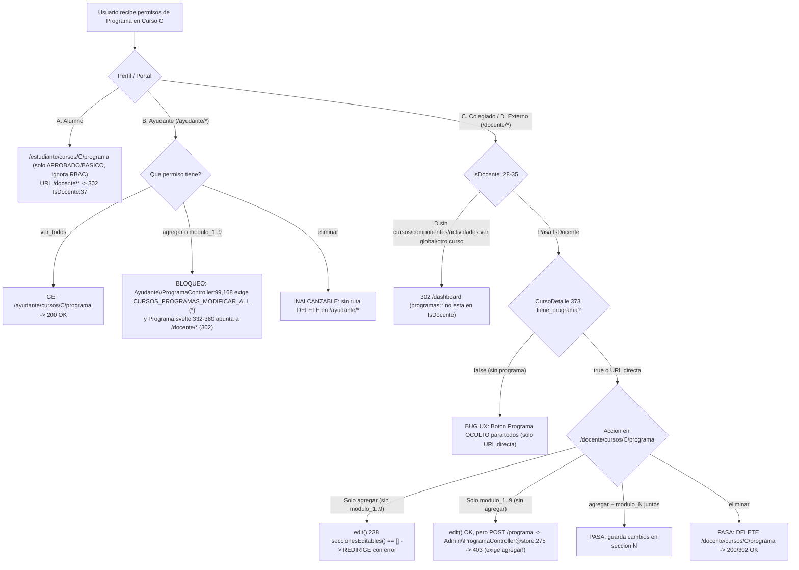

# 02. Alcance Individual: Unidades (`cursos/unidades:*`) y Programas / Syllabus (`cursos/programas:*`)

> Permisos auditados: `cursos/unidades:{ver,crear,crear_plantilla,editar,eliminar}` y `cursos/programas:{ver_todos,agregar,eliminar,modificar:modulo_1..9}`.
> ContextTypes válidos (`config/permission-context-metadata.php:82-102`): `['global', 'curso', 'carrera', 'departamento', 'facultad']` (**NO aceptan `componente` ni `actividad`**).

---

## 1. Diagrama de Flujo: Programas / Syllabus

---

## 2. Unidades (`cursos/unidades:{ver,crear,crear_plantilla,editar,eliminar}`)

- **Hallazgo lapidario**: **0 rutas registradas** en `routes/web.php` para ningún perfil (ni `/admin`, ni `/docente`, ni `/ayudante`, ni `/estudiante`).
- `app/Http/Controllers/Docente/DocenteUnidadController.php` (`index`, `store`, `update`, `destroy`) es **código huérfano sin ruta**. Además:
  - `index()` (`:30`) autoriza `viewPrograma` (no `cursos/unidades:ver`).
  - `cursos/unidades:crear_plantilla` **no se valida en ninguna policy ni controlador**.
- En producción, las unidades solo se crean/actualizan como efecto secundario al guardar la Sección VI del Syllabus (`Admin\ProgramaController::createUnidadesFromSyllabus:995-1047`), sin invocar `UnidadPolicy`.
- **Veredicto**: **100% INALCANZABLES (404)** para los 4 perfiles (**A, B, C, D**) — los 5 permisos en `DELEGABLE_MATRIX:38-44` son hoy permisos sin flujo operativo.

---

## 3. Programas / Syllabus (`cursos/programas:*` + `modificar:modulo_1..9`)

### Bugs críticos detectados que rompen la delegación individual

1. **Bug de guardado en `/docente` (`Admin\ProgramaController::store:275`)**:
   - `POST /docente/cursos/{curso}/programa` (`routes/web.php:565`) apunta a `Admin\ProgramaController::store`, que ejecuta `$this->authorize('create', [Programa::class, $curso])` (`ProgramaPolicy::create:103` → exige `cursos/programas:agregar`).
   - Como `CoursePermissionGraph:43-51` solo exige `ver_todos` (y NO `agregar`) para `modificar:modulo_1..9`, un delegado con `modulo_6` puede abrir el wizard (`edit:227`), editar, y al guardar recibe **HTTP 403**.
   - **Paradoja**: `PUT .../completar-basico` (`:332`) y `PUT .../enviar` (`:361`) usan `authorize('update')`, que **sí** acepta `modulo_1..9` sin `agregar`.
2. **Bug inverso al otorgar solo `cursos/programas:agregar` (`Administrativo\ProgramaController::edit:238`)**:
   - Sin `modulo_1..9` ni `modificar:*` ni ser titular, `SyllabusWizardPresenter::seccionesEditables()` (`:126-136`) retorna `[]` y expulsa al usuario al visor con error *"Ninguna sección del syllabus está delegada a ti"*.
   - **Conclusión**: Ni `agregar` solo ni `modulo_N` solo funcionan en `/docente`; se requieren **ambos simultáneamente**.
3. **Bug de Ayudante (`Ayudante\ProgramaController:99,168`)**:
   - `edit()` y `update()` exigen el wildcard `Permissions::CURSOS_PROGRAMAS_MODIFICAR_ALL` (`cursos/programas/modificar:*`), ignorando `agregar` y `modulo_1..9` individuales.
   - Además, `Programa.svelte:332-360` hardcodea `completarBasico`, `enviarParaRevision` y `eliminarPrograma` a `/docente/cursos/{id}/programa/...` (bloqueado por `IsDocente` para el ayudante).
4. **Bugs UX de slugs fantasma y botón oculto**:
   - `CursoDetalle.svelte:373`: `{#if curso.tiene_programa}` oculta el botón Programa si el curso aún no tiene syllabus (impide entrar a crearlo desde `CursoDetalle`).
   - `CourseListNav.svelte:203` y `ayudante/Courses/Show.svelte:35` buscan `'cursos/programas:crear'` (**slug inexistente**, el real es `'cursos/programas:agregar'`), y `CourseListNav` enlaza a `/docente/cursos/{id}/programa/create` (**ruta 404**).
   - `ayudante/Courses/Index.svelte:39` busca `can('CURSOS_PROGRAMA')` (**slug inexistente** en contexto global).

---

## 4. Resumen de Alcance por Perfil

| Permiso | A. Alumno | B. Ayudante | C. Colegiado puro | D. Docente externo |
| :--- | :--- | :--- | :--- | :--- |
| `cursos/unidades:*` (5 permisos) | Inalcanzable (sin rutas) | Inalcanzable (sin rutas) | Inalcanzable (sin rutas) | Inalcanzable (sin rutas) |
| `cursos/programas:ver_todos` | 0% efecto (solo ve publicado en `/estudiante`) | **PASA** en `/ayudante/cursos/{C}/programa` | **PASA** (oculto en `CursoDetalle` si `!tiene_programa`) | Invisible en Dashboard/listados; por URL directa **PASA** si supera `IsDocente` |
| `cursos/programas:agregar` (solo) | Bloqueado (`IsDocente:37`) | Bloqueado (`Ayudante\ProgramaController:99` exige `modificar:*`) | **BLOQUEADO** en `edit:238` (`seccionesEditables() == []`) | Igual que C + invisible en listados |
| `cursos/programas/modificar:modulo_1..9` (solo) | Bloqueado (`IsDocente:37`) | Bloqueado (`Ayudante\ProgramaController:99,168` exige `modificar:*`) | Abre wizard, pero **403 al guardar** (`Admin\ProgramaController:275` exige `agregar`). Sí puede `enviar` | Igual que C + invisible en listados |
| `agregar` + `modulo_N` juntos | Bloqueado (`IsDocente:37`) | Bloqueado (`Ayudante\ProgramaController:99,168`) | **PASA** completo en sección `N` | Invisible en listados; por URL directa **PASA** |
| `cursos/programas:eliminar` | Bloqueado (`IsDocente:37`) | Inalcanzable (sin ruta `DELETE` en `/ayudante`) | **PASA** (`DELETE /docente/cursos/{C}/programa`) | Invisible en listados; por URL directa **PASA** |
