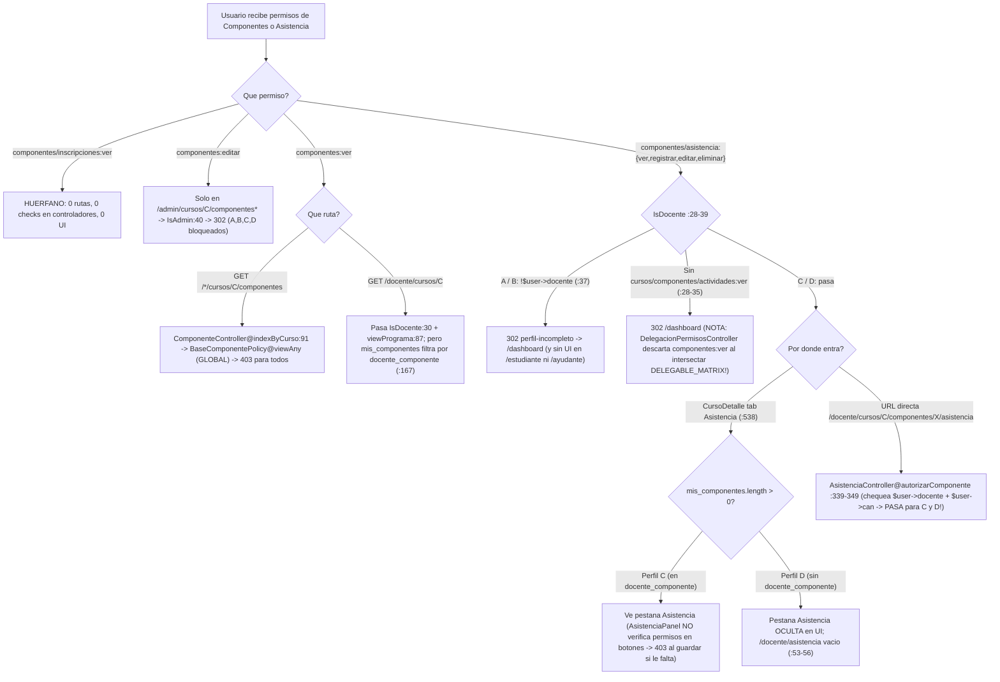

# 03. Alcance Individual: Componentes (`componentes:*`) y Asistencia (`componentes/asistencia:*`)

> Permisos auditados: `componentes:ver`, `componentes:editar`, `componentes/inscripciones:ver`, `componentes/asistencia:{ver,registrar,editar,eliminar}`.
> ContextTypes válidos (`config/permission-context-metadata.php:104-117`): todos aceptan `['global', 'componente', 'curso', 'carrera', 'departamento', 'facultad']`.

---

## 1. Diagrama de Flujo: Asistencia y Componentes

---

## 2. Condicionales y Hallazgos Críticos

### 2.1 `componentes:ver`, `componentes:editar`, `componentes/inscripciones:ver`
- **`componentes/inscripciones:ver`**: **100% huérfano** — sin ruta, sin chequeo en controladores, sin invocación de `InscripcionComponentePolicy`, sin uso en Svelte.
- **`componentes:editar`**: todas sus rutas de escritura viven bajo `IsAdmin:40` (`routes/web.php:344-355`). En `/docente`, `Admin\ComponenteController::setTitularByDt()` (`:537-554`) **ignora `componentes:editar`** y exige `$curso->id_docente_titular === $user->docente->id_docente`.
- **`componentes:ver`**:
  - En `GET /{admin,docente,ayudante}/cursos/{curso}/componentes` (`Admin\ComponenteController::indexByCurso:91`), llama `authorize('viewAny', Componente::class)` → `BaseComponentePolicy::viewAny:26` valida **solo en contexto Global** → **403 incluso para DT, DC, Colegiado y Ayudante**.
  - En `DocenteCursoController::show:167-168`, `$misComponentes` se filtra por `docente_componente`, no por `componentes:ver`.

### 2.2 `componentes/asistencia:{ver, registrar, editar, eliminar}`
- **Rutas**: solo existen bajo `/docente/*` (`routes/web.php:478-488`, middleware `is_docente`). No existen rutas de asistencia en `/ayudante/*`, `/estudiante/*` ni `/admin/*`.
- **Inconsistencia en delegación (`DelegacionPermisosController.php:235`)**:
  - `CoursePermissionGraph:58-61` marca `componentes:ver` como prerrequisito de `componentes/asistencia:*`, pero al haberse retirado `Componentes` de `DELEGABLE_MATRIX`, `array_intersect($slugsAfectados, $actorDelegables)` descarta `componentes:ver`.
  - `componentes/asistencia:eliminar` tiene `puede_delegar = false` en `Docente Componente` (`roles_config.php:117`) y no existe en `Docente Titular` → **ningún docente puede delegarlo**.
- **Controlador (`Docente\AsistenciaController.php`)**:
  - `centro()` (`GET /docente/asistencia`, `:42-106`): ruta **huérfana de navegación** (ningún enlace en Sidebar ni Dashboard). Filtra cursos por `id_docente_titular` / `docente_componente` (`:53-56`) → oculta el curso a **Perfil D**.
  - `autorizarComponente()` (`:332-350`): exige `$user->docente` (`:339`, `403` para A y B) y `$user->can($permisoRequerido, $componente)` (`:347`). **No exige `docente_componente`** → **Perfil D** pasa todos los verbos por URL directa.
  - `AsistenciaPolicy` y `ClasePolicy` son **código muerto** en runtime (porque `$user->can(Permissions::...)` llama directo a `PermissionValidator`).
- **Frontend (`CursoDetalle.svelte` y `AsistenciaPanel.svelte`)**:
  - `CursoDetalle.svelte:538`: muestra la pestaña `Asistencia` solo por `mis_componentes.length > 0` (**sin verificar `componentes/asistencia:ver`**).
  - `AsistenciaPanel.svelte`: **0 checks de permisos** — siempre dibuja *"Nueva sesión"*, edición y `<Trash2>` (eliminar), devolviendo `403` recién al confirmar en backend.

---

## 3. Resumen de Alcance por Perfil

| Permiso | A. Alumno | B. Ayudante | C. Colegiado puro | D. Docente externo |
| :--- | :--- | :--- | :--- | :--- |
| `componentes:ver` | `302 IsDocente:37` | `403` en `/ayudante/.../componentes` (`viewAny` global); `302` en `/docente` | `403` en `/docente/.../componentes`; pasa `viewPrograma` | Igual que C + invisible en listados |
| `componentes:editar` | `302 IsAdmin` | `302 IsAdmin` | `302 IsAdmin` (sin ruta en `/docente`) | `302 IsAdmin` |
| `componentes/inscripciones:ver` | Huérfano (sin flujo) | Huérfano (sin flujo) | Huérfano (sin flujo) | Huérfano (sin flujo) |
| `componentes/asistencia:ver` | `302 IsDocente:37` (sin UI en `/estudiante`) | `302 IsDocente:37` (sin UI en `/ayudante`) | **PASA** en pestaña Asistencia y API | Oculto en UI y `/docente/asistencia`; **PASA** por API directa |
| `componentes/asistencia:{registrar,editar,eliminar}` | `302 IsDocente:37` | `302 IsDocente:37` | **PASA** en UI y API (`eliminar` solo asignable por Admin) | Oculto en UI; **PASA** por API directa |
