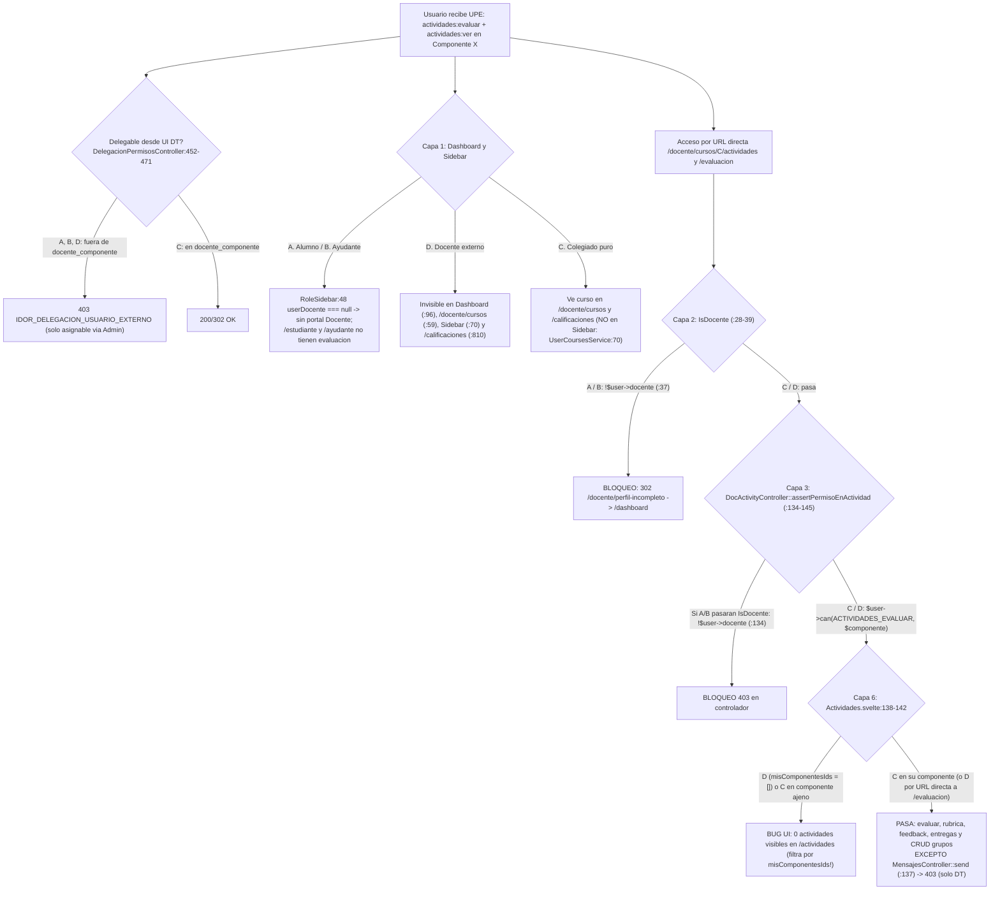
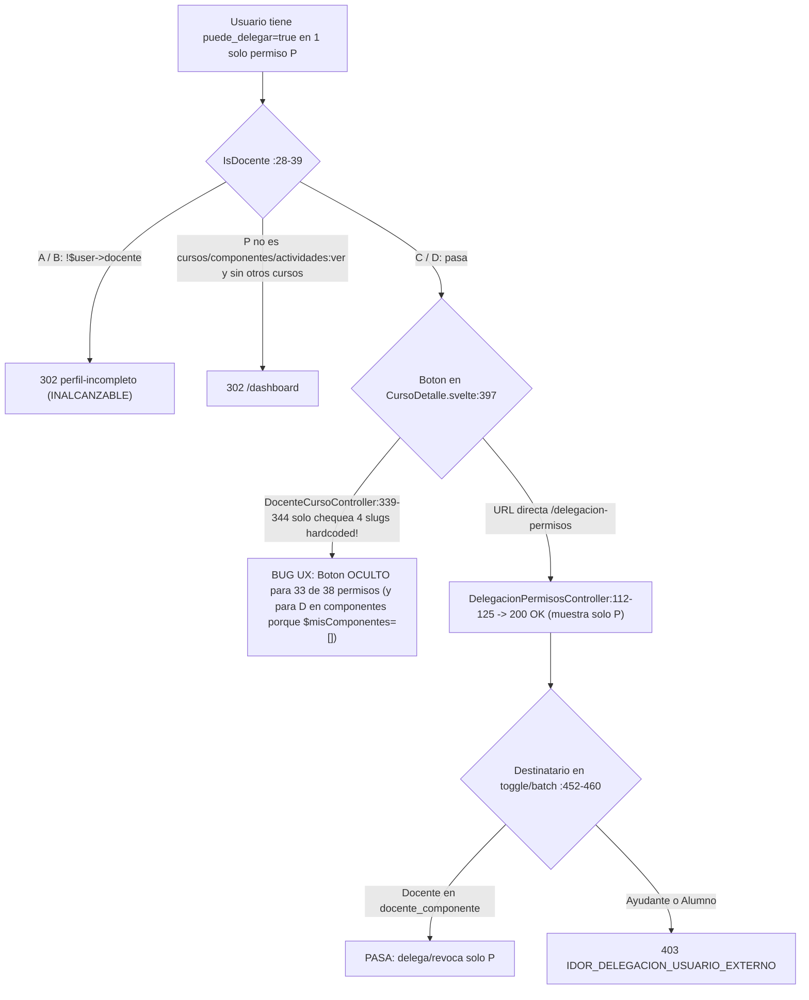

# 04. Alcance Individual: Actividades (`actividades:*`), Grupos (`actividades/grupos:*`) y Delegación (`puede_delegar`)

> Permisos auditados: los 10 permisos `actividades:*`, los 4 `actividades/grupos:*`, y el escenario de `puede_delegar = true` en 1 solo permiso.

---

## 1. Diagrama Piloto Verificado: Delegar `actividades:evaluar` (+ `actividades:ver`) por Perfil

---

## 2. Anomalías Críticas en `actividades:*` (10 permisos)

### 2.1 Restricción de `ContextType` (`config/permission-context-metadata.php:122-132`)
- `actividades:{ver,editar,subir_entregas,evaluar,dar_feedback,enviar_recordatorios,descargar_entregas}` → válidos en `['global', 'actividad', 'componente', 'curso', 'carrera', 'departamento', 'facultad']`.
- **`actividades:{crear,crear_plantilla,eliminar}`** (`_parent_actions`) → válidos **SOLO en `['global', 'componente']`**.
  - **Consecuencia**: otorgar `actividades:crear` o `actividades:eliminar` en contexto `curso` **NO sirve** (`PermissionValidator::filterAncestorsForPermission:931-937` descarta el ancestro `curso` → `403` en `store:394` y `destroy:578`).

### 2.2 Permisos muertos, rotos o bloqueados por `showEvaluacion:900`

| Permiso | Estado real en código | Hallazgo exacto (archivo:línea) |
| :--- | :--- | :--- |
| `actividades:ver` | Parcial | Permite abrir `/actividades`, pero **`showEvaluacion:900` exige `ACTIVIDADES_EVALUAR`** → hacer clic en cualquier actividad da **403**. En `Actividades.svelte:138-142` no muestra actividades de componentes fuera de `misComponentesIds`. |
| `actividades:crear` | Parcial (solo contexto `componente`) | Falla en contexto `curso` (`ContextType`). En `Actividades.svelte:145-147` el selector de componente filtra por `c.es_mio` (bloquea a D y a C en comp. ajeno). `CopiaActividadesController:34,49,77` ignora este permiso y exige `manageTeam`. |
| `actividades:crear_plantilla` | **MUERTO (0 usos)** | Sin checks en backend ni frontend. |
| `actividades:editar` | Funcional (C en su comp.) | Valida en `update:441`, `toggleVisibilidad:540`, `subirEnunciado:669`. Oculto en `Actividades.svelte:138-142` para D y comp. ajenos. |
| `actividades:eliminar` | Parcial (solo contexto `componente`) | Falla en contexto `curso` (`ContextType`). |
| `actividades:evaluar` | **Super-permiso efectivo** | En `DocenteActivityController` habilita evaluación, rúbrica, feedback, entregas y todo el CRUD de grupos. Bloqueado para A/B por `!$user->docente` (`IsDocente:37`, `L134`) y oculto en listados para D. |
| `actividades:dar_feedback` | Acoplado a `evaluar` | `enviarFeedback:2275` lo acepta, pero sin `evaluar` no abre `showEvaluacion:900` (el grafo `CoursePermissionGraph:23` sí incluye `evaluar`). |
| `actividades:descargar_entregas` | **UI inalcanzable sin `evaluar`** | Aceptado en `entregasPorActividad:1851`, `entregasPorGrupo:1872`, `descargarEntrega:1943`, pero **`showEvaluacion:900` da 403 sin `evaluar`** (y el grafo solo incluye `ver`). Sin check en Svelte. |
| `actividades:subir_entregas` | **MUERTO (0 usos)** | `Student\AgendaController::storeEntrega:90-104` solo chequea `$user->estudiante` + `IntegranteGrupo`. |
| `actividades:enviar_recordatorios` | **ROTO en backend** | `Activities/Index.svelte:192` muestra el botón, pero `MensajesController::send:137` exige `$curso->id_docente_titular === $docente->id_docente` → **403** para todos excepto DT. |

---

## 3. Anomalías Críticas en `actividades/grupos:*` (4 permisos)

1. **UI 100% inalcanzable sin `actividades:evaluar`**: `DocenteActivityController::showEvaluacion:900` exige `ACTIVIDADES_EVALUAR` para renderizar `Activities/Index.svelte`. Otorgar cualquiera de los 4 permisos `actividades/grupos:{ver,crear,editar,eliminar}` (+ `actividades:ver`) devuelve **403** al intentar abrir la pantalla de grupos.
2. **Desalineamiento de ContextType `actividad`**: `config/permission-context-metadata.php:133-137` permite `actividad`, pero `assertPermisoEnActividad:139` evalúa sobre `$actividad->componente ?? $curso` (nunca sobre `$actividad`), haciendo inútil cualquier grant en `ContextType::ACTIVIDAD`.
3. **Bugs y fugas específicas en endpoints de grupos**:
   - `gruposPorActividad` (`GET /grupos-list`, `:1666`): solo valida `viewPrograma` — **fuga cross-componente** (no verifica `ACTIVIDADES_GRUPOS_VER`, que no se chequea en ningún controlador del repo).
   - `gruposDeActividadOrigen` (`:1701`) y `copiarGruposDeActividad` (`:1754`): exigen `ACTIVIDADES_EVALUAR` y **rechazan `ACTIVIDADES_GRUPOS_CREAR` con 403**, pese a que `Activities/Index.svelte:185-189` muestra "Reutilizar grupos" con `actividades/grupos:crear`.
   - `updateIntegrante` (`:1421`): modifica `diferencia_decimas` y `nota_individual` aceptando `ACTIVIDADES_GRUPOS_EDITAR` (**fuga semántica hacia calificaciones**).
   - `GrupoCard.svelte:163,190,241,391`: nunca lee `actividades/grupos:{editar,eliminar}`; depende solo del prop `esTitular={puedeEvaluar}` (y `Activities/Index.svelte:181` enciende `puedeEvaluar=true` por `esDocenteComponente`, falso positivo UI).

---

## 4. Delegación (`puede_delegar = true` en 1 solo permiso `P`)

- **Bugs críticos adicionales en controladores legacy de delegación**:
  - `CourseTeamController::getDelegablePermissions()` (`:736-748`): no filtra `rolesAsignados()` por `$idContexto` (**fuga cross-curso**).
  - `CourseTeamController::getMemberPermissions()` (`:349`) y `DocenteCursoController::getMemberPermissions()` (`:750`): filtran por `'actividad:'` / `'curso:'` en **singular** (no existen en `Permissions.php`).
  - `CursoPermisosController::componenteIndex/Sync` (`:208-223`): **bypass completo de RelBAC** (chequea solo `docente_componente.es_titular = true`, sin `puede_delegar`, sin IDOR de `id_usuario`, sin validar `$componente->id_curso === $curso->id_curso`).
